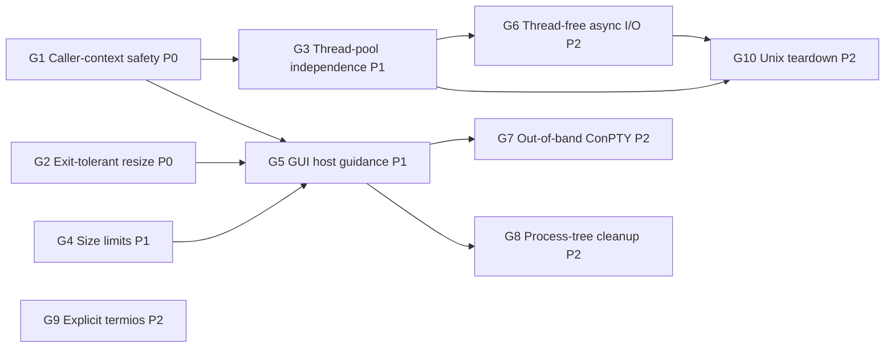

# GUI Host Readiness Plan (Desktop Terminal Embedding)

Goal: make MiniPty a dependable PTY backend for a terminal control embedded in a desktop GUI application. WinUI is the first target. WPF, WinForms, and Avalonia hosts share the same constraints. The terminal must not freeze the UI, must not starve the thread pool as tabs are added, and must not throw on ordinary GUI lifecycle events. VT fidelity must also be good enough for a terminal emulator.

**Status:** proposed (2026-10-15). Not started.

## Background

An embedder who was building a WinUI terminal control could not integrate MiniPty. The investigation reproduced the failure modes listed below.

All measurements were taken on Windows 11 build 26200 with 32 logical CPUs, the in-box ConPTY, and a Release build. Two terms are used throughout:

- **UI thread**: a single-threaded `SynchronizationContext` message loop that stands in for a `DispatcherQueue`.
- **Frozen**: a callback posted to that context did not run within the timeout (1.5–3 s).

## Findings

| ID | Scenario | Observed |
|---|---|---|
| F1 | `await foreach (var chunk in session.ReadOutputAsync())` started on the UI thread | No chunk is ever delivered and the UI is frozen (deadlock) |
| F2 | `await session.Output.ReadAsync(buffer)` loop on the UI thread | Startup output (204 B) arrives, then the UI is frozen while the shell is idle |
| F3 | Output pumped on the thread pool, `await session.WaitForExitAsync()` on the UI thread | UI frozen until the shell exits |
| F4 | `await session.CompleteAsync()` on the UI thread for a ~3 s command | UI frozen until the child exits |
| F5 | `PtyTerminal.Start` from the UI thread (its pump uses `Task.Run`) | UI stays responsive; first output after 39 ms |
| F6 | `PtyTerminal.Resize` after the child exited (a size change before tab teardown) | Throws `InvalidOperationException`: "Cannot resize after the pseudo-console has been closed." |
| F7 | `Resize(new PtySize(600, 200))` | Silently clamped to 512×200, so the frontend grid and the PTY disagree |
| F8 | N idle `PtyTerminal` instances, then a burst of 64 × 20 ms `Task.Run` items | N=0: 60 ms, N=4: 91 ms, N=8: 121 ms, **N=16: 1996 ms**. Minimum worker threads is 32, and 16 sessions × 2 parked threads = 32 |
| F9 | A 304 KB paste through `WriteInputAsync` (bytes and string overloads) from the UI thread, with output undrained | UI stays responsive because ConPTY buffers the input. No action needed |
| F10 | VT sequences written by a child through the in-box ConPTY | See the table below |

VT sequences written by the child through the in-box ConPTY (F10):

| Forwarded to the terminal side | Not forwarded verbatim |
|---|---|
| OSC 0 title, OSC 8 hyperlink (re-encoded with `id=`), OSC 52 clipboard, OSC 133 shell integration, OSC 9;4 progress | OSC 11 color query |
| DEC modes 1049 (alternate screen), 2004 (bracketed paste), 2026 (synchronized output) | DECRQSS, XTGETTCAP |
| `CSI > 1 u` keyboard-protocol push, truecolor SGR, underline-style SGR `4:3` | Kitty graphics APC, Sixel DCS |
| | Mouse tracking 1000/1003/1006, DECCKM. These are consumed by conhost itself |

Some forwarded sequences also arrived **earlier than the text the child wrote before them**. conhost re-renders the screen and flushes these sequences on its own schedule, so a mark such as OSC 133 can end up before the prompt text it belongs to.

## Root Causes

1. **`await Task.Yield()` is used as a "move to background" primitive.** When a `SynchronizationContext` is current, `Task.Yield` posts to it, so the continuation runs on the UI thread. That continuation does blocking work: transport reads, `Monitor.Wait` handoff waits, or exit polling. The call sites are [PtySession.cs:407](../../../src/MiniPty/PtySession.cs), `:413`, `:637`, and `:740`; [PtyStreams.cs:97](../../../src/MiniPty/Internal/PtyStreams.cs) and `:373`; and [UnixPtyBackend.cs:317](../../../src/MiniPty/Internal/UnixPtyBackend.cs). This causes F1–F4.
2. **Async APIs contain synchronous blocking fast paths.**
   - After the first call, `Output.ReadAsync` reads synchronously on the caller's thread ([PtyStreams.cs:80](../../../src/MiniPty/Internal/PtyStreams.cs), `:356`).
   - On both backends, `WaitForExitAsync` is a synchronous polling loop that returns an already-completed task ([WindowsPtyBackend.cs:413](../../../src/MiniPty/Internal/WindowsPtyBackend.cs)). This causes F2–F4.
3. **Every live session parks two thread-pool workers for its whole lifetime.**
   - The first is the strict-handoff producer, which blocks in the transport read and in `Monitor.Wait`.
   - The second is the exit observer: `WaitForSingleObject` with a 100 ms timeout on Windows, and 10 ms `waitpid` polling on Unix.
   - Each concurrent `WaitForExitAsync` parks one more worker.
   - The minimum pool size equals the processor count, so a few tabs on a laptop exhaust it. Every unrelated continuation in the host then waits for thread injection. This causes F8.
4. **`Resize` treats "transport closed after child exit" as a caller error** ([WindowsPtyBackend.cs:326](../../../src/MiniPty/Internal/WindowsPtyBackend.cs), [UnixPtyBackend.cs:201](../../../src/MiniPty/Internal/UnixPtyBackend.cs)). GUI size events arrive asynchronously with respect to child exit, so a terminal cannot avoid this race. This causes F6.
5. **The 512-cell clamp is below the platform limits** ([PtyStartInfo.cs:66](../../../src/MiniPty/PtyStartInfo.cs), [WindowsPtyBackend.cs:329](../../../src/MiniPty/Internal/WindowsPtyBackend.cs), [UnixPtyBackend.cs:204](../../../src/MiniPty/Internal/UnixPtyBackend.cs)). ConPTY takes a signed 16-bit `COORD`, and Unix `winsize` is unsigned 16-bit. This causes F7.
6. **The in-box ConPTY is the only Windows backend.** Its VT behavior is whatever conhost the user's Windows build ships, and it renders child output instead of relaying it. This causes F10.

## Priority Legend

| Priority | Meaning |
|---|---|
| **P0** | Blocks GUI embedding, or crashes or freezes a correctly written host |
| **P1** | Required for a multi-tab terminal application of production quality |
| **P2** | Scale, fidelity, or robustness improvements; implement after P0/P1 or when a concrete embedder asks |

## Gap Inventory

| ID | Priority | Gap | Resolution |
|---|---|---|---|
| G1 | **P0** | Async APIs block or deadlock when awaited on a UI `SynchronizationContext` (F1–F4) | [Caller-context safety](#g1-caller-context-safety-p0) |
| G2 | **P0** | `Resize` after child exit throws (F6) | [Exit-tolerant resize](#g2-exit-tolerant-resize-p0) |
| G3 | **P1** | Idle sessions park thread-pool workers (F8) | [Thread-pool independence](#g3-thread-pool-independence-p1) |
| G4 | **P1** | Terminal size clamped to 512 (F7) | [Platform size limits](#g4-platform-size-limits-p1) |
| G5 | **P1** | No guidance for GUI hosts; README patterns are unsafe on a UI thread | [GUI host guidance](#g5-gui-host-guidance-p1) |
| G6 | **P2** | Reads cannot be canceled without closing the transport; sessions still need dedicated threads after G3 | [Thread-free async I/O](#g6-thread-free-async-io-p2) |
| G7 | **P2** | Windows is limited to the in-box ConPTY (F10); `PtyTerminal.Clear()` is a no-op | [Opt-in out-of-band ConPTY](#g7-opt-in-out-of-band-conpty-p2) |
| G8 | **P2** | No process-tree cleanup on Windows | [Opt-in job object](#g8-opt-in-process-tree-cleanup-p2) |
| G9 | **P2** | Unix termios relies on kernel defaults; `IUTF8` is missing | [Explicit termios](#g9-explicit-unix-termios-p2) |
| G10 | **P2** | Unix teardown blocks the caller and has fd-lifetime races | [Unix teardown hygiene](#g10-unix-teardown-hygiene-p2) |

---

## G1: Caller-context safety (P0)

### Why P0

GUI frameworks run user code on a thread that owns a `SynchronizationContext`. The natural first integration attempt is to call `ReadOutputAsync`, `Output.ReadAsync`, `WaitForExitAsync`, or `CompleteAsync` from a page or control event handler. Today that freezes or deadlocks the application (F1–F4).

The existing tests run without a `SynchronizationContext`, where `Task.Yield` happens to resume on the thread pool, so none of them can observe the problem.

### Decision

- **Contract:** no public async API performs a blocking OS wait or blocking transport I/O on the calling thread or on the caller's captured context. Awaiting any MiniPty API from a UI thread leaves that thread responsive. The contract covers `ReadOutputAsync`, `Output.ReadAsync`, `WaitForExitAsync`, `WaitForExitStatusAsync`, `CompleteAsync`, `PtyCapture.RunAsync`, and every `MiniPty.Terminal` entry point.
- **Background dispatch:** replace `Task.Yield` with explicit thread-pool dispatch that ignores `SynchronizationContext`. The allocation-free work-item pattern already used for one-shot transport pumps is the template.
- **`Output.ReadAsync`:** attempt a non-blocking read inline first, so the zero-allocation hot path is kept when data is ready. Only when no data is available does the read complete off the caller's thread. The synchronous `Output.Read` keeps its blocking semantics.
- **Continuations:** MiniPty does not marshal callbacks back to the UI thread. The caller's own `await` resumes on its context as usual. `PtyTerminal` output handlers keep running on background threads, and G5 documents how to marshal them.

### Acceptance

- A test helper provides a single-threaded `SynchronizationContext`. Every API in the contract is driven from it against an idle interactive child. The test asserts that a posted probe callback runs within a short bound (F1–F4 turn green) and that output and exit are still observed.
- Coverage on Windows and Unix.
- No allocation regression in the integration and output benchmarks (`Session_32KiB_OutputStreamBytes` and related).

### Estimate

Medium.

---

## G2: Exit-tolerant resize (P0)

### Why P0

A terminal resizes on every layout change, and child exit is asynchronous to layout. A shell that exits while its tab is still visible makes the next size change throw (F6). In WinUI an unhandled exception from a size handler terminates the application.

### Decision

- After the child has exited, or after the transport has been closed for drain, `Resize` is a silent no-op and `Size` keeps its last applied value.
- `ObjectDisposedException` is still thrown after `Dispose`.
- Update the `PtySession.Resize` and `PtyTerminal.Resize` exception documentation to match.

### Acceptance

- Tests on both platforms: resize after exit and after drain completion does not throw, and `Size` is unchanged.
- Resize after dispose still throws `ObjectDisposedException`.

### Estimate

Small.

---

## G3: Thread-pool independence (P1)

### Why P1

Each idle session parks two thread-pool workers. With 16 idle sessions on a 32-thread minimum pool, an unrelated burst of short work took 1996 ms instead of 60 ms (F8). On an 8-core laptop the threshold is four tabs. A starved pool delays every background continuation in the host, including the host's own UI-bound async work.

### Decision

- **Producer:** the strict-handoff producer runs on a dedicated background thread per session, not on a pool worker. One reader thread per terminal connection is an accepted cost for terminal hosts, and it keeps the existing handoff and coalescing design intact.
- **Exit observation:** exit is observed through an OS wait registration instead of polling.
  - Windows: a registered wait on the process handle, which is multiplexed by the runtime's wait threads.
  - Linux: pidfd (5.3+). macOS and FreeBSD: `kqueue` `EVFILT_PROC`. One shared watcher serves all sessions.
  - Polling remains only as the fallback for kernels without these facilities.
- **`WaitForExitAsync`:** completes from that registration, so a waiter holds no thread.
- **One-shot paths:** `CompleteAsync` and Capture may keep pool-based pumps when benchmarks show that is cheaper. They are short-lived by definition.

### Acceptance

- With 16 idle sessions, a burst of short pool work completes within 2× of the zero-session baseline.
- Pool thread count does not grow with the number of idle sessions.
- Exit-to-`Completion` latency is no worse than the current 100 ms / 10 ms polling.
- No allocation regression in the benchmarks.

### Estimate

Medium–large. This also changes the drain heuristics that currently piggyback on the exit poller.

---

## G4: Platform size limits (P1)

### Why P1

High-resolution displays with small fonts exceed 512 columns. A silent clamp makes the frontend grid and the PTY disagree, which corrupts line wrapping (F7).

### Decision

- Clamp to the platform limits instead: Windows 1–32767 (signed 16-bit `COORD`), Unix 1–65535 (`winsize`).
- `Size` reports the value actually applied.
- Update the `PtyStartInfo.Size` documentation.

### Acceptance

A test resizes to 600×200 and confirms that both `Size` and the child-visible size report it.

### Estimate

Small.

---

## G5: GUI host guidance (P1)

### Why P1

The README's primary pattern, `ReadOutputAsync` followed by `WaitForExitAsync`, is exactly F1 and F3 when it is placed in an event handler. Until G1 ships, hosts need a warning. After G1, they still need the threading model spelled out.

### Decision

- Add a "GUI hosts" section to the Terminal specification and a short README note. It covers:
  - `PtyTerminal` as the recommended entry point.
  - Output handlers run on a background thread, so they marshal to the UI dispatcher and copy the bytes when they retain them.
  - Resize from size-change events, which is safe after G2.
  - Observe exit through `Completion`.
  - Dispose on tab close.
- Until G1 ships, the README explicitly warns against awaiting session APIs on a UI thread.

### Acceptance

- Specification and README updated.
- A runnable sample demonstrates the threading model. Its form is an open question (see below).

### Estimate

Small.

---

## G6: Thread-free async I/O (P2)

### Why P2

After G3, an idle session still holds one dedicated reader thread, and a pending read can only be abandoned by closing the transport. A host that hands a session between owners, or that keeps dozens of background tabs, benefits from reads that hold no thread and can be canceled without consuming bytes. G1 and G3 already fix every observed failure, so this item is about scale and cancellation.

### Decision

- **Windows:** create MiniPty's own pipe ends overlapped; the ConPTY ends stay synchronous. Complete reads through the I/O completion port and cancel them with `CancelIoEx`, leaving the pipe open.
- **Unix:** put the master in non-blocking mode and drive it from one shared readiness loop (`epoll` / `kqueue`). Use reference-counted fd lifetime so that a close cannot race an in-flight syscall. This also closes the EBADF-as-EOF masking described in G10.
- **Writes:** writes wait for writability instead of blocking or throwing on `EAGAIN`.
- **Coalescing:** the `PIPE_NOWAIT` and micro-window coalescing, and the `FIONREAD` / `minipty_try_read` continuation reads, are redesigned around readiness notifications.

### Acceptance

- Pool and OS thread counts stay constant with 64 idle sessions.
- Canceling `Output.ReadAsync` returns without consuming bytes, and the stream stays usable.
- No throughput or allocation regression in the benchmarks.

### Estimate

Large.

---

## G7: Opt-in out-of-band ConPTY (P2)

### Why P2

The in-box ConPTY's VT behavior depends on the user's Windows build. On the measured build it withholds query responses (OSC 11, DECRQSS, XTGETTCAP) and graphics protocols from the terminal side. It also reorders forwarded sequences relative to text (F10). It exposes no buffer clear, which is why `PtyTerminal.Clear()` is a no-op ([plan_terminal_parity.md](plan_terminal_parity.md) T7).

A terminal emulator that wants consistent behavior across Windows builds needs Microsoft's out-of-band ConPTY redistributable: `conpty.dll` plus `OpenConsole.exe`.

### Decision

- **Bring your own binaries:** MiniPty ships no binary and takes no dependency, consistent with AGENTS.md and T7. The host application supplies `conpty.dll` and `OpenConsole.exe` and opts in explicitly. The API shape is an open question.
- **Load by absolute path:** never load `conpty.dll` by bare name. A bare-name load can bind an OS copy where one exists, which may be conhost-backed and so defeats the purpose.
- **Detect the missing host:** `conpty.dll` without `OpenConsole.exe` in its per-architecture subdirectory is reported to fall back to conhost silently. MiniPty detects this case and reports it.
- **Diagnostics:** expose which implementation is active, for logging.
- **Startup handshake (to verify during implementation):** the out-of-band host opens with a Primary Device Attributes (DA1) query and waits up to 3 s for a reply.
  - A terminal emulator answers DA1 itself, so MiniPty does nothing by default.
  - An option lets read-only hosts have MiniPty answer.
  - Whoever answers must also hide that first query from the frontend. Otherwise a second answer reaches the child as keyboard input.
- **Clear:** when the out-of-band implementation is active, `PtyTerminal.Clear()` maps to its clear operation. This revisits T7's no-op resolution, and remains compatible with it because nothing is shipped.

### Acceptance

- Rerunning the F10 probe set with the out-of-band implementation shows which sequences are forwarded, recorded in the cross-platform reference.
- A process census shows `OpenConsole.exe` hosting the session.
- The missing-host fallback is reported.
- `Clear()` is effective when the out-of-band implementation is active.

### Estimate

Large, mostly packaging and verification.

---

## G8: Opt-in process-tree cleanup (P2)

### Why P2

When a host crashes or is killed, descendants that detached from the console, or that ignore console close, can outlive the terminal. A Windows job object with kill-on-close removes the whole tree.

### Decision

- **Opt-in, off by default.** A job also terminates GUI applications the user launched from the terminal, which hosts usually do not want.
- **Spawn order:** spawn suspended, assign to the job, then resume. Assigning after the child is already running loses a race against fast-exiting children under load, and then the spawn fails.

### Acceptance

- Enabled: a grandchild is terminated on dispose and on host process exit.
- Disabled: behavior is unchanged.

### Estimate

Small–medium.

---

## G9: Explicit Unix termios (P2)

### Why P2

Linux spawns with the kernel default termios, which lacks `IUTF8`. In canonical mode, erasing a multibyte character such as Japanese input then removes only one byte and leaves invalid UTF-8 in the line.

### Decision

- Set termios explicitly at spawn. This includes `IUTF8`, and pins the output and input flags that are currently implied by kernel defaults (`ONLCR`, `ICRNL`, and so on).
- Apply this consistently to the Linux, macOS, and FreeBSD spawn paths.

### Acceptance

A canonical-mode read of multibyte input followed by an erase yields valid UTF-8.

### Estimate

Small.

---

## G10: Unix teardown hygiene (P2)

### Why P2

- **Dispose blocks the caller:** Unix `Dispose` sends `SIGKILL` and then sleep-polls for up to 1 s on the caller's thread to reap the child ([UnixPtyBackend.cs:339](../../../src/MiniPty/Internal/UnixPtyBackend.cs)). Closing a tab freezes the UI, and the child is left as a zombie when the deadline passes.
- **EBADF masks a closed fd:** EBADF is reported as EOF ([PtyStreams.cs:399](../../../src/MiniPty/Internal/PtyStreams.cs)). A transport close while the producer is blocked in `read(2)` can therefore be masked, and the fd number reused.
- **macOS write race:** on macOS, continuation reads toggle `O_NONBLOCK` on the shared master description ([minipty_unix.c:731](../../../src/MiniPty/Native/minipty_unix.c)). A concurrent write in that window can get `EAGAIN`, which `PtyIo.WriteAll` throws.

### Decision

- **Dispose:** hang up first with a bounded escalation to kill. Do not block the caller. Reaping is guaranteed by the exit watcher (G3).
- **fd lifetime:** a transport close must not race an in-flight read. G6 provides the general solution; until then, close only after the producer has left the read.
- **macOS:** stop toggling file-status flags on the shared description. Either use a readiness check, or retry writes on `EAGAIN`.

### Acceptance

- `Dispose` returns promptly when called on a UI thread, and no zombie remains.
- Concurrent writes during continuation reads on macOS do not throw.

### Estimate

Medium.

---

## Suggested Implementation Order

| Phase | Items | Outcome |
|---|---|---|
| **Phase A** | G1, G2 | A WinUI host can use any MiniPty API from its UI thread without freezes or resize crashes |
| **Phase B** | G3, G4, G5 | Multi-tab hosts do not starve the thread pool; wide windows work; the threading model is documented |
| **Phase C** | G6, G9, G10 | Reads hold no thread and can be canceled; Unix input and teardown are correct |
| **Phase D** | G7, G8 | Optional Windows VT fidelity and process-tree cleanup for hosts that opt in |

## Lessons Learned

- **`Task.Yield` is not a thread-pool switch.** It posts to the current `SynchronizationContext` when one exists. Any library code that yields and then blocks is a UI deadlock waiting for a GUI host.
- **Tests without a `SynchronizationContext` cannot detect caller-context blocking.** The console and test runners resume continuations on the pool. Context-sensitive behavior needs an explicit single-threaded context in tests.
- **`PtyTerminal` avoided F1–F4 only incidentally.** Its pump starts with `Task.Run`, which detaches from the caller's context. The core APIs offered no such protection.
- **The pool starvation threshold is the minimum worker thread count** (the processor count). It is not a large number of sessions, so the problem appears with only a few tabs.
- **Large pastes through `WriteInputAsync` did not block the UI thread**, even with output undrained. ConPTY accepts input into its own buffer independently of output backpressure.
- **The in-box ConPTY reorders forwarded sequences relative to text** and consumes several query and graphics sequences. Its behavior must be treated as Windows-build-dependent, and must not be assumed to be a transparent relay.

## Open Questions

- API shape for the G7 opt-in: a `PtyStartInfo` property, a process-wide setting, or a separate start method.
- G5 sample form: a WinUI sample needs the Windows App SDK, which is a third-party dependency in a sample and cannot run in CI. The alternative is a framework-neutral console sample with a single-threaded context.
- Whether `ClosePseudoConsole` during `Dispose` can block on older Windows builds when output is not being drained. If it can, Windows `Dispose` on a UI thread needs the same treatment as G10. Verify on Windows 10 and Windows 11 builds before 24H2.
- Whether `Output.Read` (synchronous) should document that it blocks, or whether hosts should be steered entirely to the async and push APIs.

## Documentation Touchpoints (after each phase)

- [specs/core_session.md](../specs/core_session.md): caller-context contract, `Resize` semantics after exit, size limits.
- [specs/lifecycle.md](../specs/lifecycle.md): exit observation without polling, teardown behavior.
- [specs/terminal.md](../specs/terminal.md): GUI host section, handler threading, `Clear()` with out-of-band ConPTY.
- [specs/platform_support.md](../specs/platform_support.md): Windows ConPTY implementation choice, kernel requirements for pidfd.
- [references/pty_crossplatform.md](../references/pty_crossplatform.md): ConPTY VT forwarding measurements, termios settings.
- [README.md](../../../README.md): GUI host note and recommended entry point.

## Related Documents

- [plan_terminal_parity.md](plan_terminal_parity.md): T7 (ConPTY clear), revisited by G7.
- [specs/core_session.md](../specs/core_session.md): `ReadOutputAsync` strict handoff and coalescing that G3 and G6 must preserve.
- [specs/terminal.md](../specs/terminal.md): `PtyTerminal` contract.
- [references/pty_crossplatform.md](../references/pty_crossplatform.md): ConPTY and Unix spawn details.
