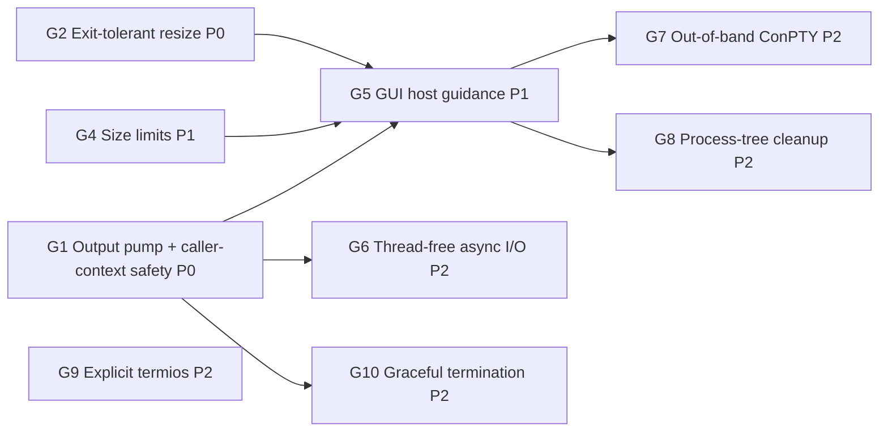

# GUI Host Readiness Plan (Desktop Terminal Embedding)

Goal: make MiniPty a dependable PTY backend for a terminal control embedded in a desktop GUI application. WinUI is the first target. WPF, WinForms, and Avalonia hosts share the same constraints. The terminal must not freeze the UI, must not starve the thread pool as tabs are added, and must not throw on ordinary GUI lifecycle events. VT fidelity must also be good enough for a terminal emulator.

**Status:** G1 design agreed (2026-10-15); implementation not started. The other items are proposed.

## Background

An embedder who was building a WinUI terminal control could not integrate MiniPty. The investigation reproduced the failure modes listed below.

All measurements were taken on Windows 11 build 26200 with 32 logical CPUs, the in-box ConPTY, and a Release build. Two terms are used throughout:

- **UI thread**: a single-threaded `SynchronizationContext` message loop that stands in for a `DispatcherQueue`.
- **Frozen**: a callback posted to that context did not run within the timeout (1.5–3 s).

## Findings

| ID | Scenario | Observed |
|---|---|---|
| F1 | `await foreach (var chunk in session.ReadOutputAsync())` started on the UI thread | No chunk is ever delivered and the UI is frozen (deadlock) |
| F2 | `await session.Output.ReadAsync(buffer)` loop on the UI thread | Startup output (204 B) arrives, then the UI is frozen while the shell is idle |
| F3 | Output pumped on the thread pool, `await session.WaitForExitAsync()` on the UI thread | UI frozen until the shell exits |
| F4 | `await session.CompleteAsync()` on the UI thread for a ~3 s command | UI frozen until the child exits |
| F5 | `PtyTerminal.Start` from the UI thread (its pump uses `Task.Run`) | UI stays responsive; first output after 39 ms |
| F6 | `PtyTerminal.Resize` after the child exited (a size change before tab teardown) | Throws `InvalidOperationException`: "Cannot resize after the pseudo-console has been closed." |
| F7 | `Resize(new PtySize(600, 200))` | Silently clamped to 512×200, so the frontend grid and the PTY disagree |
| F8 | N idle `PtyTerminal` instances, then a burst of 64 × 20 ms `Task.Run` items | N=0: 60 ms, N=4: 91 ms, N=8: 121 ms, **N=16: 1996 ms**. Minimum worker threads is 32, and 16 sessions × 2 parked threads = 32 |
| F9 | A 304 KB paste through `WriteInputAsync` (bytes and string overloads) from the UI thread, with output undrained | UI stays responsive because ConPTY buffers the input. No action needed on Windows |
| F10 | VT sequences written by a child through the in-box ConPTY | See the table below |

VT sequences written by the child through the in-box ConPTY (F10):

| Forwarded to the terminal side | Not forwarded verbatim |
|---|---|
| OSC 0 title, OSC 8 hyperlink (re-encoded with `id=`), OSC 52 clipboard, OSC 133 shell integration, OSC 9;4 progress | OSC 11 color query |
| DEC modes 1049 (alternate screen), 2004 (bracketed paste), 2026 (synchronized output) | DECRQSS, XTGETTCAP |
| `CSI > 1 u` keyboard-protocol push, truecolor SGR, underline-style SGR `4:3` | Kitty graphics APC, Sixel DCS |
| | Mouse tracking 1000/1003/1006, DECCKM. These are consumed by conhost itself |

Some forwarded sequences also arrived **earlier than the text the child wrote before them**. conhost re-renders the screen and flushes these sequences on its own schedule, so a mark such as OSC 133 can end up before the prompt text it belongs to.

## Root Causes

1. **`await Task.Yield()` is used as a "move to background" primitive.** When a `SynchronizationContext` is current, `Task.Yield` posts to it, so the continuation runs on the UI thread. That continuation does blocking work: transport reads, `Monitor.Wait` handoff waits, or exit polling. The call sites are [PtySession.cs:407](../../../src/MiniPty/PtySession.cs), `:413`, `:637`, and `:740`; [PtyStreams.cs:97](../../../src/MiniPty/Internal/PtyStreams.cs) and `:373`; and [UnixPtyBackend.cs:317](../../../src/MiniPty/Internal/UnixPtyBackend.cs). This causes F1–F4.
2. **Async APIs contain synchronous blocking fast paths.**
   - After the first call, `Output.ReadAsync` reads synchronously on the caller's thread ([PtyStreams.cs:80](../../../src/MiniPty/Internal/PtyStreams.cs), `:356`).
   - On both backends, `WaitForExitAsync` is a synchronous polling loop that returns an already-completed task ([WindowsPtyBackend.cs:413](../../../src/MiniPty/Internal/WindowsPtyBackend.cs)). This causes F2–F4.
3. **Every live session parks two thread-pool workers for its whole lifetime.**
   - The first is the strict-handoff producer, which blocks in the transport read and in `Monitor.Wait`.
   - The second is the exit observer: `WaitForSingleObject` with a 100 ms timeout on Windows, and 10 ms `waitpid` polling on Unix.
   - Each concurrent `WaitForExitAsync` parks one more worker.
   - The minimum pool size equals the processor count, so a few tabs on a laptop exhaust it. Every unrelated continuation in the host then waits for thread injection. This causes F8.
4. **`Resize` treats "transport closed after child exit" as a caller error** ([WindowsPtyBackend.cs:326](../../../src/MiniPty/Internal/WindowsPtyBackend.cs), [UnixPtyBackend.cs:201](../../../src/MiniPty/Internal/UnixPtyBackend.cs)). GUI size events arrive asynchronously with respect to child exit, so a terminal cannot avoid this race. This causes F6.
5. **The 512-cell clamp is below the platform limits** ([PtyStartInfo.cs:66](../../../src/MiniPty/PtyStartInfo.cs), [WindowsPtyBackend.cs:329](../../../src/MiniPty/Internal/WindowsPtyBackend.cs), [UnixPtyBackend.cs:204](../../../src/MiniPty/Internal/UnixPtyBackend.cs)). ConPTY takes a signed 16-bit `COORD`, and Unix `winsize` is unsigned 16-bit. This causes F7.
6. **The in-box ConPTY is the only Windows backend.** Its VT behavior is whatever conhost the user's Windows build ships, and it renders child output instead of relaying it. This causes F10.

Causes 1–3 share one structure:

- **Three independent transport read paths:** the `ReadOutputAsync` producer, raw `Output` stream reads, and the one-shot pumps of `CompleteAsync` and Capture.
- **Two polling drain paths:** the output buffer's exit observer and `PtyOutputDrain`.
- **A shared assumption:** each path blocks on whatever thread it was handed, and that thread is selected by `Task.Yield`.
- **EOF staging rides on the exit-polling loops** (`PromoteEofIfPending`, `SendEotIfPending`), so `SendEof` only makes progress while somebody is waiting for exit.

## Priority Legend

| Priority | Meaning |
|---|---|
| **P0** | Blocks GUI embedding, or crashes or freezes a correctly written host |
| **P1** | Required for a multi-tab terminal application of production quality |
| **P2** | Scale, fidelity, or robustness improvements; implement after P0/P1 or when a concrete embedder asks |

## Gap Inventory

| ID | Priority | Gap | Resolution |
|---|---|---|---|
| G1 | **P0** | Async APIs block or deadlock when awaited on a UI `SynchronizationContext` (F1–F4) | [Session-owned output pump and caller-context-safe API](#g1-caller-context-safety-p0). This also delivers G3 and non-blocking input |
| G2 | **P0** | `Resize` after child exit throws (F6) | [Exit-tolerant resize](#g2-exit-tolerant-resize-p0) |
| G3 | **P1** | Idle sessions park thread-pool workers (F8) | [Merged into G1](#g3-thread-pool-independence-merged-into-g1) |
| G4 | **P1** | Terminal size clamped to 512 (F7) | [Platform size limits](#g4-platform-size-limits-p1) |
| G5 | **P1** | No guidance for GUI hosts; README patterns are unsafe on a UI thread | [GUI host guidance](#g5-gui-host-guidance-p1) |
| G6 | **P2** | After G1, each session still holds one dedicated reader thread, and a pending read cannot be canceled at the OS level | [Thread-free async I/O](#g6-thread-free-async-io-p2) |
| G7 | **P2** | Windows is limited to the in-box ConPTY (F10); `PtyTerminal.Clear()` is a no-op | [Opt-in out-of-band ConPTY](#g7-opt-in-out-of-band-conpty-p2) |
| G8 | **P2** | No process-tree cleanup on Windows | [Opt-in job object](#g8-opt-in-process-tree-cleanup-p2) |
| G9 | **P2** | Unix termios relies on kernel defaults; `IUTF8` is missing | [Explicit termios](#g9-explicit-unix-termios-p2) |
| G10 | **P2** | Unix `Dispose` kills with `SIGKILL` immediately | [Graceful Unix termination](#g10-graceful-unix-termination-on-dispose-p2) |

---

## G1: Caller-context safety (P0)

### Why P0

GUI frameworks run user code on a thread that owns a `SynchronizationContext`. The natural first integration attempt is to call `ReadOutputAsync`, `Output.ReadAsync`, `WaitForExitAsync`, or `CompleteAsync` from a page or control event handler. Today that freezes or deadlocks the application (F1–F4).

The existing tests run without a `SynchronizationContext`, where `Task.Yield` happens to resume on the thread pool, so none of them can observe the problem.

### Scope

G1 covers three things that come from the same structure (see Root Causes):

- caller-context safety (F1–F4);
- thread-pool independence (G3, F8);
- non-blocking input writes.

Fixing only the `Task.Yield` sites would remove the freezes, but it would keep a thread-pool hop per read, keep pool starvation, and keep the duplicated read and drain paths. G2 is independent and small, and may ship in the same phase.

### Contract

- **No blocking on the caller:** no public async API performs a blocking OS wait or blocking transport I/O on the calling thread or on the caller's captured context.
- **No library code on the caller's context:** library code never runs on the caller's `SynchronizationContext`.
- **Standard await semantics for the caller's own continuations:** they resume on the captured context unless `ConfigureAwait(false)` is used.
- **Synchronous members keep their contract:** members that block by contract (`Stream.Read`, `Stream.Write`) still block.

### Architecture decisions

1. **Output pump, one per session, started by `Pty.Start`.**
   - The pump is the only code that reads the transport.
   - It reads into a bounded ring of fixed-size slots taken from the shared array pool. Each transport read fills one slot, and data that is immediately available may be appended to the same slot.
   - Each slot records its read-completion timestamp.
   - When every slot is full, the pump stops reading, and backpressure flows through the OS pipe to the child as it does today.
   - **Phase 1 driver:** a dedicated background thread per session, never a thread-pool worker.
     - Windows uses synchronous `ReadFile`. Shutdown relies on closing the pseudoconsole's write side, which makes the read return.
     - Unix puts the master in non-blocking mode, and the thread waits on the master and a wake descriptor together. On Linux, closing an fd does not interrupt a `read` blocked on it in another thread (see close(2)), so the wake descriptor is the reliable way to stop the reader.
   - **Phase 2 driver:** G6 replaces the thread with thread-free async I/O. The public API does not change.
2. **Exit watcher.**
   - Windows uses a runtime registered wait on the process handle. The runtime's wait threads multiplex the handles, so no thread is dedicated to a session.
   - Unix uses one process-wide watcher thread: pidfd on Linux 5.3+, `kqueue` `EVFILT_PROC` on macOS and FreeBSD, and consolidated `waitpid` polling on the same thread where neither is available.
   - The watcher is the only code that reaps children.
   - Exit completes a single per-session `Task<PtyExitStatus>`, whose continuations run asynchronously.
3. **Session timer.**
   - One lazily created timer per session drives two things:
     - EOF staging: Windows Ctrl+Z / CR and deferred input-pipe close, and Unix EOT deferral.
     - Post-exit quiet drain: ConPTY does not report EOF until the pseudoconsole is closed, and on Unix a grandchild can keep the slave open.
   - The existing heuristic values do not change: 100 ms quiet, `OutputDrainGrace`, and the deferral counts. Only the mechanism that drives them changes.
   - EOF staging no longer depends on somebody awaiting exit.
4. **Single consumer.**
   - `ReadOutputAsync`, the `Output` stream, `CompleteAsync`, `PtyCapture.RunAsync`, and `PtyTerminal` are all consumers of the pump.
   - The existing one-active-consumer rule stays.
   - Removed:
     - the direct transport read paths;
     - the polling drain helpers;
     - the exit-observer loop inside the output buffer;
     - the raw-read gating;
     - the macOS-only pump scheduling.
5. **Input.**
   - A write completes synchronously when the transport accepts the bytes.
   - When the write would block, for example when a Unix tty input queue is full because the child is not reading, the remainder goes to a background writer that preserves order.
   - On Windows, ConPTY accepts input promptly (F9), so the fast path is effectively always taken.

### Public API decisions

| Member | Decision | Why |
|---|---|---|
| `ReadOutputAsync` | Shape unchanged. Completes synchronously when a chunk is ready, and resumes on the caller's context only when it has to wait. Chunk memory stays valid until the next `MoveNextAsync`. The enumerator is reused per session | Zero allocation per `MoveNextAsync`. The simplest GUI pattern, `await foreach` on the UI thread, also becomes the fastest: chunks are processed in place on the UI thread with no copy and no marshaling |
| `Output` (Stream) | Kept as a view over the pump, with one copy into the caller's buffer. `ReadAsync` never blocks; `Read` blocks, per the Stream contract | Interop: `CopyToAsync`, readers, adapters |
| `WaitForExitAsync` | **Breaking:** returns `Task<PtyExitStatus>`; `WaitForExitStatusAsync` is removed. Returns the cached exit task when the token cannot be canceled | One exit API, and zero allocation for the common call |
| `HasExited` / `ExitCode` / `ExitStatus` | Read the watcher's cached state, with no OS call | No reaping race, and polling from UI code is cheap |
| `WriteInputAsync` / `Input` | Non-blocking fast path with an ordered background slow path. `Input.WriteAsync` goes through the same path | Today `Input.WriteAsync` falls through to the base `Stream` implementation and allocates a pool task per call. Unix input writes can block the caller when the tty input queue is full |
| `CompleteAsync` | Shape unchanged; implemented as a pump consumer plus the exit task | Never blocks the caller |
| `Dispose` | **Behavior change:** does not block. It kills the child, signals the pump to stop, and returns; pooled slots go back to the pool when the pump stops, so chunk memory is invalid after `Dispose`. `DisposeAsync` awaits pump shutdown and is the deterministic option. Disposing before exit still faults pending `WaitForExitAsync` calls with `ObjectDisposedException` | Closing a tab must not freeze the UI |
| `PtyOutputChunk` | Unchanged. Read timestamps stay internal, for Capture | Avoids growing the public surface |

### Specification changes implied

- **Managed buffering bound:** from "one in-flight chunk" to "slot count × slot size", in [core_session.md](../specs/core_session.md) (`ReadOutputAsync`) and [terminal.md](../specs/terminal.md) (`Pause`).
- **Output is read from spawn:** output is read into the bounded ring before any consumer attaches. Early output is never stranded, and a child no longer stalls on its first writes while nobody is reading.
- **Exit API merged:** as described in the table above.
- **Dispose versus DisposeAsync:** the new semantics above.
- **Capture timestamps:** they become pump read-completion times, which are closer to the transport than consumer receipt times.

### Rejected alternatives

| Alternative | Why rejected |
|---|---|
| Replace `Task.Yield` with a context-ignoring thread-pool switch only | Smallest diff and fixes F1–F4, but every `Output.ReadAsync` still hops to the pool and allocates, pool starvation (F8) remains, and three read paths plus two drain paths remain. Acceptable only as a stopgap |
| Expose `System.IO.Pipelines` `PipeReader` as the output API | Ships with the shared framework, so it adds no dependency, and it batches naturally. But `ReadOnlySequence` and `AdvanceTo(consumed, examined)` are easy to misuse and contradict the "immediately intuitive API" principle. Awaiting `FlushAsync` from a dedicated reader thread also allocates. A fixed-slot ring is simpler internally |
| Make `PtyTerminal` (push) the recommended GUI pattern | Handlers run off the UI thread, so each chunk needs either a copy or a completion handshake with the UI before the handler returns |
| Start Windows on overlapped I/O immediately | Zero-allocation, cancelable reads are available, but this would rebuild the ConPTY coalescing behavior (`PIPE_NOWAIT`, micro-window) at the same time as the API restructuring. Deferred to G6 so each change can be measured separately |
| Start the pump lazily on the first consumer (current behavior) | Leaves a window where early output stalls the child and fast children race the reader's start, which is the reason for today's macOS-only scheduling. The cost of eager start, one thread plus pooled slots for sessions that are never read, is acceptable |

### Delivery steps

Run the narrowest relevant tests after each step, so a hang can be attributed to that step.

1. **Test harness first:** add a single-threaded `SynchronizationContext` helper. Write tests for F1–F4, `Output.ReadAsync`, `WriteInputAsync` against a full Unix input queue, and `Dispose` on the UI thread, and confirm they fail before any implementation changes.
2. **Exit watcher, exit task, and session timer:** move EOF staging off the wait loops.
3. **Output pump and consumer views:** migrate `ReadOutputAsync`, `Output`, `CompleteAsync`, Capture, and `PtyTerminal`, then delete the old paths.
4. **Input path.**
5. **Public API break:** `WaitForExitAsync` returns `PtyExitStatus`. Update samples, specifications, the README, and benchmarks.

### Acceptance

- **Caller context:** F1–F4 tests are green on Windows and Unix. A probe posted to the single-threaded context runs within a short bound while the child is idle, and output and exit are still observed.
- **Thread pool (F8):** with 16 idle sessions, a burst of short pool work completes within 2× of the zero-session baseline, and the pool thread count does not depend on the number of sessions.
- **Exit latency:** exit-to-completion latency is no worse than today's 100 ms / 10 ms polling.
- **Allocation:**
  - No benchmark in [baselines/integration.json](../../../BenchmarkDotNet.Artifacts/baselines/integration.json) exceeds its baseline.
  - Steady state allocates nothing per chunk and nothing per wait.
- **Behavior preserved:** the existing lifecycle behavior holds, covering drain-then-exit, EOF staging, kill-then-drain, and one active consumer.

### Estimate

Large. This restructures both backends and every output consumer.

---

## G2: Exit-tolerant resize (P0)

### Why P0

A terminal resizes on every layout change, and child exit is asynchronous to layout. A shell that exits while its tab is still visible makes the next size change throw (F6). In WinUI an unhandled exception from a size handler terminates the application.

### Decision

- After the child has exited, or after the transport has been closed for drain, `Resize` is a silent no-op and `Size` keeps its last applied value.
- `ObjectDisposedException` is still thrown after `Dispose`.
- Update the `PtySession.Resize` and `PtyTerminal.Resize` exception documentation to match.

### Acceptance

- Tests on both platforms: resize after exit and after drain completion does not throw, and `Size` is unchanged.
- Resize after dispose still throws `ObjectDisposedException`.

### Estimate

Small.

---

## G3: Thread-pool independence (merged into G1)

Each idle session parks two thread-pool workers. With 16 idle sessions on a 32-thread minimum pool, an unrelated burst of short work took 1996 ms instead of 60 ms (F8). On an 8-core laptop the threshold is four tabs.

The fix uses the same components as G1: the session-owned output pump on a dedicated thread, the exit watcher with no per-session thread, and the session timer in place of polling loops. G3 is therefore delivered by G1, and its acceptance criteria (pool burst latency, and pool thread count independent of session count) are part of G1's acceptance.

---

## G4: Platform size limits (P1)

### Why P1

High-resolution displays with small fonts exceed 512 columns. A silent clamp makes the frontend grid and the PTY disagree, which corrupts line wrapping (F7).

### Decision

- Clamp to the platform limits instead: Windows 1–32767 (signed 16-bit `COORD`), Unix 1–65535 (`winsize`).
- `Size` reports the value actually applied.
- Update the `PtyStartInfo.Size` documentation.

### Acceptance

A test resizes to 600×200 and confirms that both `Size` and the child-visible size report it.

### Estimate

Small.

---

## G5: GUI host guidance (P1)

### Why P1

The README's primary pattern, `ReadOutputAsync` followed by `WaitForExitAsync`, is exactly F1 and F3 when it is placed in an event handler. After G1 the pattern is safe, and on a UI thread it becomes the recommended one. Hosts still need the threading model spelled out.

### Decision

- Add a "GUI hosts" section to the core session specification and a short README note. It covers:
  - the pull pattern on the UI thread (`await foreach` over `ReadOutputAsync`, no copy, no marshaling) as the primary recommendation;
  - `PtyTerminal` for push-style transports, where handlers run on background threads and must marshal to the UI and copy any retained bytes;
  - resize from size-change events, which is safe after G2;
  - exit through `WaitForExitAsync` or `Completion`;
  - `DisposeAsync` on tab close, with `Dispose` as the non-blocking alternative.
- Until G1 ships, the README explicitly warns against awaiting session APIs on a UI thread.

### Acceptance

- Specification and README updated.
- A runnable sample demonstrates the threading model. Its form is an open question (see below).

### Estimate

Small.

---

## G6: Thread-free async I/O (P2)

### Why P2

After G1, an idle session holds one dedicated reader thread, and a pending read is stopped only by closing or waking the transport. A host that keeps dozens of background tabs, or that hands sessions between owners, benefits from reads that hold no thread and can be canceled at the OS level. G1 already fixes every observed failure, so this item is about scale.

### Decision

G6 replaces G1's phase 1 pump driver without changing the public API.

- **Windows:** create MiniPty's own pipe ends overlapped; the ConPTY ends stay synchronous. Complete reads through the I/O completion port and cancel them with `CancelIoEx`.
- **Unix:** drive every session's non-blocking master from one shared readiness loop (`epoll` / `kqueue`). This is the same loop that G1's exit watcher already runs.
- **Coalescing:** redesign the ConPTY coalescing (`PIPE_NOWAIT`, micro-window) and the Unix continuation reads around completion and readiness notifications.

### Acceptance

- Thread count stays constant with 64 idle sessions.
- No throughput or allocation regression in the benchmarks.

### Estimate

Large.

---

## G7: Opt-in out-of-band ConPTY (P2)

### Why P2

The in-box ConPTY's VT behavior depends on the user's Windows build. On the measured build it withholds query responses (OSC 11, DECRQSS, XTGETTCAP) and graphics protocols from the terminal side. It also reorders forwarded sequences relative to text (F10). It exposes no buffer clear, which is why `PtyTerminal.Clear()` is a no-op ([plan_terminal_parity.md](plan_terminal_parity.md) T7).

A terminal emulator that wants consistent behavior across Windows builds needs Microsoft's out-of-band ConPTY redistributable: `conpty.dll` plus `OpenConsole.exe`.

### Decision

- **Bring your own binaries:** MiniPty ships no binary and takes no dependency, consistent with AGENTS.md and T7. The host application supplies `conpty.dll` and `OpenConsole.exe` and opts in explicitly. The API shape is an open question.
- **Load by absolute path:** never load `conpty.dll` by bare name. A bare-name load can bind an OS copy where one exists, which may be conhost-backed and so defeats the purpose.
- **Detect the missing host:** `conpty.dll` without `OpenConsole.exe` in its per-architecture subdirectory is reported to fall back to conhost silently. MiniPty detects this case and reports it.
- **Diagnostics:** expose which implementation is active, for logging.
- **Startup handshake (to verify during implementation):** the out-of-band host opens with a Primary Device Attributes (DA1) query and waits up to 3 s for a reply.
  - A terminal emulator answers DA1 itself, so MiniPty does nothing by default.
  - An option lets read-only hosts have MiniPty answer.
  - Whoever answers must also hide that first query from the frontend. Otherwise a second answer reaches the child as keyboard input.
- **Clear:** when the out-of-band implementation is active, `PtyTerminal.Clear()` maps to its clear operation. This revisits T7's no-op resolution, and remains compatible with it because nothing is shipped.

### Acceptance

- Rerunning the F10 probe set with the out-of-band implementation shows which sequences are forwarded, recorded in the cross-platform reference.
- A process census shows `OpenConsole.exe` hosting the session.
- The missing-host fallback is reported.
- `Clear()` is effective when the out-of-band implementation is active.

### Estimate

Large, mostly packaging and verification.

---

## G8: Opt-in process-tree cleanup (P2)

### Why P2

When a host crashes or is killed, descendants that detached from the console, or that ignore console close, can outlive the terminal. A Windows job object with kill-on-close removes the whole tree.

### Decision

- **Opt-in, off by default.** A job also terminates GUI applications the user launched from the terminal, which hosts usually do not want.
- **Spawn order:** spawn suspended, assign to the job, then resume. Assigning after the child is already running loses a race against fast-exiting children under load, and then the spawn fails.

### Acceptance

- Enabled: a grandchild is terminated on dispose and on host process exit.
- Disabled: behavior is unchanged.

### Estimate

Small–medium.

---

## G9: Explicit Unix termios (P2)

### Why P2

Linux spawns with the kernel default termios, which lacks `IUTF8`. In canonical mode, erasing a multibyte character such as Japanese input then removes only one byte and leaves invalid UTF-8 in the line.

### Decision

- Set termios explicitly at spawn. This includes `IUTF8`, and pins the output and input flags that are currently implied by kernel defaults (`ONLCR`, `ICRNL`, and so on).
- Apply this consistently to the Linux, macOS, and FreeBSD spawn paths.

### Acceptance

A canonical-mode read of multibyte input followed by an erase yields valid UTF-8.

### Estimate

Small.

---

## G10: Graceful Unix termination on dispose (P2)

### Why P2

Unix `Dispose` used to have several teardown hazards. Most of them are removed by G1:

| Original hazard | Removed by G1 because |
|---|---|
| `Dispose` sleep-polls up to 1 s on the caller's thread to reap ([UnixPtyBackend.cs:339](../../../src/MiniPty/Internal/UnixPtyBackend.cs)) | `Dispose` no longer blocks |
| A child is left as a zombie when that 1 s deadline passes | The exit watcher always reaps |
| A transport close races a `read` blocked in another thread, and EBADF reported as EOF ([PtyStreams.cs:399](../../../src/MiniPty/Internal/PtyStreams.cs)) masks it | The pump stops through its wake descriptor and closes the master only after leaving the read |
| macOS toggles `O_NONBLOCK` on the shared master description ([minipty_unix.c:731](../../../src/MiniPty/Native/minipty_unix.c)), so a concurrent write can fail with `EAGAIN` | The master is permanently non-blocking, and writes handle `EAGAIN` through the slow path |

What remains is the termination policy itself. `Dispose` sends `SIGKILL` immediately, so shells cannot save history or clean up.

### Decision

On `Dispose`, hang up first and escalate to kill after a bounded grace period. Both steps run off the caller's thread.

### Acceptance

- An interactive shell observes the hangup and can exit cleanly.
- A child that ignores hangup is still killed within the bound.
- `Dispose` returns promptly.

### Estimate

Small, after G1.

---

## Suggested Implementation Order

| Phase | Items | Outcome |
|---|---|---|
| **Phase A** | G1 (including G3), G2 | A WinUI host can use any MiniPty API from its UI thread without freezes or resize crashes, and idle tabs do not starve the thread pool |
| **Phase B** | G4, G5 | Wide windows work, and the threading model is documented with the pull pattern as the GUI recommendation |
| **Phase C** | G6, G9, G10 | Reads hold no thread, and Unix input and teardown are correct |
| **Phase D** | G7, G8 | Optional Windows VT fidelity and process-tree cleanup for hosts that opt in |

## Lessons Learned

- **`Task.Yield` is not a thread-pool switch.** It posts to the current `SynchronizationContext` when one exists. Any library code that yields and then blocks is a UI deadlock waiting for a GUI host.
- **Tests without a `SynchronizationContext` cannot detect caller-context blocking.** The console and test runners resume continuations on the pool. Context-sensitive behavior needs an explicit single-threaded context in tests.
- **`PtyTerminal` avoided F1–F4 only incidentally.** Its pump starts with `Task.Run`, which detaches from the caller's context. The core APIs offered no such protection.
- **The pool starvation threshold is the minimum worker thread count** (the processor count). It is not a large number of sessions, so the problem appears with only a few tabs.
- **Large pastes through `WriteInputAsync` did not block the UI thread on Windows**, even with output undrained. ConPTY accepts input into its own buffer independently of output backpressure. Unix tty input queues are small and can block a writer.
- **The in-box ConPTY reorders forwarded sequences relative to text** and consumes several query and graphics sequences. Its behavior must be treated as Windows-build-dependent, and must not be assumed to be a transparent relay.

## Open Questions

- **Slot sizing:** the pump's slot count and size. Start from 4 × 4 KiB and tune with the streaming throughput and allocation benchmarks.
- **Coalescing micro-window:** whether the ConPTY 1 ms coalescing micro-window is still needed once reads are pipelined into multiple slots.
- **Unix fallback interval:** the `waitpid` polling interval for the fallback exit watcher on kernels without pidfd.
- **`ClosePseudoConsole` blocking:** whether `ClosePseudoConsole` can block on older Windows builds when output is not being drained. G1 makes `Dispose` non-blocking, so if it can block, the call must run off the caller's thread. Verify on Windows 10 and Windows 11 builds before 24H2.
- **G7 API shape:** a `PtyStartInfo` property, a process-wide setting, or a separate start method.
- **G5 sample form:** a WinUI sample needs the Windows App SDK, which is a third-party dependency in a sample and cannot run in CI. The alternative is a framework-neutral console sample with a single-threaded context.

## Documentation Touchpoints (after each phase)

- [specs/core_session.md](../specs/core_session.md): caller-context contract, consumer model, managed buffering bound, merged exit API, `Dispose` versus `DisposeAsync`, `Resize` after exit, size limits, GUI host section.
- [specs/lifecycle.md](../specs/lifecycle.md): output pump started at spawn, exit watcher, timer-driven EOF staging and post-exit drain.
- [specs/terminal.md](../specs/terminal.md): `Pause` buffering bound, handler threading, `Clear()` with out-of-band ConPTY.
- [specs/capture.md](../specs/capture.md): timestamps taken at pump read completion.
- [specs/platform_support.md](../specs/platform_support.md): Windows ConPTY implementation choice, kernel requirements for pidfd.
- [references/pty_crossplatform.md](../references/pty_crossplatform.md): ConPTY VT forwarding measurements, reader shutdown via wake descriptor, termios settings.
- [README.md](../../../README.md): GUI host note, recommended pull pattern, `WaitForExitAsync` signature.

## Related Documents

- [plan_terminal_parity.md](plan_terminal_parity.md): T7 (ConPTY clear), revisited by G7.
- [specs/core_session.md](../specs/core_session.md): `ReadOutputAsync` strict handoff and coalescing, which G1 replaces with the pump and G6 later re-drives.
- [specs/terminal.md](../specs/terminal.md): `PtyTerminal` contract.
- [references/pty_crossplatform.md](../references/pty_crossplatform.md): ConPTY and Unix spawn details.
