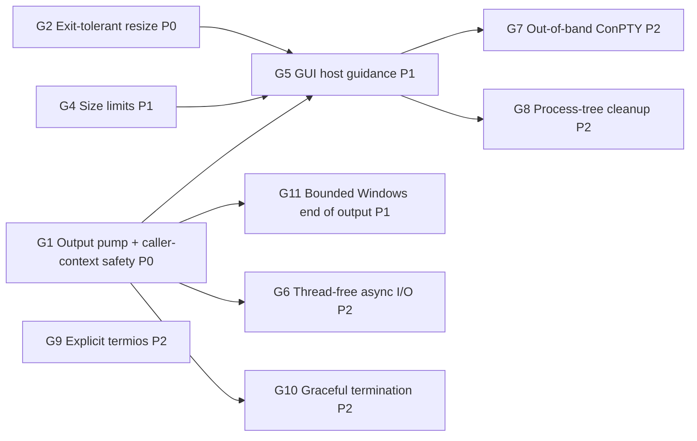

# GUI Host Readiness Plan (Desktop Terminal Embedding)

Goal: make MiniPty a dependable PTY backend for a terminal control embedded in a desktop GUI application. WinUI is the first target. WPF, WinForms, and Avalonia hosts share the same constraints. The terminal must not freeze the UI, must not starve the thread pool as tabs are added, and must not throw on ordinary GUI lifecycle events. VT fidelity must also be good enough for a terminal emulator.

**Status:** Phase A (G1 including G3, and G2) and Phase B (G4, G5, G11) are implemented (2026-10-17). G1 was delivered in steps 1 (caller-context test harness), 2 (exit watcher, exit task, EOF staging timer), 3 (output pump and consumer views), 4 (input path), 4b (Windows non-blocking input, F11), and 5 (exit API merged into `WaitForExitAsync`). Phase C: G9 (explicit Unix termios with `IUTF8`) and G10 (hang-up before kill on Unix dispose) are implemented (2026-10-17); G6 is deferred until an embedder needs dozens of concurrent sessions, since G1 already removed every observed failure. Phase D: G8 (opt-in process-tree cleanup) is implemented (2026-10-18), and G7 (opt-in out-of-band ConPTY supplied by the application) is implemented (2026-10-19).

## Background

An embedder who was building a WinUI terminal control could not integrate MiniPty. The investigation reproduced the failure modes listed below.

All measurements were taken on Windows 11 build 26200 with 32 logical CPUs, the in-box ConPTY, and a Release build. Two terms are used throughout:

- **UI thread**: a single-threaded `SynchronizationContext` message loop that stands in for a `DispatcherQueue`.
- **Frozen**: a callback posted to that context did not run within the timeout (1.5–3 s).

## Findings

| ID | Scenario | Observed |
|---|---|---|
| F1 | `await foreach (var chunk in session.ReadOutputAsync())` started on the UI thread | No chunk is ever delivered and the UI is frozen (deadlock) |
| F2 | `await session.Output.ReadAsync(buffer)` loop on the UI thread | Startup output (204 B) arrives, then the UI is frozen while the shell is idle |
| F3 | Output pumped on the thread pool, `await session.WaitForExitAsync()` on the UI thread | UI frozen until the shell exits |
| F4 | `await session.CompleteAsync()` on the UI thread for a ~3 s command | UI frozen until the child exits |
| F5 | `PtyTerminal.Start` from the UI thread (its pump uses `Task.Run`) | UI stays responsive; first output after 39 ms |
| F6 | `PtyTerminal.Resize` after the child exited (a size change before tab teardown) | Throws `InvalidOperationException`: "Cannot resize after the pseudo-console has been closed." |
| F7 | `Resize(new PtySize(600, 200))` | Silently clamped to 512×200, so the frontend grid and the PTY disagree |
| F8 | N idle `PtyTerminal` instances, then a burst of 64 × 20 ms `Task.Run` items | N=0: 60 ms, N=4: 91 ms, N=8: 121 ms, **N=16: 1996 ms**. Minimum worker threads is 32, and 16 sessions × 2 parked threads = 32 |
| F9 | A 304 KB paste through `WriteInputAsync` (bytes and string overloads) from the UI thread, with output undrained and the child idle | UI stays responsive because ConPTY buffers the input. This holds only while ConPTY can still write its own output (see F11) |
| F10 | VT sequences written by a child through the in-box ConPTY | See the table below |
| F11 | `WriteInputAsync` while the child keeps writing output and nobody reads it (the ring, then the output pipe, are full) | ConPTY stops reading input after about 4 KiB. Writes of 1 and 4 KiB completed in 1 ms; 16 and 64 KiB blocked the caller for more than 5 s and completed 27–87 ms after output reading resumed; 2 MiB blocked for more than 15 s. With the same undrained output but an idle child, 225 KB took 311 ms. When the output loop runs on the writing thread, as with `await foreach` on a UI thread, this is a deadlock |
| F12 | Sessions started while the host runs `Process.Start` with redirected stdio on other threads (48 at a time, each child alive about 1 s or about 3 s) | End of output waits for the unrelated children. Time to the end of `ReadOutputAsync` for `cmd /c echo hi`: p50 139 ms alone, 1052 ms with 1 s children, 3061 ms with 3 s children (27/30 and 30/30 sessions over 600 ms). Making MiniPty's own pipe handles non-inheritable changed nothing (1083 / 3069 ms). `ClosePseudoConsole` returned within 2 ms in every run |

VT sequences written by the child through the in-box ConPTY (F10):

| Forwarded to the terminal side | Not forwarded verbatim |
|---|---|
| OSC 0 title, OSC 8 hyperlink (re-encoded with `id=`), OSC 52 clipboard, OSC 133 shell integration, OSC 9;4 progress | OSC 11 color query |
| DEC modes 1049 (alternate screen), 2004 (bracketed paste), 2026 (synchronized output) | DECRQSS, XTGETTCAP |
| `CSI > 1 u` keyboard-protocol push, truecolor SGR, underline-style SGR `4:3` | Kitty graphics APC, Sixel DCS |
| | Mouse tracking 1000/1003/1006, DECCKM. These are consumed by conhost itself |

Some forwarded sequences also arrived **earlier than the text the child wrote before them**. conhost re-renders the screen and flushes these sequences on its own schedule, so a mark such as OSC 133 can end up before the prompt text it belongs to.

## Root Causes

1. **`await Task.Yield()` is used as a "move to background" primitive.** When a `SynchronizationContext` is current, `Task.Yield` posts to it, so the continuation runs on the UI thread. That continuation does blocking work: transport reads, `Monitor.Wait` handoff waits, or exit polling. The call sites are [PtySession.cs:407](../../../src/MiniPty/PtySession.cs), `:413`, `:637`, and `:740`; [PtyStreams.cs:97](../../../src/MiniPty/Internal/PtyStreams.cs) and `:373`; and [UnixPtyBackend.cs:317](../../../src/MiniPty/Internal/UnixPtyBackend.cs). This causes F1–F4.
2. **Async APIs contain synchronous blocking fast paths.**
   - After the first call, `Output.ReadAsync` reads synchronously on the caller's thread ([PtyStreams.cs:80](../../../src/MiniPty/Internal/PtyStreams.cs), `:356`).
   - On both backends, `WaitForExitAsync` is a synchronous polling loop that returns an already-completed task ([WindowsPtyBackend.cs:413](../../../src/MiniPty/Internal/WindowsPtyBackend.cs)). This causes F2–F4.
3. **Every live session parks two thread-pool workers for its whole lifetime.**
   - The first is the strict-handoff producer, which blocks in the transport read and in `Monitor.Wait`.
   - The second is the exit observer: `WaitForSingleObject` with a 100 ms timeout on Windows, and 10 ms `waitpid` polling on Unix.
   - Each concurrent `WaitForExitAsync` parks one more worker.
   - The minimum pool size equals the processor count, so a few tabs on a laptop exhaust it. Every unrelated continuation in the host then waits for thread injection. This causes F8.
4. **`Resize` treats "transport closed after child exit" as a caller error** ([WindowsPtyBackend.cs:326](../../../src/MiniPty/Internal/WindowsPtyBackend.cs), [UnixPtyBackend.cs:201](../../../src/MiniPty/Internal/UnixPtyBackend.cs)). GUI size events arrive asynchronously with respect to child exit, so a terminal cannot avoid this race. This causes F6.
5. **The 512-cell clamp is below the platform limits** ([PtyStartInfo.cs:66](../../../src/MiniPty/PtyStartInfo.cs), [WindowsPtyBackend.cs:329](../../../src/MiniPty/Internal/WindowsPtyBackend.cs), [UnixPtyBackend.cs:204](../../../src/MiniPty/Internal/UnixPtyBackend.cs)). ConPTY takes a signed 16-bit `COORD`, and Unix `winsize` is unsigned 16-bit. This causes F7.
6. **The in-box ConPTY is the only Windows backend.** Its VT behavior is whatever conhost the user's Windows build ships, and it renders child output instead of relaying it. This causes F10.
7. **Windows input writes are synchronous, and ConPTY stops reading input while its own output is blocked.** Once the ring is full, the pump stops reading. conhost then blocks on the output pipe and stops draining the input pipe, which holds about 4 KiB, so a synchronous `WriteFile` blocks its caller until somebody reads output. This causes F11.
8. **End of output on Windows waits for the output pipe to break, and an unrelated process can hold it open.** A process the host spawns with handle inheritance while a pseudoconsole is being created (`Process.Start` always inherits) keeps a write handle to that session's output pipe. MiniPty's own handles are ruled out (F12), which points at handles that the in-box `CreatePseudoConsole` makes inheritable while it starts its host process. Closing the pseudoconsole then ends output only when that process exits. This causes F12.

Causes 1–3 share one structure:

- **Three independent transport read paths:** the `ReadOutputAsync` producer, raw `Output` stream reads, and the one-shot pumps of `CompleteAsync` and Capture.
- **Two polling drain paths:** the output buffer's exit observer and `PtyOutputDrain`.
- **A shared assumption:** each path blocks on whatever thread it was handed, and that thread is selected by `Task.Yield`.
- **EOF staging rides on the exit-polling loops** (`PromoteEofIfPending`, `SendEotIfPending`), so `SendEof` only makes progress while somebody is waiting for exit.

## Priority Legend

| Priority | Meaning |
|---|---|
| **P0** | Blocks GUI embedding, or crashes or freezes a correctly written host |
| **P1** | Required for a multi-tab terminal application of production quality |
| **P2** | Scale, fidelity, or robustness improvements; implement after P0/P1 or when a concrete embedder asks |

## Gap Inventory

| ID | Priority | Gap | Resolution |
|---|---|---|---|
| G1 | **P0** | Async APIs block or deadlock when awaited on a UI `SynchronizationContext` (F1–F4, F11) | [Session-owned output pump and caller-context-safe API](#g1-caller-context-safety-p0). This also delivers G3 and non-blocking input |
| G2 | **P0** | `Resize` after child exit throws (F6) | [Exit-tolerant resize](#g2-exit-tolerant-resize-p0) |
| G3 | **P1** | Idle sessions park thread-pool workers (F8) | [Merged into G1](#g3-thread-pool-independence-merged-into-g1) |
| G4 | **P1** | Terminal size clamped to 512 (F7) | [Platform size limits](#g4-platform-size-limits-p1) |
| G5 | **P1** | No guidance for GUI hosts; README patterns are unsafe on a UI thread | [GUI host guidance](#g5-gui-host-guidance-p1) |
| G6 | **P2** | After G1, each session still holds one dedicated reader thread, and a pending read cannot be canceled at the OS level | [Thread-free async I/O](#g6-thread-free-async-io-p2); deferred until an embedder needs it |
| G7 | **P2** | Windows is limited to the in-box ConPTY (F10); `PtyTerminal.Clear()` is a no-op | [Opt-in out-of-band ConPTY](#g7-opt-in-out-of-band-conpty-p2): `PtyStartInfo.ConPty` with a host-supplied `conpty.dll`; implemented |
| G8 | **P2** | No process-tree cleanup on Windows | [Opt-in job object](#g8-opt-in-process-tree-cleanup-p2): `PtyStartInfo.KillProcessTree` (implemented) |
| G9 | **P2** | Unix termios relies on kernel defaults; `IUTF8` is missing | [Explicit termios](#g9-explicit-unix-termios-p2) (implemented) |
| G11 | **P1** | On Windows, end of output can wait for an unrelated process the host spawned (F12) | [Bounded end of output after close](#g11-bounded-end-of-output-on-windows-p1) |
| G10 | **P2** | Unix `Dispose` kills with `SIGKILL` immediately | [Graceful Unix termination](#g10-graceful-unix-termination-on-dispose-p2) (implemented) |

---

## G1: Caller-context safety (P0)

### Why P0

GUI frameworks run user code on a thread that owns a `SynchronizationContext`. The natural first integration attempt is to call `ReadOutputAsync`, `Output.ReadAsync`, `WaitForExitAsync`, or `CompleteAsync` from a page or control event handler. Today that freezes or deadlocks the application (F1–F4).

The existing tests run without a `SynchronizationContext`, where `Task.Yield` happens to resume on the thread pool, so none of them can observe the problem.

### Scope

G1 covers three things that come from the same structure (see Root Causes):

- caller-context safety (F1–F4);
- thread-pool independence (G3, F8);
- non-blocking input writes.

Fixing only the `Task.Yield` sites would remove the freezes, but it would keep a thread-pool hop per read, keep pool starvation, and keep the duplicated read and drain paths. G2 is independent and small, and may ship in the same phase.

### Contract

- **No blocking on the caller:** no public async API performs a blocking OS wait or blocking transport I/O on the calling thread or on the caller's captured context.
- **No library code on the caller's context:** library code never runs on the caller's `SynchronizationContext`.
- **Standard await semantics for the caller's own continuations:** they resume on the captured context unless `ConfigureAwait(false)` is used.
- **Synchronous members keep their contract:** members that block by contract (`Stream.Read`, `Stream.Write`) still block.

### Architecture decisions

1. **Output pump, one per session, started by `Pty.Start`.**
   - The pump is the only code that reads the transport.
   - It reads into a bounded ring of fixed-size slots taken from the shared array pool. Each transport read fills one slot, and data that is immediately available may be appended to the same slot.
   - Read-completion timestamps travel with each read to one-shot sinks (step 3). Ring slots do not store one: only Capture needs it, and Capture receives every read directly on the reader thread.
   - When every slot is full, the pump stops reading, and backpressure flows through the OS pipe to the child as it does today.
   - **Phase 1 driver:** a dedicated background thread per reading session, never a thread-pool worker. Step 3 takes it from a process-wide pool of reader threads that park and serve later sessions, because a thread per spawn allocated about 4.9 KB once pooled buffers were returned on it.
     - Windows uses synchronous `ReadFile`. Shutdown relies on closing the pseudoconsole's write side, which makes the read return.
     - Unix waits on the master and a wake descriptor together before each read. On Linux, closing an fd does not interrupt a `read` blocked on it in another thread (see close(2)), so the wake descriptor is the reliable way to stop the reader. Step 3 keeps the master in blocking mode instead of the planned non-blocking mode, because input writes share the descriptor and step 4 owns the input path. Step 4 made the master non-blocking.
   - **Phase 2 driver:** G6 replaces the thread with thread-free async I/O. The public API does not change.
2. **Exit watcher.**
   - Windows uses process-wide watcher threads, each waiting on up to 63 duplicated process handles with `WaitForMultipleObjects`. A runtime registered wait was the original plan; step 2 replaced it because it allocates about 270 bytes per session.
   - Unix uses one process-wide watcher thread: pidfd on Linux 5.3+, `kqueue` `EVFILT_PROC` on macOS and FreeBSD, and consolidated `waitpid` polling on the same thread where neither is available.
   - The watcher is the only code that reaps children.
   - Exit is recorded once per session. Public waits get a `Task<PtyExitStatus>` created on first use, whose continuations run asynchronously; library-internal waits use an allocation-free waiter slot; the session's output drain is notified through an allocation-free listener.
3. **Timers instead of wait loops.**
   - EOF staging (Windows Ctrl+Z / CR and deferred input-pipe close, Unix EOT deferral) runs on one lazily created timer per session (step 2).
   - Post-exit quiet drain runs on one process-wide timer that ticks only while some session is between exit and end of output (step 3). ConPTY does not report EOF until the pseudoconsole is closed, and on Linux a grandchild can keep the slave open (macOS revokes the tty when the session leader exits). A shared timer replaced the planned per-session one because the drain needs no per-session state beyond what the pump already holds.
   - The existing heuristic values do not change: 100 ms quiet, `OutputDrainGrace`, and the deferral counts. Only the mechanism that drives them changes.
   - EOF staging no longer depends on somebody awaiting exit.
4. **Single consumer.**
   - `ReadOutputAsync`, the `Output` stream, `CompleteAsync`, `PtyCapture.RunAsync`, and `PtyTerminal` are all consumers of the pump. `ReadOutputAsync` and `Output` drain the ring on their own thread; `CompleteAsync` and Capture attach a sink that the pump writes into on the reader thread (step 3), so a one-shot run needs no consumer thread and cannot fill the ring while it waits for exit.
   - The existing one-active-consumer rule stays.
   - Removed:
     - the direct transport read paths;
     - the polling drain helpers;
     - the exit-observer loop inside the output buffer;
     - the raw-read gating;
     - the macOS-only pump scheduling.
5. **Input.**
   - A write completes synchronously when the transport accepts the bytes.
   - When the write would block, for example when a Unix tty input queue is full because the child is not reading, the remainder goes to a background writer that preserves order. Step 4 makes the session's reader thread that writer: it already waits on the master, so it adds write readiness to the same wait while input is queued. No thread or pool worker is added, and `Dispose` fails queued writes on its own thread. A queued write completes when written, which gives the caller backpressure and errors.
   - On Windows, ConPTY accepts input promptly while it can write its output (F9), but stops reading input while its output is blocked (F11). Step 4 kept writes synchronous because the anonymous input pipe cannot be waited on. Step 4b makes MiniPty's end of the input pipe overlapped: a write still completes synchronously when the pipe takes the bytes, and otherwise the rest is written in order by I/O completions, with no thread waiting. ConPTY's end of the pipe stays synchronous, and the output side is unchanged until G6.

### Public API decisions

| Member | Decision | Why |
|---|---|---|
| `ReadOutputAsync` | Shape unchanged. Completes synchronously when a chunk is ready, and resumes on the caller's context only when it has to wait. Chunk memory stays valid until the next `MoveNextAsync`. The enumerator is reused per session | Zero allocation per `MoveNextAsync`. The simplest GUI pattern, `await foreach` on the UI thread, also becomes the fastest: chunks are processed in place on the UI thread with no copy and no marshaling |
| `Output` (Stream) | Kept as a view over the pump, with one copy into the caller's buffer. `ReadAsync` never blocks; `Read` blocks, per the Stream contract | Interop: `CopyToAsync`, readers, adapters |
| `WaitForExitAsync` | **Breaking:** returns `Task<PtyExitStatus>`; `WaitForExitStatusAsync` is removed. Returns the cached exit task when the token cannot be canceled | One exit API, and zero allocation for the common call |
| `HasExited` / `ExitCode` / `ExitStatus` | Read the watcher's cached state, with no OS call | No reaping race, and polling from UI code is cheap |
| `WriteInputAsync` / `Input` | Non-blocking fast path with an ordered background slow path. `Input.WriteAsync` goes through the same path | Before step 4, `Input.WriteAsync` fell through to the base `Stream` implementation and allocated a pool task per call, and input writes could block the caller: on Unix when the tty input queue was full, on Windows while ConPTY's output was blocked (F11) |
| `CompleteAsync` | Shape unchanged; implemented as a pump consumer plus the exit task | Never blocks the caller |
| `Dispose` | **Behavior change:** does not block. It ends the child (since G10, a hang-up first on Unix), signals the pump to stop, and returns; pooled slots go back to the pool when the pump stops, so chunk memory is invalid after `Dispose`. `DisposeAsync` awaits pump shutdown and is the deterministic option. Disposing before exit still faults pending `WaitForExitAsync` calls with `ObjectDisposedException` | Closing a tab must not freeze the UI |
| `PtyOutputChunk` | Unchanged. Read timestamps stay internal, for Capture | Avoids growing the public surface |

### Specification changes implied

- **Managed buffering bound:** from "one in-flight chunk" to "slot count × slot size", in [core_session.md](../specs/core_session.md) (`ReadOutputAsync`) and [terminal.md](../specs/terminal.md) (`Pause`). Done in step 3.
- **Output is read from spawn:** output is read into the bounded ring before any consumer attaches. Early output is never stranded, and a child no longer stalls on its first writes while nobody is reading. Done in step 3.
- **Exit API merged:** as described in the table above. Done in step 5.
- **Dispose versus DisposeAsync:** the new semantics above. Done in step 3.
- **Capture timestamps:** they become pump read-completion times, which are closer to the transport than consumer receipt times. Done in step 3.
- **Exit waits no longer close the transport** (step 3): the post-exit drain closes it for every consumer after output has gone quiet, in [lifecycle.md](../specs/lifecycle.md).

### Rejected alternatives

| Alternative | Why rejected |
|---|---|
| Replace `Task.Yield` with a context-ignoring thread-pool switch only | Smallest diff and fixes F1–F4, but every `Output.ReadAsync` still hops to the pool and allocates, pool starvation (F8) remains, and three read paths plus two drain paths remain. Acceptable only as a stopgap |
| Expose `System.IO.Pipelines` `PipeReader` as the output API | Ships with the shared framework, so it adds no dependency, and it batches naturally. But `ReadOnlySequence` and `AdvanceTo(consumed, examined)` are easy to misuse and contradict the "immediately intuitive API" principle. Awaiting `FlushAsync` from a dedicated reader thread also allocates. A fixed-slot ring is simpler internally |
| Make `PtyTerminal` (push) the recommended GUI pattern | Handlers run off the UI thread, so each chunk needs either a copy or a completion handshake with the UI before the handler returns |
| Start Windows on overlapped I/O immediately | Zero-allocation, cancelable reads are available, but this would rebuild the ConPTY coalescing behavior (`PIPE_NOWAIT`, micro-window) at the same time as the API restructuring. Deferred to G6 so each change can be measured separately. Step 4b makes only the input pipe overlapped (F11); input has no coalescing to rebuild |
| Windows input: non-blocking (`PIPE_NOWAIT`) writes with a retry | Nothing signals when ConPTY reads input again, so the retry would poll |
| Windows input: a writer thread | A thread per session costs what the pump avoids, and a shared writer is stalled by any one session whose ConPTY stopped reading |
| Start the pump lazily on the first consumer (current behavior) | Leaves a window where early output stalls the child and fast children race the reader's start, which is the reason for today's macOS-only scheduling. The cost of eager start, one thread plus pooled slots for sessions that are never read, is acceptable |

### Delivery steps

Run the narrowest relevant tests after each step, so a hang can be attributed to that step.

1. **Test harness first:** add a single-threaded `SynchronizationContext` helper. Write tests for F1–F4, `Output.ReadAsync`, `WriteInputAsync` against a full Unix input queue, and `Dispose` on the UI thread, and confirm they fail before any implementation changes.
2. **Exit watcher, exit task, and session timer:** move EOF staging off the wait loops.
3. **Output pump and consumer views:** migrate `ReadOutputAsync`, `Output`, `CompleteAsync`, Capture, and `PtyTerminal`, then delete the old paths. Remove the `Skip` from `ReadOutputAsyncOnUiThreadDeliversOutputWithoutBlockingIt`, `OutputReadAsyncOnUiThreadDoesNotBlockItWhileIdle`, and `IdleSessionsDoNotOccupyThreadPoolWorkers`.
4. **Input path.** Remove the `Skip` from `WriteInputAsyncTextOnUiThreadDoesNotBlockItWhenTheChildIsNotReading`.
   - **4b. Windows input path (F11).** Add tests that fail first: a write on the UI thread while the child floods output that nobody reads, and queued Windows input delivered with EOF after it. Then make the input pipe overlapped.
5. **Public API break:** `WaitForExitAsync` returns `PtyExitStatus`. Update samples, specifications, the README, and benchmarks.

Tests that a later step fixes stay in the suite but are skipped until that step, so every pull request merges with a passing CI. Each skip reason names the step that removes it.

### Step 1 result: caller-context tests

`SingleThreadSynchronizationContext` (test helper) stands in for a GUI dispatcher. `PtyCallerContextTests` drives the API from it.

| Test | Finding | Previous code |
|---|---|---|
| `ReadOutputAsyncOnUiThreadDeliversOutputWithoutBlockingIt` | F1 | Fails on Windows and Linux: no chunk arrives |
| `OutputReadAsyncOnUiThreadDoesNotBlockItWhileIdle` | F2 | Fails: the UI thread is busy for the whole window |
| `WaitForExitAsyncOnUiThreadDoesNotBlockIt` | F3 | Fails |
| `CompleteAsyncOnUiThreadDoesNotBlockIt` | F4 | Fails |
| `PtyCaptureRunAsyncOnUiThreadDoesNotBlockIt` | F4 via Capture | Fails |
| `WriteInputAsyncTextOnUiThreadDoesNotBlockItWhenTheChildIsNotReading` | Non-blocking input | Fails on Linux; returns early on Windows (F9) |
| `WriteInputAsyncBytesOnUiThreadDoesNotBlockItWhenTheChildIsNotReading` | Guard | Passes, because the base `Stream.WriteAsync` offloads the write today |
| `DisposeOnUiThreadReturnsPromptly`, `DisposeAsyncOnUiThreadDoesNotBlockIt` | Guards | Pass |
| `PtyTerminalOnUiThreadDeliversOutputWithoutBlockingIt` | Guard (F5) | Passes |
| `IdleSessionsDoNotOccupyThreadPoolWorkers` | F8 | Fails: 4 idle sessions occupy exactly 8 workers on both platforms |

Lessons from building the harness:

- **A single probe is not enough.** The previous Unix exit wait blocks for 100 ms and then calls `Task.Yield`, which lets a probe slip through between slices, so the UI thread looks responsive while it is blocked about 100% of the time. The harness therefore also measures the time the UI thread spends inside callbacks during a 500 ms idle window. A free thread is busy for well under 1 ms; a blocked one is busy for the whole window.
- **Measure pool occupancy directly.** Occupied workers, computed as `GetMaxThreads` minus `GetAvailableThreads`, give a deterministic F8 signal (2 per session), where burst latency does not. The test runs `[NotInParallel]`.
- **Until G1 fixes F8, run the guards on their own.** The failing tests occupy pool workers in the test process itself. On an 8-core Linux machine (minimum 8 workers), that starves the timing-sensitive guards in a full parallel run, and they time out. Run `PtyCallerContextTests` by itself to check the guards until the occupancy is gone. On the 32-core Windows machine the full run shows only the expected failures.
- **A blocked Unix input write can outlive cleanup.** A write blocked on a full tty input queue stays blocked through cleanup when the pool is starved. The background writer in step 4 must be stoppable by `Dispose` without depending on pool threads (resolved in step 4: the reader thread writes, and `Dispose` fails queued writes itself).

### Step 2 result: exit watcher, exit task, EOF staging timer

What changed:

- **Exit observation:** process-wide watchers replace every exit poll loop (see [Child exit observation](../references/pty_crossplatform.md#child-exit-observation)).
- **Waits:** `WaitForExitAsync`, `WaitForExitStatusAsync`, and `CompleteAsync` await the recorded exit and never poll or block.
- **EOF staging:** a per-session 100 ms timer advances it, with the same tick counts as before. `SendEof` no longer depends on somebody awaiting exit.
- **Unix `Dispose`:** kills without the caller-thread reap wait, and the watcher always reaps.
- **Output drain:** `ReadOutputAsync`'s post-exit drain is queued by the exit listener instead of a polling task.

Results:

| Test | Windows | Linux |
|---|---|---|
| F3 `WaitForExitAsync`, F4 `CompleteAsync`, F4 Capture | Pass | Pass |
| F8 occupied workers | 8 → 4 (producers only; step 3) | 8 → 4 |
| F1, F2, Unix text input | Still fail (steps 3–4) | Still fail |
| Existing suite | All pass, 3 runs | All pass, 3 runs |

On Linux, exit is reported 2 ms after it happens through pidfd. The previous polling took 10–100 ms. A process with three sessions has one watcher thread and no zombies after `Dispose`. NativeAOT publish and run were verified on Windows and on Linux (project reference, shared native library).

Allocation (Windows, KB per operation, in the repository checkout; HEAD maximum of four runs against this step's three runs):

| Benchmark | HEAD | Step 2 |
|---|---|---|
| `Session_Exit0_Bytes` | 3.75 | 2.68 |
| `Session_32KiB_Bytes` | 41.97 | 39.25–39.58 |
| `Session_32KiB_StreamBytes` | 6.50 | 4.19–4.30 |
| `Session_32KiB_OutputStreamBytes` | 4.13 | 2.00 |
| `Capture_32KiB_Text` | 126.87 | 124.14–124.48 |

About 1.1 KB of each improvement comes from the Windows command-line builder: it now measures and writes one exact-size buffer instead of building a string, a NUL-terminated copy, and a char array. The exit work alone saved about 170 B on the one-shot paths, but added about 85 B to `OutputStreamBytes`, because the exit state lives in every backend object. The command-line change more than offsets that, and `WindowsCommandLineTests` checks it against the previous quoting with 2000 random inputs.

Lessons:

- **Kill-on-cancellation cannot ride on a token registration next to `WaitAsync(token)`.** Callbacks run in reverse registration order, so the waiter resumed and unregistered the kill before it ran (`PtyCancellationKill` caught it).
- **A latent deadlock in the output buffer surfaced once exit timing changed.** Completing the consumer's wait under the buffer lock deadlocked against a concurrent cancellation callback (see [core_session.md](../specs/core_session.md) lessons). It hung two stdio bridge tests deterministically on Linux.
- **Stale epoll registrations from forked children closed live descriptors** and hung the Linux suite until registrations became one-shot and explicitly removed.
- **Allocation-neutral exit observation needs care at every layer:**
  - Create the task lazily.
  - Give internal waits a slot, not a task.
  - Avoid async state machines where only one await happens.
  - Never construct an exception that is not thrown (`Dispose` built an `ObjectDisposedException` on every call).
  - Pooled `ValueTask` builders did not help: boxes returned on another thread were often not reused.
- **The caller-context probe must not depend on the thread pool.** Its latency is now timestamped on the UI thread. Tests whose operation spawns a child on the UI thread start measuring after the spawn, which is inherent and can exceed 100 ms under load.

### Step 3 result: output pump and consumer views

What changed:

- **Reader:** each session's output is read from spawn by one pump on a dedicated reader thread, into a ring of 4 × 4 KiB slots. Reader threads come from a process-wide pool: a thread parks when its session's output ends and serves the next session (see [Output pump](../references/pty_crossplatform.md#output-pump)).
- **Ring consumers:** `ReadOutputAsync` uses one enumerator per session that hands out slots in place and allocates nothing per `MoveNextAsync`. `Output` is a stream view whose `ReadAsync` never blocks.
- **Sink consumers:** `CompleteAsync` and Capture attach a sink that the pump writes into on the reader thread. Capture chunk times are read-completion times.
- **Post-exit drain:** one process-wide timer closes the transport after 100 ms of quiet. Exit waits no longer close it.
- **Disposal:** `Dispose` does not block. `DisposeAsync` completes when the reader has stopped.
- **Unix master:** reference-counted, with each reader stopped through its own wake descriptor (`eventfd` on Linux, a pipe elsewhere, `select` on macOS).
- **Removed:**
  - the transport read streams and raw-read gating;
  - the output buffer and its drain work item;
  - the transport pump tasks, including the macOS scheduling;
  - the polling drain helpers;
  - the `FIONREAD` and `minipty_try_read` natives;
  - `CloseTransportAfterExit`;
  - `PtyTransportPumpBenchmarks`.

Results:

| Test | Windows | Linux |
|---|---|---|
| F1 `ReadOutputAsync` on the UI thread | Pass | Pass |
| F2 `Output.ReadAsync` on the UI thread | Pass | Pass |
| F8 occupied workers, 4 idle sessions | Pass (≤ 2; was 4 after step 2) | Pass |
| Full suite (3 new tests: output kept for a late reader, `CompleteAsync` after output ended, blocking `Output.Read`) | 197 pass, 1 skipped (step 4), 3 runs | 197 pass, 1 skipped, 3 runs |

NativeAOT publish and run were verified on Windows and Linux with the `Session` and `Interactive` samples, with no trim or AOT warnings. On Linux the static archive under the ignored `runtimes/` folder must be rebuilt with `scripts/build-native.sh` first; the stale local copy lacked the new natives.

Allocation (Windows, KB per operation, in the repository checkout; HEAD minimum against this step's final three runs, which had no outliers):

| Benchmark | HEAD | Step 3 |
|---|---|---|
| `Session_Exit0_Bytes` | 2.68 | 1.98 |
| `Session_Echo_Bytes` | 2.72 | 2.03–2.04 |
| `Capture_Echo_Bytes` | 3.89 | 3.21–3.22 |
| `Session_32KiB_Bytes` | 39.25 | 38.51 |
| `Capture_32KiB_Bytes` | 45.29 | 39.92–39.93 |
| `Session_32KiB_StreamBytes` | 4.24 | 1.70 |
| `Session_32KiB_OutputStreamBytes` | 2.00 | 1.80 |
| `Session_Echo_Text` | 3.04 | 2.35–2.36 |
| `Capture_Echo_Text` | 5.36 | 4.68 |
| `Capture_32KiB_Text` | 124.14 | 114.10–114.12 |
| `Capture_32KiB_DisplayPlain` | 189.67 | 179.64 |

Notes on the numbers:

- `Session_32KiB_OutputStreamBytes` now only reads `Output` to the end. Before, it had to wait for exit and run the drain helper itself, because ConPTY output never ended on its own.
- Its time rose from 94 ms to about 185–245 ms. Exit no longer closes the pseudo-console, so output ends after the 100 ms quiet period, as `ReadOutputAsync` always did (`Session_32KiB_StreamBytes`, about 188–223 ms). The one-shot benchmarks got slightly faster (for example `Capture_32KiB_Bytes` 202 → 187 ms).
- Capture allocates about 5–10 KB less because coalescing now applies to it, which gives fewer chunks and less chunk metadata.

Lessons:

- **Reuse reader threads.** A bare thread start allocates 137 B. One pooled-array return on a fresh thread raises that to about 4.9 KB, because the array pool allocates a per-thread cache and strands the returned array in it when the thread exits.
- **Keep each pooled buffer's rent and return on one thread.** An array returned on another thread stays in that thread's pool cache, and the next rent elsewhere allocates. Two places did this. Signaling end of output before dropping the pump's ring reference intermittently left the final ring release to the reader thread (the streaming benchmark averaged 7.2 KB instead of 1.7 KB in one run). Detaching a one-shot result on the thread that resumed the caller stranded grown buffers in a worker's cache (intermittent 7 KB and 119 KB averages on the one-shot benchmarks; HEAD showed the same kind of spike). The pump now releases the ring and parks its thread before completion is visible, and a sink finishes its result on the reader thread.
- **Stamp quiet detection per read, not per slot.** Stamping the last read after the coalescing micro-window let its empty tail postpone the post-exit close by up to a clock tick. Capture runs were about 10 ms slower until the stamp moved to each read that returned bytes.
- **One-shot consumers belong on the reader thread.** A bounded ring drained by a consumer that only starts after exit would block a bulk-output child before it can exit. Writing into a sink on the reader thread also removed the pump task, the drain polling, and the timeout tasks.
- **A one-time timeout needs a re-check after arming.** Review found that the drain close timeout, which fires once, could land between the sink's state check and its arming the wait, leaving no wait to signal and the scheduler done with the pump: `CompleteAsync` would have hung instead of throwing. The sink now re-checks after arming, with full fences on both sides. Review also found a full ring spinning against a closed Unix master; that state now ends output. Neither had a failing test.
- **macOS was not run locally.** The macOS-only native paths (the `select` wait and the pipe wake descriptor) were compiled and tested only by CI. Its macOS test jobs passed until the review added `ResumingAfterBackpressureDoesNotCloseTheTransport`, which then failed on both macOS runners. FreeBSD shares the pipe path. They were later run on a Mac after step 4b (see [macOS check](#macos-check)).

### Step 4 result: input path

What changed:

- **Unix:** the master is non-blocking. A write takes what the tty input queue accepts on the calling thread, and the rest is queued in issue order. The session's reader thread writes the queue: while input is queued it waits for the master to be writable along with readable, including while parked on a full ring. A queued write completes when written. `Dispose` fails queued writes with `ObjectDisposedException` on the disposing thread, end of output fails them with `IOException`, and cancellation discards the bytes not yet written. Staged EOT waits until nothing is queued.
- **Windows:** writes stay synchronous; ConPTY takes input promptly (F9), and the anonymous pipe cannot be waited on. F11 later showed that this holds only while ConPTY's output is drained; step 4b revisits it.
- **Both:** `WriteInputAsync` (both overloads), `Input.WriteAsync`, and the APM pair go through the backend directly; Stream's async-over-sync default is gone. One `PtyInputStream` replaces the per-platform write-stream wrappers.

Results:

| Test | Windows | Linux |
|---|---|---|
| `WriteInputAsyncTextOnUiThreadDoesNotBlockItWhenTheChildIsNotReading` | Pass (returns early, F9) | Pass; the skip is removed |
| New `PtyInputTests`: synchronous small writes; 140 KB queued while the child sleeps, delivered in order with EOF after it (and a blocking `Input.Write` waiting its turn); canceling and disposing a queued write | Pass (Unix cases return early) | Pass |
| Full suite | 216 pass, no skips, 3 runs | 216 pass, no skips, 3 runs |

Allocation and time (Windows, new `PtyInputBenchmarks`: one 64-byte line into a live session whose child reads and discards it):

| Benchmark | Before | After |
|---|---|---|
| `WriteInputBytes` | 111.6 µs, 248 B | 89.9 µs, 0 B |
| `WriteInputText` | 105.1 µs, 0 B | 88.8 µs, 0 B |
| `InputStreamWriteAsync` | 107.6 µs, 112 B | 90.9 µs, 0 B |

Every `PtyIntegrationBenchmarks` scenario allocates about 0.1 KB less, because one input stream object replaced two; times did not change. NativeAOT publish and run were verified on Windows and Linux (`Session` and `Interactive` samples).

Lessons:

- **The reader thread is the natural input writer on Unix.** It already waits on the master, so write readiness joins the same wait. A separate writer would cost a thread per session or a pool worker, and step 1 showed that a pool worker blocked on a full tty can outlive cleanup.
- **EOF is ordered input too.** Staged EOT must not overtake input still queued for a child that is not reading. The ordering test writes 20,000 numbered lines plus EOF at once and checks that the child saw every line.
- **macOS was not run locally.** Its write wait uses the `select` write set, which only macOS compiles. It was later run on a Mac after step 4b (see [macOS check](#macos-check)).

### Step 4b result: Windows input path

Why: F11. A Windows write blocks its caller while ConPTY's output is blocked, so a GUI host that pastes while output is flowing and reads output on the same thread deadlocks. G1's contract forbids blocking transport I/O on the caller.

Decision:

- **Transport:** MiniPty's end of the input pipe is the server end of a named pipe, opened overlapped. Anonymous pipes cannot be opened overlapped.
  - ConPTY's end is opened synchronously by name right after creation and is handed to `CreatePseudoConsole` as before.
  - The pipe has a random name, allows one instance, must be the first instance of that name, and rejects remote clients. If anything else connects first, the spawn fails instead of sharing the pipe.
  - The buffer stays 4 KiB, as the anonymous pipe's default was. With a zero buffer every write would wait for ConPTY to read.
- **Writes:** a write completes synchronously when the pipe takes the bytes, which is the usual case and allocates nothing after the session's first write. Otherwise the rest is queued in issue order, and each I/O completion writes the next part, so no thread waits. The queue keeps step 4's semantics, except for cancellation:
  - cancellation discards the bytes not yet staged. Up to 4 KiB already staged in a pending write still reaches the child, because a pending pipe write cannot be taken back in part;
  - `Dispose` fails queued writes with `ObjectDisposedException` on the disposing thread;
  - end of output fails them with `IOException`;
  - staged EOF (Ctrl+Z / CR) waits until nothing is queued or in flight.
- **Both pipes are created non-inheritable.** Nothing needs them inheritable, and F12 showed that MiniPty's own handles are not the leak.
- **No cost for sessions that never write.** The queue, the completion-port binding, the reusable overlapped structure, and a 4 KiB native staging buffer are created on the first write. Every write is issued from the staging buffer, because an overlapped write needs its bytes until it completes, which can be after the caller's span is gone.
- **Queued-write entries are reused** on both platforms, through one process-wide spare. An entry returns there only after both the completer and the waiter are done with it.

Results:

| Test | Windows | Linux |
|---|---|---|
| New `WriteInputAsync{Text,Bytes}OnUiThreadDoesNotBlockItWhileOutputIsBackedUp` | Fail before (UI thread busy for the whole 500 ms window); pass | Pass before and after |
| `PtyInputTests`: delivery with EOF after it while output is backed up (new, both platforms); cancel and dispose of a queued write (now both platforms) | Fail before (the write call itself did not return within 5 s); pass | Pass |
| Full suite | 219 pass, 3 runs | 219 pass, 3 runs |

Allocation and time (Windows, against HEAD):

| Benchmark | HEAD | Step 4b |
|---|---|---|
| `WriteInputBytes` | 85.1 µs, 0 B | 86.5 µs, 0 B |
| `WriteInputText` | 85.6 µs, 0 B | 86.0 µs, 0 B |
| `InputStreamWriteAsync` | 87.2 µs, 0 B | 86.7 µs, 0 B |
| `PtyIntegrationBenchmarks`, every scenario | for example `Session_Exit0_Bytes` 1.88–1.89 KB | 0.03–0.04 KB less (1.84–1.85 KB); times unchanged |

The integration benchmarks allocate less because the old pipe setup boxed a security-attributes structure to marshal it. NativeAOT publish and run were verified on Windows and Linux (`Session` and `Interactive` samples), and a NativeAOT probe on Windows completed 312 pending writes in 20,000 through the completion port.

Lessons:

- **The input benchmark saturates the pipe.** It writes faster than ConPTY reads, so about one write in 64 (64 × 64 B = the 4 KiB buffer) waits. Before this step, that write blocked the benchmark thread. With the queue, it first allocated an entry (2 B per write on average) until entries were reused. Read a benchmark's per-operation average with its saturation in mind.
- **Every new field on the backend object is paid by every session.** The first version kept the queue and the overlapped state as backend fields, and every integration scenario allocated about 20–30 B more, although none of them writes input. One lazily created object fixed it.
- **A reused `IValueTaskSource` needs both parties to let go.** Resetting an entry as soon as its waiter has read the result races the completer, which may still be signaling that waiter. The entry is recycled only after `Complete` has returned and the waiter has read the result.
- **Pin system tools by full path in tests.** A bare `find` resolved to a Unix `find` earlier on `PATH` and walked the file system instead of counting lines.

### Steps 4 and 4b: review fixes

An adversarial review of both steps, with each claim checked by three independent verifiers, found contract gaps, untested branches, and references that kept finished writes reachable. It also found two Windows defects that predate step 4. What changed:

- **Failures go through the task.** A canceled token, closed input, and a failed write now fault or cancel the task returned by `WriteInputAsync` and `Input.WriteAsync`, and are thrown from `EndWrite` after `BeginWrite`. Before, they were thrown from the call, so a host that starts a write and awaits it later, or never, got an exception in its event handler. Disposal still throws. One shared helper applies this rule on both platforms.
- **Kill on cancellation covers the input step.** `CompleteAsync` and Capture write their input before waiting for exit. A cancellation that lands during that write now kills the child too.
- **EOF goes by the last byte the terminal took.** A canceled write leaves the bytes the terminal already took, which can end inside a line. EOF now submits that line first. Before, it went by the caller's last byte, so the child could miss EOF with no way to recover, because a second `SendEof` does nothing.
- **Windows EOF after a write during the empty-input wait.** A write while an input pipe that never carried bytes waits to be closed now switches EOF to Ctrl+Z / CR. Before, EOF was never delivered. This predates step 4. (Superseded on 2026-10-19: the wait is gone, empty input sends the chord on the first tick, so this case and its test no longer exist; see the [G7 lessons](#g7-result).)
- **Blocking writes.** A blocked `Input.Write` waits on its queued write, and the completing thread wakes it directly. On Unix it needs no thread-pool worker. On Windows the I/O completion itself still runs on the runtime's thread pool.
- **Queued-write entries.** A completed write drops its cancellation registration even when nobody awaits it. The parked spare drops its token, and only the waiter's first read of the result releases an entry.
- **Unix.** A write after disposal throws `ObjectDisposedException`, as on Windows. A write rejected after the input closed no longer strands a pooled buffer. Queued writes fail when the master closed before the reader began.
- **Windows.** The transport close completes even when writing EOF fails. `Start` releases the pipes when `CreatePseudoConsole` fails, which predates step 4.
- **Contract wording.** "Writes, including `SendEof`, reach the child in issue order" was narrowed. `SendEof` takes effect after every write issued before it, and a later write may reach the child first. Cancellation discards only the bytes not yet handed to the terminal. On Windows those handed over include a pending part of up to 4 KiB that ConPTY has not read yet.

Results:

| Check | Result |
|---|---|
| New tests on the commit before these fixes | Windows: failures through the task, kill on cancellation during input, EOF after a write during the empty-input wait (a test removed on 2026-10-19 with the wait itself), and EOF after a canceled partial line all fail. Linux: the same, except the empty-input case, plus `ObjectDisposedException` after disposal |
| Windows EOF guard removed (mutation) | The new ordering test fails. The earlier delivery test passed without the guard |
| Full suite | Windows 230 pass, 5 runs. Linux 230 pass, 4 runs |
| `PtyInputBenchmarks` | 86.7 / 86.1 / 87.7 µs, 0 B |
| `PtyIntegrationBenchmarks` | Unchanged from step 4b except `Session_Exit0_Bytes`, 1902 B/op. Step 4b itself measures 1902 B/op in the same checkout today, so that run's 1885–1890 B/op was run-to-run variation |
| NativeAOT | `Session` and `Interactive` samples on Windows and Linux. A Windows probe completed 312 queued writes in 20,000 and a blocking 256 KiB `Input.Write` |

Lessons:

- **A short partial line is needed to test the EOF chord on Windows.** The console hands a line longer than the reader's buffer to the reader without waiting for CR, so the next Ctrl+Z starts a line and ends input anyway. A test with one long line passed without the fix.
- **A Linux tty can take queued input after the child exits.** "End of output fails queued writes" holds only for writes still queued when output ends. The deterministic test closes the transport while the child is still running.
- **A wait longer than the child's own lifetime proves nothing.** The first kill-on-cancellation test waited 30 seconds for a child that exits after about 30 seconds, and passed without the fix.
- **A test must reach the branch it is named for.** The first EOF-ordering test drained output before the first staging tick, so EOF never waited for the queue. A line count also cannot see reordered parts. The ordering test now lets ticks pass while the queue is blocked and compares the copied lines.
- **A one-byte field can cost every session 8 bytes.** The backend's 1-byte fields fill one 8-byte slot, and one more bool grew every session. The chord state shares the deferral counter instead.
- **Remove nested checkouts before benchmarking.** BenchmarkDotNet refuses to build when another copy of the benchmark project sits under the repository, as worktrees for parallel reviewers did.

A second review round of the fixed branch, verified the same way, found two narrow races, tests that could pass for the wrong reason, and doc wording. What changed:

- **Windows empty-input EOF.** A write that lands between the unlocked check and the pipe close now switches EOF to Ctrl+Z / CR under the lock. Before, the pipe could close after bytes, which the child sees as `STATUS_CONTROL_C_EXIT`. (Superseded on 2026-10-19: the pipe is no longer closed for EOF at all.)
- **Registration after completion.** A full fence orders the registration against the completed check, so an entry that completes while its task is being created always drops the registration.
- **Unix disposal.** `Dispose` fails queued writes before it ends the child and closes the transport, so they report the disposal rather than the end of output that follows.
- **Tests.**
  - Blocked-input payloads are complete short lines, as described in the lessons below.
  - Both EOF tests assert exit code 0.
  - Failure routing covers every write overload.
  - A new test covers `ObjectDisposedException` after output had already ended.
  - The thread-pool test drives the write helper behind `Input.Write`, checks that the pool cap took effect, and proves saturation with a probe.
  - The transport close that fails a queued write runs off the test thread.
- **Docs.** Several statements were corrected:
  - when a write waits: on Windows whenever writes outpace ConPTY;
  - what cancellation leaves behind;
  - the first write's allocation on Windows;
  - `SendEof` ordering and its switch to the chord;
  - the macOS EOT deferral.

Results:

| Check | Result |
|---|---|
| Full suite | Windows 232 pass, 3 runs. Linux 232 pass, 3 runs |
| Thread-pool test against the earlier `AsTask` wait (mutation) | Fails |
| Unix EOT ordering guard removed (mutation) | Two ordering tests pass, 5 runs on Linux. See the lessons |
| `PtyInputBenchmarks` | 0 B in 14 of 15 rows across five runs. One `WriteInputBytes` row showed 1 B/op. A probe of the same loop, 8 rounds of 20,000 writes, allocated one entry and the first write's state in the first round and no entries after that. The only later bytes were a thread-pool thread being added (1056 B), which the process-wide counter includes. Means ranged 86–139 µs, and the tree before this round measured 97–161 µs in interleaved runs on the same machine |
| `PtyIntegrationBenchmarks` | Unchanged from the first round, for example `Session_Exit0_Bytes` 1.85 KB. The allocation check passes |
| NativeAOT | `Session` sample published and run on Windows and Linux. `Interactive` published on Windows |

The two races have no deterministic test, because each window lies between two adjacent steps. The macOS test changes were not run on macOS in this round. The [macOS check](#macos-check) below ran them later.

Lessons:

- **A macOS tty needs complete lines in tests.** In canonical mode the macOS tty code holds back a write only once a complete line is queued, and it drops input past `MAX_INPUT` (1024 bytes) on a line, EOT included. A test that needs a write to wait, or EOF to arrive after a partial line, uses short complete lines there. This came from reading the xnu tty code, and the [macOS check](#macos-check) later confirmed it on a Mac.
- **An unlocked check needs repeating under the lock.** The EOF tick read the write state without the lock, so a write could land before the close.
- **A test that caps the thread pool must prove the pool was busy.** `SetMaxThreads` returns false and changes nothing when the cap is below the minimum, which the first version ignored. Blockers that never saturate the pool let the test pass on the old path.
- **Count before calling a 1 B/op blip a regression.** BenchmarkDotNet's allocation column counts every thread. On a benchmark that waits, a thread-pool thread being added mid-run shows up as a fraction of a byte per operation. The [macOS check](#macos-check) later found a steady cost as well: 32 B for each write that waits, under BenchmarkDotNet's wait. At one write in 64 that is about 0.5 B/op here. BenchmarkDotNet rounds bytes per operation half to even, so 0.5 shows as 0 B, and slightly more waiting writes or a thread being added turn a row into 1 B. The share of waiting writes per row was not measured.
- **The Linux runs did not show whether the EOT guard is tested.** Two ordering tests passed on Linux with the guard removed, in 5 runs. Which two, and which of the guard's two checks were removed, were not recorded. On macOS, removing either check alone passes too. The [macOS check](#macos-check) later found that the tests do notice the whole guard removed on macOS.

Rounds three and four found only comment and doc wording, and round five found nothing. The reference now says Unix EOT also waits for room in the tty input queue. A canceled write can leave the queue full while nothing is queued in MiniPty.

### macOS check

Steps 4 and 4b were built and tested on Windows and Linux only. Step 3 reached macOS only through CI on its pull request and on its merge to `main`. The native jobs for osx-arm64 and osx-x64 compiled the macOS paths. The macOS test jobs passed until the review commit added `ResumingAfterBackpressureDoesNotCloseTheTransport`, and from then on that test failed on both macOS runners, on the pull request and on `main`. This check ran the end of step 4b on macOS 26 (arm64), covering the macOS-only paths: the `select` read and write sets, the pipe wake descriptor, the EOT deferral, and the macOS branches in the tests.

| Check | Result |
|---|---|
| Full suite | 233 pass, no skips, 16 runs. `ResumingAfterBackpressureDoesNotCloseTheTransport` passed in every run here, so its CI failure on macOS is not reproduced and remains open. The test drives the pump with a fake backend and fixed delays |
| NativeAOT | `Session` and `Interactive` samples published and run against the static native archive. The input probe below gave the same results published as it did under JIT |
| `PtyInputBenchmarks` | 140.7, 141.4, and 144.9 µs, 2 B/op each. The bytes are 32 B per write that had to wait, not thread-pool growth. BenchmarkDotNet waits on a pending `ValueTask` through `UnsafeOnCompleted` with an `Action`. A pending write runs its continuation asynchronously, and for an `Action` that queues an allocated thread-pool work item. An `await` queues none: a probe of 8 rounds of 20,000 awaited writes into `cat`, some of them queued, allocated 0 B process-wide after the first round, apart from about 1 KB in rounds where a thread-pool thread was added |

Input probe: the child counts its stdin bytes into a file, and the probe writes once and then calls `SendEof`. The same probe ran against `main` before the input path.

| Input | Input path | Before |
|---|---|---|
| 1 MiB of 64-byte lines while the child sleeps 1 s | Every byte arrives, exit 0, in 2–3.5 s | The write completes, but the child has not exited 10 s later |
| One line of 1,023 bytes plus LF | Arrives | Same |
| One line of 1,024 bytes or more plus LF, with the child reading or asleep, or 3,000 bytes without LF | The write completes at once; the child never gets the line or EOF and is still running 10 s later | Same |
| 64 KiB of short lines to a raw-mode child | Arrives | Same |

Lessons:

- **The macOS tty line limit is real and older than the input path.** In canonical mode a line holds at most 1,024 bytes, LF included. Once 1,024 bytes are pending without an LF, the tty takes later writes without blocking and drops later bytes, LF and EOT included. So the write reports success while the child keeps waiting. Kill, interrupt, quit, and suspend free the line, and the pending bytes are lost then. Erase and word erase free only the bytes they remove, and the rest of the line arrives if its LF comes before that room fills again. Other special characters, such as reprint and status, are processed but free nothing. With the default IMAXBEL setting, the tty answers each dropped byte with a BEL while its output has room, whether echo is on or off, but that looks like a BEL the child prints. MiniPty cannot detect this and sends none of these characters. Raw-mode children are not affected. The reference documents the limit.
- **A benchmark's wait can allocate where `await` does not.** The 2 B/op above comes from how BenchmarkDotNet waits, not from the write path. macOS shows it because its tty takes about 1 KiB, so about one write in 16 waits there. Windows runs the same code. There 312 or 313 of 20,000 writes wait, about one in 64 for the 4 KiB pipe buffer, and each wait through an `Action` costs 32 B, so about 0.5 B/op. That rounds to 0 B or 1 B. Awaiting the same writes allocates nothing.
- **macOS `poll` is avoided on its documentation, not on observed failure.** poll(2) on macOS says it does not support devices. On macOS 26, probes saw `poll` on a PTY master report input, room for output, and hang-up correctly. The wait keeps `select` because the documented limit still stands.
- **Native binaries need a deployment target.** `scripts/build-native.sh` passes no `-mmacosx-version-min`, and no workflow sets `MACOSX_DEPLOYMENT_TARGET`. So the archive, `libminipty_unix.dylib`, and `minipty_spawn_helper` all declare the build host's macOS as their minimum (`minos 26.0` in `otool -l` here). Linking an AOT sample against the archive warns about it, and CI builds the packaged binaries the same way on macOS 26 runners. Whether an older macOS refuses them was not tested. This is outside the input path and is left as is.

A review on macOS, with each claim checked by three independent attempts to refute it, found untested paths, two unreliable tests, and a slow cancellation. What changed:

- **Tests.**
  - Each of these Unix paths passed the suite with its code removed, so each got a test that fails without it:
    - writing queued input while the output ring is full;
    - waking the reader after a write is queued;
    - retrying EOT when a full tty refuses it with nothing queued (macOS only).
  - `SmallWritesCompleteSynchronously` used a child that exits after one line, so its second write could fail. It now uses a child that never reads.
  - `ABlockingWriteResumesWithoutTheThreadPool` disposed the event its extra blocker waits on. When that blocker started late, it threw on a pool thread and ended the test process, in 2 of 6 to 5 of 20 full runs. The event is no longer disposed.
- **Cancellation.** Queued writes are doubly linked, so a canceled one leaves the queue without a walk from the head. Canceling 20,000 queued writes that share one token took 1,441 ms on macOS and now takes 14 ms. On Windows, with output backed up so that ConPTY took no input, canceling 19,487 queued writes that share one token took 319–337 ms and now takes 2–10 ms. Every one of them completed as canceled. A second review round found that no test checked the backward links, so removing their updates passed the suite. A unit test now removes entries after earlier removals and fails without them.

| Check | Result |
|---|---|
| Full suite | 237 pass in 20 runs, and in 10 more runs with 12 busy processes on 8 cores. With the backward-link test, 238 pass in 10 runs, and in 15 more after the later test fixes |
| Full suite with 64 busy processes on 8 cores | One timeout of `SendEofEndsInputAfterACanceledWriteLeftAPartialLine` in 48 runs (see [Open Questions](#open-questions)) |
| `PtyInputBenchmarks` | 142.9, 145.4, and 147.6 µs, 2 B/op each, against 140.7, 141.4, and 144.9 µs before the fixes |
| Windows and Linux | Full suite 238 pass, 3 runs on each. Windows `PtyInputBenchmarks` 0 B, 88–99 µs |

Lessons:

- **Echo hides a missing wake.** Echo of the part a write takes at once makes the master readable, so the reader waits again with the write set anyway. A test of queued input needs a child with echo off to prove the wake. The echo-off test first waited a fixed 500 ms for `stty -echo`. With `stty` started 0.7 s late and the wake removed, it still passed 9 of 10 runs, so it now writes only after a marker the child prints once echo is off.
- **Writes that share a token are canceled newest first.** Their callbacks run in reverse registration order, so a removal that walks from the head costs the whole queue for each write.
- **A disposed `ManualResetEventSlim` throws from `Wait` even when it is set.** A test must not dispose an event that work it queued may still wait on.
- **The ordering tests do check the EOT guard on macOS.** With both of its checks removed, the one before the lock and the one under it, `QueuedInputIsDeliveredInOrderWithEofAfterIt` failed in most runs of every set. `CancelingAQueuedWriteKeepsTheOthersInOrder` and `QueuedInputIsDeliveredInOrderWithEofAfterItWhileOutputIsBackedUp` failed in no run of some sets and in some or all runs of the rest. The macOS tty, holding about 1 KiB, regains room while input is still queued, and EOT then overtakes it. With either check removed alone, the tests passed every run, because the other check covers it.
- **A loose assertion can pass for the wrong reason.** The 0xFF test compared only the byte before 0xFF, so it would pass even if 0xFF were lost. A Unix tty passes 0xFF through as data, so the test now requires both bytes there.

### Step 5 result: exit API

What changed:

- `WaitForExitAsync` returns `Task<PtyExitStatus>`, and `WaitForExitStatusAsync` is removed. Callers that need only the code read `ExitCode`.
- Without a cancelable token every call returns the session's one exit task. With one, the wait is `Task.WaitAsync` over that task.
- Disposal before exit still fails the wait with `ObjectDisposedException`, through the exit task itself. The wait no longer checks disposal again after the exit. Before, a wait whose continuation ran after disposal reported `ObjectDisposedException` even though the child had already exited. Now such a wait reports the exit status.
- `PtyTerminal`, the samples, the README, the specifications, and the reference use the merged API.

Results:

| Check | Result |
|---|---|
| New test: calls without a token return the same task | Fails when each call returns a new task (mutation). The disposal test now also covers a wait with a cancelable token |
| Full suite | Windows 239 pass, 2 runs. Linux 239 pass, 2 runs |
| New `Session_Exit0_WaitForExit` benchmark | 1.46 KB before, 1.22 KB after, in 3 runs each. About 24 ms both |
| `PtyIntegrationBenchmarks`, other scenarios | Unchanged. The allocation check passes |
| NativeAOT | `Session` and `Interactive` published on Windows, and `Session` run |

The old wait ran two async methods, one returning the code over one returning the status, and each allocated a state machine when it had to wait. The new wait runs none.

Lessons:

- **The README samples pin a released package.** `README_MiniPty.cs` and `README_MiniPty.Console.cs` mirror the README and compile against `MiniPty@1.2.0`, so they fail to build until the pin moves to a release with the merged API. CI does not build them.

### Acceptance

- **Caller context:** F1–F4 tests are green on Windows and Unix. A probe posted to the single-threaded context runs within a short bound while the child is idle, and output and exit are still observed.
- **Thread pool (F8):** with 16 idle sessions, a burst of short pool work completes within 2× of the zero-session baseline, and the pool thread count does not depend on the number of sessions.
- **Exit latency:** exit-to-completion latency is no worse than today's 100 ms / 10 ms polling.
- **Allocation:**
  - No benchmark in [baselines/integration.json](../../../BenchmarkDotNet.Artifacts/baselines/integration.json) exceeds its baseline.
  - Steady state allocates nothing per chunk and nothing per wait.
- **Behavior preserved:** the existing lifecycle behavior holds, covering drain-then-exit, EOF staging, kill-then-drain, and one active consumer.

### Estimate

Large. This restructures both backends and every output consumer.

---

## G2: Exit-tolerant resize (P0)

### Why P0

A terminal resizes on every layout change, and child exit is asynchronous to layout. A shell that exits while its tab is still visible makes the next size change throw (F6). In WinUI an unhandled exception from a size handler terminates the application.

### Decision (implemented)

- **Child exit never makes `Resize` fail.**
  - While the transport is open, the size is applied, even if the child has already exited.
  - Once the transport has been closed after exit, `Resize` is a no-op and `Size` keeps its last applied value.
  - If the OS rejects the call and the child has exited in the meantime, that is also a no-op.
- **What still throws:** `ObjectDisposedException` after `Dispose`, `ArgumentOutOfRangeException` for negative pixel dimensions (validated before the exit state is considered), and OS failures while the child is running.
- **Windows race guard:** a reference on the pseudo-console handle is held for the duration of `ResizePseudoConsole`. A drain close on another thread therefore defers `ClosePseudoConsole` until the call returns, instead of invalidating the handle mid-call.
- **Documentation:** `PtySession.Resize`, `PtyTerminal.Resize`, [core_session.md](../specs/core_session.md), and [terminal.md](../specs/terminal.md) describe the behavior.

### Tests

| Test | State it covers |
|---|---|
| `PtyResizeUpdatesSize`, `PtyResizeAcceptsPixelDimensions` (existing) | Child running |
| `PtyResizeAfterExitWithOpenTransportDoesNotThrow` | Child exited, transport open |
| `PtyResizeAfterTransportClosedIsNoOp` | Child exited, transport closed (F6) |
| `PtyResizeAfterDisposeThrowsObjectDisposed` | Disposed |
| `PtyTerminalResizeAfterCompletionIsNoOp` | Size change after `Completion` (F6) |

The two F6 tests fail on the previous code with `InvalidOperationException`.

### Lessons Learned

- **Define the no-op by transport state, not by `HasExited`.** The planned rule, a no-op as soon as the child had exited, would have broken existing resize tests that use fast-exiting children (`PtyResizeUpdatesSize`, `PtyWindowsSpawnAllowsImmediateResize`). Their resize would race the exit and silently stop applying. Applying the size while the transport is open is harmless on both platforms, and it keeps `Size` deterministic until drain closes the transport.
- **The Unix master fd can still be closed and reused by a concurrent drain during the ioctl.** This race predates this change and is resolved by G1's fd-lifetime design (see G10).

### Estimate

Small.

---

## G3: Thread-pool independence (merged into G1)

Each idle session parks two thread-pool workers. With 16 idle sessions on a 32-thread minimum pool, an unrelated burst of short work took 1996 ms instead of 60 ms (F8). On an 8-core laptop the threshold is four tabs.

The fix uses the same components as G1: the session-owned output pump on a dedicated thread, the exit watcher with no per-session thread, and the session timer in place of polling loops. G3 is therefore delivered by G1, and its acceptance criteria (pool burst latency, and pool thread count independent of session count) are part of G1's acceptance.

---

## G4: Platform size limits (P1)

### Why P1

High-resolution displays with small fonts exceed 512 columns. A silent clamp makes the frontend grid and the PTY disagree, which corrupts line wrapping (F7).

### Decision (implemented)

- Each dimension is clamped to what the platform API encodes: 1–32767 on Windows (ConPTY's signed 16-bit `COORD`), 1–65535 on Unix (`winsize`). One internal limits type replaces the three `512` literals, so spawn and resize cannot drift apart.
- Values below 1 still clamp to 1 rather than throw: a GUI window reports zero cells before layout, and that must not fault a size-changed handler.
- `Size` reports the value applied; `PtyStartInfo.Size` and `PtySize` document the limits.

Measured before implementing, on Windows 11 build 26200: `CreatePseudoConsole` and `ResizePseudoConsole` succeeded at 600×200, 1000×1000, 4000×300, 8000×1000, 32767×1, 1×32767, and 32767×32767 in about 5 ms each, and a PowerShell child reported 600×200, 4000×300, 32767×50, and 200×32767 as both its window and buffer size. Nothing in ConPTY needed the old cap.

### Tests

| Test | Covers |
|---|---|
| `PtyResizeAppliesSizesUpToThePlatformLimit` | 600×200 applied; the platform maximum applied; above-maximum and non-positive values clamped |
| `PtyStartAppliesSizesUpToThePlatformLimit` | The same at spawn |
| `PtyChildSeesWideResizedSize` | The child, not only `Size`, observes 600×200 (PowerShell `WindowSize` on Windows, `stty size` on Unix) |

### Lessons Learned

- A clamp is the right failure mode for a size, but its bound must be the platform's, not a guess. The 512 cap predated any GUI embedder and was never measured against ConPTY.

---

## G5: GUI host guidance (P1)

### Why P1

The README's primary pattern, `ReadOutputAsync` followed by `WaitForExitAsync`, is exactly F1 and F3 when it is placed in an event handler. After G1 the pattern is safe, and on a UI thread it becomes the recommended one. Hosts still need the threading model spelled out.

### Decision (implemented)

- [core_session.md](../specs/core_session.md) has a "GUI Hosts" section: one table from host concern (output, push transports, input, layout, exit, tab close, many tabs) to the recommended call and why it is safe, with the pull pattern on the UI thread as the primary recommendation and `PtyTerminal` as the push alternative whose handlers must marshal and copy. The README has a short "GUI hosts" paragraph pointing at it.
- **Sample form: a code-only WinUI 3 app**, [samples/WinUiTerminal](../../../samples/WinUiTerminal), chosen over a framework-neutral console sample because the embedder that motivated this plan is a WinUI host and a real dispatcher is the thing being demonstrated. No XAML file at all: `Main`, the `Application`, the window, and the terminal control are all C#, with no `Task.Run` anywhere. The Windows App SDK and Win2D are the sample's dependencies, not MiniPty's, and the sample is JIT-only (`PublishAot=false`), since it demonstrates the threading model rather than publishing.
- **A second host, [samples/AvaloniaTerminal](../../../samples/AvaloniaTerminal), runs the same emulator on Windows, Linux, and macOS.** The emulator core lives in [samples/TerminalEmulator](../../../samples/TerminalEmulator) (parser, screen buffer, palette, key encoding, mouse reporting, wheel accumulation, paste normalization, selection) and is compiled into both samples and the test project as linked sources; each host contributes only its drawing and input layer (Win2D, or Avalonia's `DrawingContext` with `FormattedText`) and a map from its key enum onto the framework-neutral `TermKey`. Avalonia is the sample's dependency, not MiniPty's, and the sample is code-only (no `.axaml`) and JIT-only like the WinUI one. CI builds it on every runner and smoke-tests it where a display exists: natively on Windows and macOS, under Xvfb on Linux. The Linux path was checked before the first push by running the CI publish command in WSL and the published executable under `xvfb-run` with no display variables set: smoke, `--dump`, and `--screenshot` all pass.
- **The sample is a real terminal emulator**, because a text log could not be typed into and could not show what a GUI embedder wants to see: a VT parser (C0, ESC, CSI with sub-parameters, OSC, skipped DCS/APC) and screen buffer (scrollback, alternate screen, scroll regions, wide characters, combining marks, DEC graphics, the DEC private modes a shell or full-screen program sets, cursor and status reports) behind a Win2D-drawn cell grid, with xterm-style key encoding, mouse selection and reporting, clipboard copy and paste, and synchronized output. XAML text elements were rejected for the grid: a full-screen program repaints every row every frame, and rebuilding `Inlines` per frame is object churn that immediate-mode drawing avoids. Verified by screenshot with `matrix` in ASCII and full-width movie mode (truecolor gradients, aligned columns), and by a `--dump` run that put `あいう漢字テスト` on the screen through the real PTY.
- `--smoke` runs `cmd /c echo <marker>` and closes the window once the marker has been shown, with exit code 0 when it arrived. CI builds and smoke-tests the sample on the Windows runners (`dotnet publish` with the runner's RID, then run); locally it exits 0 in about 1.1 s.

### Lessons Learned

- **A code-only WinUI 3 `Application` needs two things that `App.xaml` otherwise supplies**, and the first attempt had neither, so it crashed with `0xC000027B` before `OnLaunched`. Isolated by tracing to a file and by two single-variable runs:
  - **`Application.Resources` cannot be read inside the `Application` constructor:** `get_Resources` fails with `E_UNEXPECTED` (`0x8000FFFF`) there. The generated `InitializeComponent` also runs in the constructor, but `LoadComponent` sets the resources through the XAML parser, not through the property. Merging `XamlControlsResources` in `OnLaunched` works.
  - **The `Application` must implement `IXamlMetadataProvider`.** The XAML compiler generates that implementation from `App.xaml`, with a fallback to `Microsoft.UI.Xaml.XamlTypeInfo.XamlControlsXamlMetaDataProvider` for WinUI's own controls. Without it, `new XamlControlsResources()` fails with `0x80004005`, "Cannot find a resource with the given key: AcrylicBackgroundFillColorDefaultBrush". An app with no XAML types of its own delegates the three members to that provider.
- **`dotnet publish` of an unpackaged WinUI 3 app omits the project's PRI file unless `EnableMsixTooling` is true**, and only a code-only app notices. `Microsoft.WindowsAppSDK.Base.targets` imports `Microsoft.WindowsAppSDK.SingleProject.targets`, which carries the publish handling for `<AppName>.pri`, only when `EnableMsixTooling` is `true`; it is false by default, and the Windows App SDK templates set it to true even for unpackaged apps. `dotnet build` output always has the file, so the build-output smoke passed while the CI-style publish crashed with `0x80004005`, "Cannot locate resource from 'ms-appx:///Microsoft.UI.Xaml/Themes/themeresources.xaml'", from `new XamlControlsResources()`. The committed `App.xaml` version published and ran fine without the file: the XAML parser resolves the same dictionary through the framework's own PRI, while the activation from code goes through the app's resource map. Verified as the single variable: the same tree published with the property false crashes in 2 of 2 runs and with it true exits 0 in 2 of 2.
- **Test an emulator core headlessly before anyone types into it.** The parser and screen buffer have no UI dependency, so the test project compiles the shared sources under `samples/TerminalEmulator` directly (`TerminalEmulatorTests`). The first run found that the first CSI parameter slot was never cleared between sequences, so `ESC[2J` after `ESC[4;1H` arrived as `ESC[42J`: every one-parameter sequence and every 24-bit color was broken while two-parameter sequences like CUP worked, which is exactly the kind of defect a quick manual try would have misattributed to ConPTY.
- **The desktop-automation tooling will not type into anything it classifies as a terminal**, and the sample's name contains "Terminal", so keyboard and mouse handling were verified by review and by the headless tests, while rendering and the output path were verified with screenshots and `--dump`. The first interactive keyboard check is the user's. The Avalonia window it could not see at all (neither the process name nor the window title resolved), so that sample renders its own window to a PNG on request (`--screenshot <file.png>`, through `RenderTargetBitmap`), which needs no desktop capture and works under Xvfb.
- **Keep the emulator core free of UI types and a second host is one file of rendering and event plumbing.** The WinUI control had grown key, mouse, and clipboard code that was emulator logic in disguise; moving it into `KeyEncoder`, `MouseReport`, `PasteText`, and `TerminalSelection` behind a framework-neutral key enum made it testable headlessly on every platform and left the Avalonia port with drawing, pointer and key events, and a key map.
- **Avalonia 12 differs from 11 in exactly the places a terminal touches**: `OnGotFocus`/`OnLostFocus` take `FocusChangedEventArgs`, and clipboard text goes through the `TryGetTextAsync`/`SetTextAsync` extension methods in `Avalonia.Input.Platform` instead of interface members. Nothing else in a `Control.Render` + `FormattedText` + pointer-event terminal changed between the two majors, and the current major also drops a transitive `Tmds.DBus.Protocol` that NuGet audit flags under 11.3.
- **Avalonia on macOS bypasses the input method for a control that offers no input method client.** With no client, `AvnView keyDown:` turns each key into text from its key symbol and never calls the `NSTextInputContext`, so Japanese input produced romaji and dead keys never composed. A custom-drawn control must answer `TextInputMethodClientRequested` with a `TextInputMethodClient` (cursor rectangle for the candidate window, preedit text to draw); a terminal offers no surrounding text. With a client, a key the input method owns arrives as `Key.ImeProcessed` and must be left unhandled, and a handled `KeyDown` still suppresses text, as before.
- **macOS input differs from Windows in two more places a terminal touches.** Option is the layout's third level (AltGr), so encoding Option+letter as ESC+letter swallows characters such as `@` on a German layout; Terminal.app and iTerm2 type the character by default. Trackpad wheel events are fractional (Avalonia reports pixels / 50) and arrive dozens per swipe, so rounding each up to a notch scrolled hundreds of lines; the fraction is carried between events (`WheelAccumulator`, tested headlessly). The WinUI host had the opposite defect with the same cause: it divided `MouseWheelDelta` by 120 as an integer, so a Windows precision touchpad, whose deltas are smaller than a notch, did not scroll at all; it now feeds the same accumulator and ignores horizontal deltas.
- **A stowed-exception crash code says nothing by itself, and `Application.UnhandledException` does not see every failure.** An exception thrown from the `Application` constructor propagates out of the `Application.Start` callback and fail-fasts at the interop boundary without reaching the handler, which is why the first attempt left no crash file. A try/catch around the suspect call, writing to a file, found the real exception in one run. The sample keeps the `UnhandledException` handler, which does catch failures from `OnLaunched` onward.
- `Environment.ExitCode` set before `Window.Close()` survives `Application.Start` returning, which is what makes a GUI sample checkable from a script.

---

## G6: Thread-free async I/O (P2)

### Why P2

After G1, an idle session holds one dedicated reader thread, and a pending read is stopped only by closing or waking the transport. A host that keeps dozens of background tabs, or that hands sessions between owners, benefits from reads that hold no thread and can be canceled at the OS level. G1 already fixes every observed failure, so this item is about scale.

### Decision

G6 replaces G1's phase 1 pump driver without changing the public API.

- **Windows:** create MiniPty's own pipe ends overlapped; the ConPTY ends stay synchronous. Complete reads through the I/O completion port and cancel them with `CancelIoEx`. The input end is already overlapped by G1 step 4b, so G6 covers the output end.
- **Unix:** drive every session's non-blocking master from one shared readiness loop (`epoll` / `kqueue`). This is the same loop that G1's exit watcher already runs.
- **Coalescing:** redesign the ConPTY coalescing (`PIPE_NOWAIT`, micro-window) and the Unix continuation reads around completion and readiness notifications.

### Acceptance

- Thread count stays constant with 64 idle sessions.
- No throughput or allocation regression in the benchmarks.

### Estimate

Large.

---

## G7: Opt-in out-of-band ConPTY (P2)

**Status:** implemented (2026-10-19) as designed below; see [Result](#g7-result). The design replaced an earlier sketch; its remaining open point (in-box release) is in [Open Questions](#open-questions).

### Why P2

The in-box ConPTY's VT behavior depends on the user's Windows build. On the measured build it withholds query responses (OSC 11, DECRQSS, XTGETTCAP) and graphics protocols from the terminal side. It also reorders forwarded sequences relative to text (F10). It exposes no buffer clear, which is why `PtyTerminal.Clear()` is a no-op ([terminal.md](../specs/terminal.md) N7).

A terminal emulator that wants consistent behavior across Windows builds needs Microsoft's out-of-band ConPTY redistributable: `conpty.dll` plus `OpenConsole.exe`, published as the NuGet package `Microsoft.Windows.Console.ConPTY`.

### Findings

Verified against the console host source (the `winconpty`, `VtIo`, and input-engine files of the 1.22, 1.24, 1.25, and main branches), the export tables and version resources of two redistributable builds (1.22 and 1.25), the package's nuspec and MSBuild files, and the in-box `kernel32.dll` of Windows 11 build 26100. These facts decide the design.

**How `conpty.dll` finds its host.** The path is computed once per process, in this order: `OpenConsole.exe` next to `conpty.dll`; then `<dir>\<arch>\OpenConsole.exe`, where `<arch>` is the **operating system's** native architecture (`IsWow64Process2`, so an x64 process on ARM64 Windows looks in `arm64\`); then `System32\conhost.exe`. The fallback is silent: no error, no event, and the session works, on the implementation the package was taken to avoid. A sideloaded `conpty.dll` with no host beside it therefore has to be detected by the caller.

**Exports.** Both builds export the same 14 names: `ConptyCreatePseudoConsole`, `ConptyCreatePseudoConsoleAsUser`, `ConptyResizePseudoConsole`, `ConptyClearPseudoConsole`, `ConptyShowHidePseudoConsole`, `ConptyReparentPseudoConsole`, `ConptyReleasePseudoConsole`, `ConptyClosePseudoConsole`, `ConptyPackPseudoConsole`, and the unprefixed `CreatePseudoConsole`, `ResizePseudoConsole`, `ClosePseudoConsole`, `ClearPseudoConsole`, `ReleasePseudoConsole`. `ConptyClosePseudoConsoleTimeout` appears in some header copies but in no binary and not in the source; nothing may depend on it. `ConptyClearPseudoConsole` takes **two** arguments, `(HPCON, BOOL keepCursorRow)`, in 1.24, 1.25, and main; a caller using a one-argument signature leaves the second register undefined, so the argument is always passed explicitly.

**Flags.** `PSEUDOCONSOLE_INHERIT_CURSOR` (0x1) is stable and exists in-box. The other bits have changed meaning: older headers defined 0x2, 0x4, and 0x8 as resize-quirk, Win32-input-mode, and passthrough; 1.22 and later use 0x08, 0x10, and 0x18 for glyph-width measurement and 1.25 adds 0x20 (ambiguous-is-wide). MiniPty passes only this flag, when `PtyStartInfo.InheritCursor` asks for it ([core_session.md](../specs/core_session.md#inherited-cursor)), and exposes no other.

**Startup handshake, by version.** On every version the host writes `ESC[c` (DA1), `ESC[?1004h`, and `ESC[?9001h` at startup. What differs is the wait:

| Host version | DA1 wait |
|---|---|
| 1.22, 1.24 | `WaitUntilDA1(3000)` unconditionally: a consumer that never answers pays 3 s per session |
| 1.25, main | `WaitUntilDA1(1000)` only when inherit-cursor was requested; otherwise no wait |

The input engine consumes the **first** DA1 reply it sees, one per host instance, whether or not a wait is pending; every later reply reaches the child as keyboard input. So an emulator that answers the forwarded query is clean on every version, and anything MiniPty answered on the emulator's behalf would turn the emulator's own answer into keystrokes. The earlier sketch's answer-and-hide option is dropped: the fix for read-only consumers is the version floor below, not a second answerer.

**Release and close.** `ConptyReleasePseudoConsole` closes only the reference handle, after which the host exits when its last client disconnects and the output pipe breaks on its own. `ConptyClosePseudoConsole` closes the signal, reference, and process handles and does **not** wait for the host (1.22 and main; its doc comment saying otherwise is stale). This is the end-of-output signal G11 had to approximate with a quiet interval on the in-box path. The in-box `kernel32.dll` of build 26100 also exports `ReleasePseudoConsole` (and `kernelbase.dll` exports `CreatePseudoConsoleAsUser`); older builds do not, so using it in-box needs a runtime export probe and is a follow-up, not part of G7.

**The package.** Versions on the feed run from 1.24.260303001 to 1.25.260930003 (the current non-preview) and 1.26.260930004-preview; nothing older is published, so a NuGet consumer always has a host with the export set above. Layout: `runtimes/win-{x86,x64,arm64}/native/conpty.dll`, `build/native/runtimes/{x86,x64,arm64}/OpenConsole.exe`, `inc/conpty.h`, and `build/Microsoft.Windows.Console.ConPTY.{props,targets}`. The managed targets copy `<arch>\OpenConsole.exe` to the output root only when `ConptyRequires{x86,x64,ARM64}Host` is true, and the props derive those from `PlatformTarget`/`Platform`, which for a .NET project is `AnyCPU` and matches nothing: a .NET consumer gets `conpty.dll` and no host unless it sets the property itself. `build/` files also import only for a direct package reference. Two layouts result, and only one of them works unaided:

| Build | `conpty.dll` | `OpenConsole.exe` (with the property set) | Found? |
|---|---|---|---|
| RID-specific | app root | `<root>\<arch>\` | yes, when `<arch>` is the OS architecture |
| portable (no RID) | `runtimes\win-<arch>\native\` | `<root>\<arch>\` | no: the host is not beside the DLL; silent fallback |

**System32.** Build 26200 ships no `System32\conpty.dll`, but other builds are reported to, and a bare-name load would bind it. Loading is by absolute path only.

### Decision

**API.** One property on the start info and one small Windows-only type. Null, the default, keeps the in-box ConPTY; nothing changes for existing callers.

```csharp
public sealed record PtyStartInfo
{
    /// Windows only; ignored elsewhere. Null (default) uses the in-box ConPTY.
    public ConPtyLibrary? ConPty { get; init; }
}

/// A loaded out-of-band ConPTY (conpty.dll plus OpenConsole.exe) supplied by the host application.
public sealed class ConPtyLibrary
{
    public static ConPtyLibrary Load(string path);                 // absolute path to conpty.dll; throws when a required export is missing
    public static ConPtyLibrary? TryLoadFromApplicationDirectory(); // AppContext.BaseDirectory, then runtimes\win-<arch>\native; null when absent
    public string Path { get; }
    public Version FileVersion { get; }        // the DLL's version resource, for logs and bug reports
    public bool HasConsoleHost { get; }        // OpenConsole.exe is where conpty.dll will look (beside it, or in the OS-architecture subdirectory)
    public string? ConsoleHostPath { get; }
}

public sealed class PtySession { public void Clear(); }   // PtyTerminal.Clear() forwards; no-op in-box and on Unix
```

- Per session, not per process, so a test can run the two implementations side by side and a host can report which one a given session used. A library object is loaded once per path and shared; the native module stays loaded for the process lifetime like any other P/Invoke target.
- `Load` takes an absolute path and resolves exactly the five exports MiniPty uses (`ConptyCreatePseudoConsole`, `ConptyResizePseudoConsole`, `ConptyClosePseudoConsole`, `ConptyReleasePseudoConsole`, `ConptyClearPseudoConsole`) into unmanaged function pointers. No `DllImport` by name, no version gate: the ABI is the contract, and it has been the same across every published version.
- `HasConsoleHost` mirrors the DLL's own probe order so the silent fallback is visible **before** the first spawn. `Load` does not fail on a missing host, because the fallback is a valid, working configuration; the host application decides.
- `TryLoadFromApplicationDirectory` is the one-line opt-in for applications that stage the files with their build. It never looks outside the application directory.
- Explicit opt-in, not auto-detection: a package that arrives transitively must not change which console host every session in the process runs on.

**Session lifecycle on the out-of-band path.**

- Create with the in-box path's flags (0, or `PSEUDOCONSOLE_INHERIT_CURSOR` for `InheritCursor`), through the library's function pointer; the pipe setup, `PROC_THREAD_ATTRIBUTE_PSEUDOCONSOLE`, and `CreateProcess` are unchanged.
- After `CreateProcess` succeeds, call `ConptyReleasePseudoConsole`. The host then exits with its last client and the output pipe breaks, so end of output no longer waits for the post-exit quiet interval; G11's close-after-quiet stays as the bound for a host kept alive by a grandchild. Resize and clear still work after the release, since they use the signal pipe.
- Resize, clear, and close go through the same library the session was created with; the pseudo-console handle records which one.
- DA1: nothing. The version floor (below) makes the 3 s wait a non-issue for read-only consumers, and an emulator answers the forwarded query itself.

**Version policy.**

- At run time MiniPty pins nothing. The requirement is the five exports, checked at `Load`, and `FileVersion` is surfaced for diagnostics. The host application chooses the package version through its own `PackageReference`.
- The repository pins one version for its own tests and Windows samples in `Directory.Packages.props`, initially `1.25.260930003`, and the README and specification name it as the tested version. Dependabot proposes bumps; CI runs the out-of-band tests on win-x64 and win-arm64 against the pinned version, so a bump is verified before it lands. The pin moves deliberately, with a MiniPty release.
- Recommended floor for applications: **1.25**. On 1.24 a consumer that does not answer DA1 pays 3 s per session, which is documented rather than worked around; 1.24 otherwise loads and runs.

**Packaging help, without a dependency.** The usable layout is the flat one: `OpenConsole.exe` beside `conpty.dll`, which the DLL probes first and which is architecture-agnostic (each `runtimes\win-<arch>\native\` folder gets the host of its own architecture). MiniPty's `buildTransitive/MiniPty.targets` gains an optional target that, when the consumer's resolved copy-local items contain `conpty.dll`, adds the matching `OpenConsole.exe` from the same package directory (derived from the resolved DLL path, never from a version literal) with the DLL's own `DestinationSubDirectory`. It adds no package reference, does nothing when the package is absent, and is disabled with `MiniPtyStageConPtyHost=false`. The alternative for applications that do not want it, a RID-specific build with `ConptyRequires<arch>Host=true`, is documented too.

**Clear.** `PtySession.Clear()` calls `ConptyClearPseudoConsole(hpc, keepCursorRow: false)` on the out-of-band path and is a no-op otherwise; `PtyTerminal.Clear()` forwards. This revisits the no-op resolution (terminal.md N7) and stays compatible with it because MiniPty still ships nothing.

**Not in G7.** Create-as-user, show/hide, reparent, pack; any flag other than inherit-cursor; answering DA1; in-box `ReleasePseudoConsole` (follow-up); shipping or downloading binaries.

### Acceptance

- `ConPtyLibrary.Load` on the pinned package resolves the five exports and reports the package's `FileVersion`; `HasConsoleHost` is true after staging and false for a copy of the DLL alone in a temporary directory.
- Process census (`[NotInParallel]`, win-x64 and win-arm64): an out-of-band session runs under `OpenConsole.exe`, and an in-box control session under `conhost.exe`.
- The F10 probe set through the out-of-band host is recorded in the cross-platform reference; mouse tracking 1000/1003/1006 and DECCKM are forwarded.
- End of output after child exit on the out-of-band path arrives on the pipe break, well inside the 100 ms quiet interval the in-box path needs.
- A read-only `CompleteAsync` of `cmd /c echo` under the pinned version completes without a multi-second startup wait; the 1.24 wait is measured once and recorded, not tested in CI.
- `Clear()` produces the host's clear and repaint; the exact sequence is recorded during implementation.
- The `PtyInheritCursorTests` cases pass on the out-of-band path; whether the 1.25 host bounds an unanswered cursor query (it bounds the DA1 wait to 1 s when inherit-cursor is requested) is measured and recorded.
- A packed consumer in both layouts (RID-specific and portable) loads the out-of-band host, checked by a process census in the NuGet smoke step.
- A sample published with NativeAOT runs an out-of-band session.
- No allocation regression: the out-of-band path adds one function-pointer call per operation and nothing per read.

### Implementation order

| Step | Content |
|---|---|
| G7a | `ConPtyLibrary`, `PtyStartInfo.ConPty`, function-pointer dispatch, release after spawn, census and export tests, package pin and CI legs |
| G7b | `buildTransitive` staging target, portable and RID smoke, README and specification sections, out-of-band toggle in the WinUI sample, F10 table |
| G7c | `PtySession.Clear()` and `PtyTerminal.Clear()` |

### Estimate

Large in verification, medium in code.

### G7 result

Delivered in one step rather than three: `ConPtyLibrary` and `PtyStartInfo.ConPty`, dispatch through unmanaged function pointers, release after spawn, `PtySession.Clear()` and `PtyTerminal.Clear()`, `buildTransitive/MiniPty.ConPty.targets`, the package pin, the two GUI samples opted in, and documentation ([Out-of-band ConPTY](../specs/core_session.md#out-of-band-conpty), [reference](../references/pty_crossplatform.md#out-of-band-conpty)).

Measured on Windows 11 build 26200 with package `1.25.260930003`:

| Acceptance item | Result |
|---|---|
| Exports and host detection | `Load` resolves the five exports and reports file version `1.25.2609.30003`; `HasConsoleHost` is true for the staged DLL and false for a copy of the DLL alone, whose sessions a census shows on `conhost.exe` (`WithoutItsHostTheLibraryReportsSoAndSessionsRunOnConhost`) |
| Census | An out-of-band session runs under an `OpenConsole.exe` child of the calling process, an in-box one under `conhost.exe`, and each ends with its session (`SessionRunsUnderTheHostOfItsImplementation`) |
| F10 probe set | All 18 sequences forwarded out-of-band; in-box drops 9 (mouse 1000/1003/1006, DECCKM, OSC 11, DECRQSS, XTGETTCAP, Kitty graphics, Sixel). The 7 the in-box host consumes are asserted (`ForwardsTheSequencesTheInBoxHostConsumes`), the full table is in the reference |
| End of output | 2.4 ms after exit (min 2.0, max 2.6, 10 sessions) against 114 ms in-box (`OutputEndsOnThePipeBreakAfterExit` asserts the order under the same load) |
| Read-only startup | `CompleteAsync` of `cmd /c echo` in 40 ms, the `ESC[c` query in the output (`ReadOnlyCompletionDoesNotWaitForTheDeviceAttributesAnswer`) |
| Clear | The host emits nothing; the next output starts at `ESC[1;1H` (`ClearEmptiesTheHostBufferSoTheNextOutputStartsAtTheTop`); in-box and Unix no-ops and the disposed case are covered |
| Inherit cursor | Answered: continues from the report without clearing. Unanswered: the host gives up after its 1 s wait and runs the child, 1043 ms measured, where in-box had produced nothing after 8 s |
| Layouts | A portable test build stages all three `runtimes\win-<arch>\native\` pairs and `TryLoadFromApplicationDirectory` finds the process architecture's; a RID-specific publish puts both files at the root; a NativeAOT publish (`PublishAot`, win-x64) builds without trim or AOT warnings, loads the library, hosts under `OpenConsole.exe`, and forwards 18 of 18 |
| Leaks | `StartAndTeardownLeakNothing` on the out-of-band path |
| Suite | Windows 340 of 340 after the census fix below, Linux 340 of 340 (the type refuses to load there, `Clear` is a no-op) |
| Allocation | `PtyIntegrationBenchmarks` on the branch and on `main` in the same checkout: identical on every scenario (`Session_Exit0_Bytes` 1.88 against 1.89 KB, `Session_32KiB_StreamBytes` 1.60 KB both, `Capture_32KiB_Text` 114.06 KB both); the in-box handle gained no field once the implementation moved into a handle subclass, which the first version's extra field had shown as +40 B |
| In-box against out-of-band | `PtyConPtyBenchmarks` (`[Params] OutOfBand`), Windows 11 26200, package 1.25.260930003: `Session_Exit0_WaitForExit` 26.8 → 28.1 ms and 1.25 → 1.26 KB (spawning either host costs the same; the 8 B is the handle subclass's field); `Session_Echo_Bytes` 140.6 → 33.0 ms, 1.94 → 1.86 KB; `Session_32KiB_StreamBytes` 188.1 → 68.4 ms, 1.60 → 1.57 KB; `Capture_32KiB_Bytes` 174.6 → 69.1 ms, 39.85 → 35.43 KB. Every scenario that reads to the end saves the 100 ms post-exit quiet interval, and bulk output arrives in fewer, fuller reads |

Lessons learned:

- **Tell console hosts apart by process id, not by count.** The first census compared child counts before and after the start; the hosts of other sessions in the same class, starting and ending meanwhile, made "one more than before" false, and the test failed only in the full suite. The census now takes the set of child ids before the start and waits for a new id to appear and later disappear.
- **The clear and input travel on different pipes.** `ConptyClearPseudoConsole` writes to the host's signal pipe and keystrokes to its input pipe, with no ordering between the two, so a command typed in the same instant as the clear was processed first (1 of 1 runs). A frontend's user types long after; the test waits 500 ms. The test also waits for the shell's next prompt before clearing: under 3× CPU oversubscription the prompt arrived after the clear and took the top row itself, so the typed command landed on row 2.
- **The package's own build files do not stage the host for a .NET project.** They derive `ConptyRequires<arch>Host` from `PlatformTarget`, which is `AnyCPU`, so a consumer gets `conpty.dll` alone and a silent conhost fallback. Staging from the resolved DLL's package directory with the DLL's `DestinationSubDirectory` covers both layouts; publish needs its own item, since it recomputes its file list from the package assets.
- **A session without the library pays nothing.** The in-box path keeps its `LibraryImport` calls behind a null check on the pseudo-console handle's owner; the out-of-band path adds one indirect call per create, resize, clear, and close, and nothing per read or write.
- **A swallowed exception is an allocation, and a comparison benchmark finds it.** `PtyConPtyBenchmarks` showed the out-of-band spawn-and-wait scenario 330 B above the in-box one, and BenchmarkDotNet counted one exception. Disposal closes the output handle under the reader's blocked `ReadFile` and cancels the read; the pump then reads once more to let the transport end, and on a closed handle the generated marshaller threw `ObjectDisposedException`, which `ReadOutput` caught as end of output. Out-of-band, the cancel won the race against the pipe break in 300 of 300 sessions (the host exits with the child, so the pipe breaks later); in-box, in 2 of 300. `ReadOutput` now returns end of output when the handle is already closed, and neither path throws (0 of 300 and 0 of 400).
- **Closing the ConPTY input pipe is not EOF, not even for input that never carried bytes.** The console host ends its clients with `STATUS_CONTROL_C_EXIT` when its input pipe closes, and a child that is about to exit on its own loses that race under load: `PtyEmptyInputSignalsEof` exited `0xC000013A` on the hosted ARM64 and windows-2025 runners and in both 3× oversubscription runs on the desktop, never when idle. Input with bytes had avoided the close since step 4 by sending Ctrl+Z + CR, and the same chord works for empty input on the first staging tick: the host queues it for the child whether or not the child has attached yet. Under 3× oversubscription on the desktop the test passed 8 of 8 runs of the EOF tests with the chord, while the committed build failed 1 of 6 such runs alternated with them under the same load, plus both earlier full-suite runs; the flood-backed EOF tests were no slower with the chord (7–30 s against 33–61 s on the committed build, round by round). That removed the 4 s wait, its deferral counter and marker, the EOF reason for closing the pipe, and the test for a write during that wait, whose case no longer exists (a write after `SendEof` is documented as unordered against it). Empty-input EOF now takes one tick instead of four seconds.

---

## G8: Opt-in process-tree cleanup (P2)

### Why P2

Closing the pseudo-console ends only the processes attached to it ([lifecycle.md](../specs/lifecycle.md#descendants)). A descendant in a console of its own, or a GUI program, outlives the session, and when the host crashes or is killed nothing ends anything it started. Windows has a kernel mechanism for this: a job object with kill-on-close, whose last handle the kernel closes even when the host dies. Unix has no equivalent short of cgroups, which is why the option is Windows only.

### Findings

Measured with a throwaway spike on Windows 11 build 26200, from a host that itself runs inside a job (the desktop app's):

- `PROC_THREAD_ATTRIBUTE_JOB_LIST` (0x2000D) in the same attribute list as `PROC_THREAD_ATTRIBUTE_PSEUDOCONSOLE`: `CreateProcess` succeeds, and the child is in the job from its first instruction. Nested jobs (Windows 8 and later) let a host that is already in a job put the child in a job of its own.
- Descendants inherit the job: a `ping` attached to the pseudo-console and a `ping` in a console of its own (`Start-Process -WindowStyle Hidden`) were both in it.
- Closing the job's only handle, `TerminateJobObject`, and a host crash (`Environment.FailFast` with the job never closed) each ended the child and both descendants within one second.
- ConPTY's console host is created by `CreatePseudoConsole` before the child, so it is not in the job; it ends when the pseudo-console closes, as it does without G8.

### Decision (implemented)

```csharp
public sealed record PtyStartInfo { public bool KillProcessTree { get; init; } }   // Windows only; Unix ignores it
```

- **Opt-in, off by default.** A job also ends GUI programs the user launched from the terminal, which hosts usually do not want. Unix ignores the option and keeps its hang-up policy, the same pattern as `InheritCursor`.
- **The child joins the job at creation**, through `PROC_THREAD_ATTRIBUTE_JOB_LIST`, replacing the earlier plan to spawn suspended, assign, and resume. There is no suspended state, no window in which a fast child exits or spawns before it is assigned, and no primary-thread handle to keep (MiniPty closes it right after `CreateProcess`). The attribute list grows from one entry to two only when the option is set.
- **Kill-on-close only, no breakaway.** Neither `BREAKAWAY_OK` nor `SILENT_BREAKAWAY_OK` is set, so every descendant ends with the tree, and a program that asks to break away (`CREATE_BREAKAWAY_FROM_JOB`) fails to start inside such a session. Documented with the option.
- **When the tree ends:** at `Dispose` (the job handle closes), at `Kill()` (`TerminateJobObject`, so `Kill` and `Dispose` end the same set), and at the host's exit or crash (the kernel closes the handle). Not at the child's own exit: the session owns the tree until it is disposed, so a descendant of a finished child runs until then.
- **No silent fallback.** If the job cannot be created or configured, or `CreateProcess` rejects the job list, `Pty.Start` throws and leaks nothing, as PTY creation does not fall back to pipes.
- **Ownership follows the process handle:** a `SafeHandle` the session releases once at disposal, pinned for each native call, so a `Kill` racing `Dispose` never uses a released handle.
- **Independent of G7:** the attribute rides on the `CreateProcess` call that the in-box and out-of-band paths share.

### Acceptance

- Enabled: the child, a descendant attached to the pseudo-console, and a descendant in a console of its own all end at `Dispose`, at `Kill()`, and when the host process exits, including a crash (the test executable started as a host that fails fast without disposing).
- Enabled: after the child exits by itself, a descendant in a console of its own keeps running until `Dispose`.
- Enabled: a host that already runs inside a job (CI runners, the test host) starts sessions normally.
- Enabled: a failed start leaks no handle (the `PtyBaselineTests` leak check and the `PtyStartFaultTests` stages), and `Kill` racing `Dispose` uses no released handle (the `PtyConcurrentDisposeTests` pattern).
- Disabled: behavior is unchanged; `TeardownEndsOnlyTheDescendantsOnTheTerminal` still passes, and a session creates no job and no extra attribute.
- Unix: the option is accepted and changes nothing.

### Implementation order

1. Create and configure the job, and add the job-list attribute, in the Windows start path, with cleanup in its failure path.
2. Session ownership of the job handle: released at disposal after the child is terminated; `Kill` uses `TerminateJobObject` when there is a job.
3. `PtyStartInfo.KillProcessTree`, and the docs: the option in [core_session.md](../specs/core_session.md), its row in the [lifecycle.md](../specs/lifecycle.md#descendants) descendants table, and README.
4. Tests for the acceptance list, reusing the baseline descendant helpers and the test executable's host mode.

### Estimate

Small–medium: one attribute and one handle; the tests reuse the existing descendant, host-process, leak, and fault patterns.

### Lessons Learned

- **An attribute value must outlive the attribute list, not only `CreateProcess`.** The job list is an array of handles, and the session keeps its attribute list until disposal, so the array lives in a slot after the list in the same allocation and is freed with it.
- **With a job, `Kill` cannot stop at the child's exit.** Without the option a kill after exit has nothing to do, but with it the child's descendants may still run, so `Kill` terminates the job whether or not the child has exited; otherwise `Kill` and `Dispose` would end different sets.
- **The host-crash guarantee holds only while the session's handle is the job's only one.** The child is created without handle inheritance, and the job handle is never duplicated, so the kernel's close at host exit is the last one.

---

## G9: Explicit Unix termios (P2)

### Why P2

Children used to start with the kernel default termios, and the Linux and macOS defaults lack `IUTF8`. In canonical mode, erasing a multibyte character such as Japanese input then removed only one byte and left invalid UTF-8 in the line.

### Decision (implemented)

- The native shim builds one `struct termios` for every child: input `ICRNL IXON IXANY IMAXBEL BRKINT IUTF8`, output `OPOST ONLCR`, control `CREAD CS8 HUPCL`, local `ICANON ISIG IEXTEN ECHO ECHOE ECHOK ECHOKE ECHOCTL`, and 38400 baud. Every control character slot starts disabled (`_POSIX_VDISABLE`), and the usual ones are enabled (`VEOF` ^D, `VERASE` DEL, `VWERASE` ^W, `VKILL` ^U, …), plus `VERASE2` ^H, `VDSUSP` ^Y, and `VSTATUS` ^T where the platform defines them.
- Against the Linux pts default (iflag `ICRNL IXON`, oflag `OPOST ONLCR`, cflag `B38400 CS8 CREAD`, the same local flags and control characters), the termios adds `IUTF8`, `IXANY`, `IMAXBEL`, `BRKINT`, and `HUPCL`. Two of them change behavior: `IUTF8` erases whole multibyte characters, and `IXANY` lets any character resume output stopped with ^S. The other three have no visible effect on a Linux pts. The macOS default lacks `IUTF8` and `ECHOK` and starts at 9600 baud.
- Linux and FreeBSD pass it as `forkpty`'s termios argument. macOS, whose spawn opens the slave in the parent, applies it with `tcsetattr` on the slave before `posix_spawn`. Flags and control characters a platform does not define are guarded and left out, so the line discipline is not identical everywhere (^T reports status on BSD and is an ordinary character on Linux).
- Recorded in [pty_crossplatform.md](../references/pty_crossplatform.md) → Unix line discipline.

### Tests

| Test | Covers |
|---|---|
| `PtyUnixLineDisciplineTests.CanonicalEraseRemovesAWholeUtf8Character` (Unix) | `sh` reads a line with echo off after U+3042, DEL, `b`: the child receives `[b]`, never `[\xE3\x81b]`. Fails with the Linux kernel default termios |
| `PtyUnixLineDisciplineTests.LinuxReportsTheExplicitInputFlags` (Linux) | `stty -a` in the child reports `iutf8` and `imaxbel` set, which the Linux default does not. It also reports `onlcr`, which the default has too, so the explicit termios keeps output translation |

FreeBSD is not tested locally or in CI. Its `VERASE2` handling follows from source: FreeBSD treats a control character slot as disabled only when it is 0xff, and the first version of this change left `VERASE2` at zero, which made NUL erase and stopped ^H from erasing. Starting every slot at `_POSIX_VDISABLE` and setting `VERASE2` to ^H, the FreeBSD default, fixes both.

### Lessons Learned

- **The erase happens when the input is written, not when the child reads.** The line discipline processes canonical editing as bytes enter the tty, so the test's `stty -echo` only keeps echoed bytes out of the output. It does not have to run before the input arrives for the assertion to hold.
- **Zero is not "disabled" on every Unix.** Linux defines `_POSIX_VDISABLE` as 0, but BSD defines it as 0xff, so a termios built with `memset` to zero enables NUL as every control character it does not name.

---

## G10: Graceful Unix termination on dispose (P2)

### Why P2

Unix `Dispose` used to have several teardown hazards. Most of them are removed by G1:

| Original hazard | Removed by G1 because |
|---|---|
| `Dispose` sleep-polls up to 1 s on the caller's thread to reap ([UnixPtyBackend.cs:339](../../../src/MiniPty/Internal/UnixPtyBackend.cs)) | `Dispose` no longer blocks |
| A child is left as a zombie when that 1 s deadline passes | The exit watcher always reaps |
| A transport close races a `read` blocked in another thread, and EBADF reported as EOF ([PtyStreams.cs:399](../../../src/MiniPty/Internal/PtyStreams.cs)) masks it | The pump stops through its wake descriptor and closes the master only after leaving the read |
| macOS toggles `O_NONBLOCK` on the shared master description ([minipty_unix.c:731](../../../src/MiniPty/Native/minipty_unix.c)), so a concurrent write can fail with `EAGAIN` | The master is permanently non-blocking, and writes handle `EAGAIN` through the slow path |

What remained was the termination policy itself. `Dispose` sent `SIGKILL` immediately, so shells could not save history or clean up.

### Decision (implemented)

- `Dispose` sends `SIGHUP` to the child on the disposing thread, which does not block, and closes the master as before. The exit watcher sends `SIGKILL` one second later unless it has reaped the child by then. The deadline is part of the watcher's wait timeout rather than a timer, so disposal allocates no timer. The deadline is set under the pid lock, so a racing second `Dispose` finds it and schedules no other kill. The kill takes the same lock as the reap, so a child the watcher has reaped is never signaled. `DisposeAsync` still waits only for the reader, not for the exit.
- An `AppDomain.ProcessExit` handler, registered once with the watcher, sends every pending kill at once and makes any later disposal kill at once. The watcher stops with the process, so without it a child that ignores the hang-up outlived a host that exited during the grace: on Linux the first version of this change left such a child running after `Main` returned and after `Environment.Exit`, where the previous `SIGKILL`-first disposal had killed it. A disposal after the handler matters because the library subscribes at the first `Pty.Start`, so a host's own exit handler that disposes sessions usually runs after it.
- A host that crashes, is killed, or is ended by a signal it does not handle cannot run the handler. A .NET console host that receives `SIGTERM` without a handler of its own exits without raising `ProcessExit` (measured on Linux, .NET 10), so a child it disposed less than a second earlier and that ignores `SIGHUP` keeps running. A library-wide `SIGTERM` handler would close that gap, but it would change how every host using MiniPty handles the signal, so the gap is documented instead. (Later closed: a handler that does not cancel the signal leaves the host's end and exit status unchanged, so MiniPty now sends the pending kills from handlers for `SIGTERM`, `SIGINT`, `SIGHUP`, and `SIGQUIT`; see [lifecycle.md](../specs/lifecycle.md) Lessons Learned.) Hosts built on the generic host handle `SIGTERM` and then exit normally. Calling `Kill()` before `Dispose` still ends the child at once.
- `SIGHUP` is the signal a shell receives when its terminal window closes; a shell saves its history and runs its exit hooks on it. Closing the last reference to the master also hangs the tty up and signals the session leader on Linux, FreeBSD, and macOS (on the BSDs only while `CLOCAL` is clear), and the child is the session leader. The explicit signal is still needed because glibc's `forkpty` master is not close-on-exec: a process the host starts inherits a copy and keeps the tty from hanging up until it exits. On macOS and FreeBSD it also reaches a child that has set `CLOCAL`, which the close does not hang up.
- MiniPty signals only the child. When the child exits, the system sends `SIGHUP` to the terminal's foreground process group, so a descendant in that group ends too unless it ignores `SIGHUP`. An interactive shell resends `SIGHUP` to its jobs before it exits, so its background jobs now end as well, which the previous `SIGKILL` prevented (measured with bash on Linux). A descendant that ignores `SIGHUP`, was disowned, or started its own session keeps running, as it does when a terminal window closes.
- `Kill()` stays `SIGKILL`, and `PtyTerminal.Kill()` stays `SIGHUP` without escalation; only disposal is graceful with a bound. The grace (`UnixPtyBackend.DisposeHangupGraceMs`) is long enough for a shell on a loaded machine to save its history; it can become an option if an embedder needs one.
- Windows is unchanged: `TerminateProcess`, then `ClosePseudoConsole`. ConPTY offers no hang-up to send first.

### Tests

| Test | Covers |
|---|---|
| `PtyUnixDisposeTests.DisposeHangsUpAChildThatExitsOnHangup` | A `sh` that sets `CLOCAL` and whose `HUP` trap writes a file and exits: the file appears, so the hang-up reached it (on macOS only the explicit one can) and it was not killed outright; the pid is gone afterwards with status 0; `Dispose` returned in less than the grace |
| `PtyUnixDisposeTests.DisposeKillsAChildThatIgnoresHangupAfterTheGrace` | A `sh` whose `HUP` trap writes the file but keeps running: the file appears (hang-up first), the child is still alive at 70% of the grace (no early kill), and the pid is gone with `SIGKILL` afterwards (the kill followed) |
| `PtyUnixDisposeTests.DisposeHangsUpTheChildWhileAnotherHolderKeepsTheMasterOpen` (Linux) | The test holds a duplicate of the master, as an inheriting process would, so only the explicit `SIGHUP` can run the trap; status 0 |
| `PtyUnixDisposeTests.HostExitKillsAChildStillInItsHangupGrace` (exit, exit-handler) | The test executable, started again as the host, disposes a session whose child ignores `SIGHUP` and exits at once through `Environment.Exit`, either right after the disposal or by disposing from its own exit handler. The child is gone within 5 s, although it would loop for 30 s and the host's watcher died with the host. Returning from `Main` raises the same exit event, so it has no case of its own |
| `PtyUnixDisposeTests.PtyTerminalDisposeHangsUpTheChild` | `PtyTerminal.DisposeAsync` takes the same path: the trap runs and the pid is gone |
| `PtyUnixDisposeTests.DisposeAsyncEndsAChildWithTheDefaultHangupAction` | A `sh` without a trap reports 129 / `SIGHUP` after `DisposeAsync`, not the grace kill |
| `PtyUnixDisposeTests.DisposeAfterExitKeepsTheChildsOwnStatus` | Disposing after exit leaves the child's own status (3) in place |
| `PtyTests.PtyKillSendsSigkillOnUnix` | The parameterless `Kill()` still ends a child that ignores `SIGHUP`, with exit code 137 and signal 9 |

Each new test was confirmed red against a mutation of the behavior it covers on Linux: without the `ProcessExit` subscription both host-exit cases fail; with a disposal after the exit handler queued instead of killed, the exit-handler case fails; without the explicit `SIGHUP` the shared-master test fails; with the kill sent at once instead of after the grace the hang-up, ignore, shared-master, and `PtyTerminal` tests fail; and with `Kill()` sending `SIGHUP` the `Kill()` test fails. The dispose tests also passed 3 runs with 48 busy loops on 8 cores. The test children loop for about 30 s (300 iterations of `sleep 0.1`) and then exit, so a child that a failed run leaves behind ends by itself.

The hang-up, ignore, and default-action tests are red with the previous `SIGKILL`-first disposal: the trap never runs, the file never appears, and the status is `SIGKILL`.

With G9 and G10 and the review fixes: Linux 286 pass in 2 full-suite runs (WSL, Ubuntu 24.04), Windows 286 pass, and a host that disposes a session whose child ignores `SIGHUP` and then returns from `Main` or calls `Environment.Exit` leaves no child behind, under JIT and NativeAOT on Linux. On macOS 26.6 (arm64), an earlier version of the fixes that armed a timer per disposal passed 281 in 3 full-suite runs, and a host-exit probe (return from `Main` after `Dispose` or `DisposeAsync`, or `Dispose` in the host's own `ProcessExit` handler registered after the first `Pty.Start`) left no child behind on CoreCLR and NativeAOT; the watcher-deadline version has not been rerun on macOS.

Allocation, Linux (WSL, `PtyIntegrationBenchmarks`): `Session_32KiB_StreamBytes` was 1.55 KB before G10, 1.70 KB with the first version, which armed a timer per disposal, and 1.56 KB with the watcher deadline. `Session_Exit0_Bytes` (1.69 → 1.70 KB) and `Session_Exit0_WaitForExit` (1.21 → 1.22 KB) are unchanged within jitter, because their child has been reaped before disposal.

### Lessons Learned

- **A shell runs a trap only when the foreground command returns.** The test child loops on `sleep 0.1` rather than blocking in `read` or a long `sleep`, so the trap runs within about 100 ms of the hang-up, well inside the grace, and the test does not depend on how a given `sh` interrupts a builtin.
- **Closing the master already hangs up the session leader.** A test of the explicit hang-up passes without it unless the child sets `CLOCAL`, which on macOS stops the master close from signaling it. Without `CLOCAL`, removing the explicit `SIGHUP` left both original tests green.
- **A pending timer does not run at process exit.** With only the grace timer, a child that ignored the hang-up survived a host that returned from `Main` right after `Dispose` or `DisposeAsync`, reparented to `launchd`.
- **`ProcessExit` runs only on a normal exit, and handlers run in registration order.** A plain console host ended by `SIGTERM`, `SIGINT`, an unhandled exception, or `Environment.FailFast` runs none, even under NativeAOT. A host that registers its own handler after the first `Pty.Start` runs it after MiniPty's, which is why a later `Dispose` checks the exiting flag.
- **A killed child is a zombie until it is reaped, and `kill(pid, 0)` succeeds on a zombie.** "The pid is gone" therefore also asserts that the watcher reaped the child after disposal, which is the zombie guarantee G1 introduced.
- **A deferred kill needs a process-exit path.** A graceful step that waits on a timer silently becomes "never" when the host exits first, and a console host often disposes and returns in the same moment. The path must also cover disposals that happen during exit, after it has run.
- **Process exit can only be tested from outside the process.** An in-process test that calls the exit handler's method stays green when the subscription is deleted; a host that really exits is what proves the subscription. The test executable serves as that host: a module initializer runs the host code and exits before the test framework starts, so no separate project is needed. That code stays synchronous on the initializing thread, because code from the same assembly on another thread can wait for the module initializer to finish.
- **Find a PTY master by its terminal, not by descriptor number.** A master that another session closes can hand its number to the next one opened, so a before-and-after diff of open descriptors misses it under load. On Linux, `/proc/self/fdinfo/<fd>` reports the master's `tty-index`, which matches the child's `/dev/pts/N`.
- **End of output does not mean the child has been reaped.** The pump ends output on `EIO` as soon as the slave closes, and the watcher reaps a moment later. In the streaming benchmarks on Linux the child was still unreaped at disposal in 296 to 300 of 300 iterations, so every per-disposal cost of the running-child path lands in their allocation figures.
- **The kernel already hangs up on the last master close, so a test that only closes the master cannot tell whether disposal sent `SIGHUP` itself.** The test that proves the explicit signal holds an extra reference to the master.

---

## G11: Bounded end of output on Windows (P1)

### Why P1

Hosts such as IDEs start other processes, for example `git` or language servers, while terminals open. F12 shows two effects:

- `ReadOutputAsync` and `Output` do not end until the unrelated process exits, which for a long-lived language server is never.
- `CompleteAsync` throws `TimeoutException` after `OutputReaderCloseTimeout`, although all output was read.

Nothing freezes, so this is P1 rather than P0.

### Decision (implemented)

- **The drain keeps ticking after the close.** Once reads have been quiet for the same 100 ms interval after `ClosePseudoConsole` (counted from the later of the close and the last read, and never while the reader is parked on a full ring), the pump ends output itself. A normal session still ends when the pipe breaks, about 3 ms after the close; only a pipe held open reaches the interval.
- **The reader is released, not abandoned.** The reader thread opens a handle to itself when it starts, and `PtyReaderThread.CancelRead` calls `CancelSynchronousIo` on it (plus the ordinary wake), under the lock that also guards the pump handover, so a thread that has moved on to another session is never interrupted. A canceled `ReadFile` transfers nothing and reports `ERROR_OPERATION_ABORTED`, which the backend maps to "re-check state". The pump then takes whatever arrived between the quiet check and the cancel with a non-blocking read and reports end of output.
- **The cancel is repeated every tick** until the reader has finished, because a cancel that lands between two reads cancels nothing.
- **Disposal issues the same cancel** after the pipe handle is closed, so `DisposeAsync` does not wait for such a process either. Today ConPTY's final frame wakes that read anyway; the cancel covers a console host that writes none.
- **Not fixable at the source**, as F12 found: MiniPty's handles are all non-inheritable, and a library cannot serialize the host's process creation against `CreatePseudoConsole`.

Measured with a raw ConPTY probe on Windows 11 build 26200 (30 sessions per row, `cmd /c echo hi`, closed after 100 ms of post-exit quiet):

| Load | `ClosePseudoConsole` call | Final frame after close | End of output after close |
|---|---|---|---|
| none | p50 0.0 ms, max 0.0 ms | within 1 ms, in 30/30 | p50 3.2 ms, max 3.9 ms |
| 48 `Process.Start` spawners, 1 s children | max 0.0 ms | within 1 ms, in 30/30 | p50 909 ms; 26/30 over 600 ms |
| 48 spawners, 3 s children | max 0.7 ms | within 1 ms, in 30/30 | 2/30 still blocked after 1.5 s; `CancelSynchronousIo` released them in 0.2 ms |

The final frame (`ESC[?9001l ESC[?1004l`, 16 bytes) arrived within 1 ms of the close in every one of the 90 sessions, so the 100 ms interval has two orders of magnitude of margin, and the close itself never blocked. This also answers the question that was open here.

### Tests

| Test | Covers |
|---|---|
| `OutputEndsAfterQuietWhenTheClosedTransportStaysOpen` (fake backend) | `ReadOutputAsync` ends about 200 ms after exit on a transport the close does not end; hangs without the fix |
| `CompleteAsyncDoesNotTimeOutWhenTheClosedTransportStaysOpen` (fake) | One-shot completion completes instead of failing with `TimeoutException` at `OutputReaderCloseTimeout`; fails without the fix |
| `OutputStillDrainingAfterTheCloseIsDelivered` (fake) | A slow flush after the close (one byte every 50 ms against a 500 ms quiet period) is delivered in full before the forced end; measured from the close alone it would be cut short |
| `FullRingAfterTheCloseDoesNotEndOutput` (fake) | The close lands on a full ring: the reader parks instead of finishing, and the rest of the flush is delivered once the consumer reads on. Ended output with the flush unread before the CI fix below |
| `PtyWindowsOutputEndsWhileAnotherProcessHoldsTheOutputPipe` (Windows, `[NotInParallel]`) | The real leak: four threads race `Process.Start` of a 3 s `ping` around each `Pty.Start`, and every session's output ends within 2 s. Fails without the fix (sessions end after about 3 s); passes 3 of 3 runs with it |

Full suite: Windows 246 pass in 2 runs; Linux 246 pass in 2 runs. NativeAOT: the `Session` sample published and ran on Windows. Allocation (Windows, `PtyIntegrationBenchmarks`): every scenario is within run-to-run jitter of the step 5 numbers and below the tracked baseline, for example `Session_Exit0_Bytes` 1.86 KB, `Session_32KiB_StreamBytes` 1.57 KB, `Session_32KiB_OutputStreamBytes` 1.67 KB, `Capture_32KiB_Text` 114.06 KB; the forced end adds one flag read per transport read and nothing per session.

### Lessons Learned

- **A steady background spawn rate does not reproduce the leak.** The inheritance window is ConPTY's own `CreateProcess` of its console host, a few milliseconds per pseudo-console. At a steady 16 spawns per second (48 spawners with 3 s children) the window was hit in none of 12 sessions; the test therefore races `Process.Start` around `Pty.Start` itself on four dedicated threads and kills those children after each session.
- **Spawners started together cycle in lockstep.** 48 spawners that each start a 3 s child at once produce three bursts of 48 and nothing in between, which read as "16 per second" over a long window and as zero during a 1.5 s session loop. Stagger them, or race the window directly.
- **Pool workers blocked in `WaitForExit` starve the consumer under test.** With the spawners on `Task.Run`, the first session's `ReadOutputAsync` continuation (queued to the thread pool, no `SynchronizationContext` in a test) waited 11 s for a worker, which the test misread as a held-open pipe. Test harnesses that block must use dedicated threads; the same effect would hit any console host that blocks its pool.
- **An exception on a dedicated test thread takes the whole host down.** `ManualResetEventSlim.Wait(token)` throwing on cancellation left two `MiniPty.Tests.exe` processes that could not be terminated and kept the test output directory locked; building to an alternate output directory (`-o`) and running the test executable directly was the way around them.
- **A cancel aimed at a read must be aimed by identity, not by thread.** Reader threads serve several sessions over their lifetime; `CancelRead` checks the pump under the handover lock, and the pump re-checks its own state after any `-1`, so a stray cancel costs one extra read and never ends another session's output.

### Hosted CI after Phase B

Four consecutive main builds (PRs #46–#49) failed on GitHub-hosted runners while every test passed on the development desktops (Windows 11 build 26200, 32 cores; macOS 26). Each failure was reproduced or explained on the desktop before it was fixed:

| Test | Runners | Classification | Fix |
|---|---|---|---|
| `ResumingAfterBackpressureDoesNotCloseTheTransport` (fake) | every macOS run, two win-arm64 runs | Timing margin: a reader paced by 50 ms sleeps against a 100 ms quiet period. A reader thread scheduled 100–200 ms late on a 3–4 core runner running the suite in parallel looks quiet, and the transport is closed or output ended | The paced fake backends report a 500 ms quiet period through `IPtyBackend.PostExitQuietMs` (platform backends keep 100 ms); the desktop reproduced the sibling test's failure 2 of 10 runs under 1.5× CPU oversubscription |
| `OutputStillDrainingAfterTheCloseIsDelivered` (fake) | every platform in #49 | Same margin, plus a defect: when the close found the ring full the pump ended output with the flush unread, which is what runs that delivered exactly 4 of 8 bytes showed | Margin as above; the pump now parks on a full ring after the close (`FullRingAfterTheCloseDoesNotEndOutput`) |
| `QueuedInputIsDeliveredInOrderWithEofAfterItWhileOutputIsBackedUp`, `CancelingAQueuedWriteKeepsTheOthersInOrder`, `SendEofEndsInputAfterACanceledWriteLeftAPartialLine` | win-x64 and win-arm64, every run | Test premise: a fixed 500 ms was assumed to be enough for a `for /L ... do @echo` flood of 20,000 lines to back up, and 30 s for the child to drain it and copy 3,000 input lines. Every line costs the console host a frame, and under CPU oversubscription a frame took about 8 ms: the echo flood took 1.2 s on the idle desktop, 58 s for 5,000 lines with 48 busy processes, and the 3,000-line copy 66 s. So the write issued at 500 ms was taken at once, or the exit wait timed out while the child was still working | The flood is 1,000 lines of 100 characters in a file written by `type`, the input is 300 lines of 100 characters per block, the tests write until a write stays pending for 500 ms instead of waiting a fixed time, the three run one at a time (`[NotInParallel]`), and their wait bound is 60 s |
| `PtyReadOutputAsyncCoalescesBulkStdoutOnWindows` | win-arm64 every run, win-x64 twice | Environment: hosted runners space ConPTY's slices beyond the 500 µs coalescing window, so 32 KiB arrived in 42–94 chunks against 13 on the idle desktop, and in 63–123 on the desktop under CPU oversubscription, which is the uncoalesced count | The chunk-count assertion is gone (the test is now `PtyReadOutputAsyncDeliversBulkStdoutOnWindows`: all bytes arrive, no chunk exceeds a slot); the chunking is tracked by the benchmarks |
| `PtyTerminalPauseStopsDeliveryAndResumeRecovers` | win-arm64 once | The same echo flood (2,048 lines of 120 characters) against a 30 s completion wait | `type` flood |
| `PtyEmptyInputSignalsEof` | win-arm64 once, windows-2025 (G7's PR run), both 3× oversubscription runs on the desktop | Defect. Exit code `0xC000013A` (`STATUS_CONTROL_C_EXIT`): with no input bytes, EOF was sent by closing the input pipe after a 4 s deferral, and the console host ends its clients on that close; a child that is about to exit on its own loses the race under load | Empty input sends the Ctrl+Z + CR chord on the first staging tick, as input with bytes already did, and the pipe is never closed to signal EOF (see [G7 lessons](#g7-result)) |
| `DisposeEndsEveryDescendant` (G7's PR run, windows-2025); earlier `TeardownEndsOnlyTheDescendantsOnTheTerminal` and siblings, three at once on win-arm64 | once each | Start-up contention: nine tests start the test executable as a descendants child (a .NET start, two `waitfor.exe`, a console host) at the same instant the whole parallel suite starts its children, and the pid file was not written within the 30 s general timeout. Reproduced on the desktop under 3× CPU oversubscription, where one such test took 32 s | The nine share `[NotInParallel(DescendantsGroup)]`, so one child starts at a time, and the pid-file wait is a 60 s hang bound (`DescendantsStartTimeout`) awaited directly instead of under the 30 s wrapper |

Lessons learned:

- **Timing margins that hold on a desktop are not margins on a hosted runner.** The runners have 3–4 cores and run the suite in parallel with dozens of PTY children; a thread sleeping 50 ms is routinely scheduled 100 ms later. Give a scripted transport an order of magnitude over the period it tests, and make the period injectable rather than shortening the sleeps.
- **A consistent CI failure is not a flake, even when the desktop never fails.** Every failure above was deterministic for its environment; running the same tests under CPU oversubscription on the desktop reproduced the fake-backend failure and was enough to separate the timing margin from the ring-full defect it had hidden.
- **A ConPTY flood costs a console frame per line, and frames are what a loaded host cannot afford.** Each line the child writes is rendered and relayed as its own frame through a chain of cross-process wake-ups, so a drain's cost is its line count, not its bytes, and under oversubscription each frame waits for a time slice: 100 KB drained in 0.2 s idle and anywhere from 0.6 to 11 s with 48 busy processes. `for /L ... do @echo` adds a console write per line on top (four times slower still). Windows tests that need bulk output `type` a file of few, wide lines, and tests that copy console input use wide lines for the same reason.
- **Tests that wait for a flooded console to drain run one at a time.** Three such drains at once, on top of the rest of the suite, exceeded a 30 s wait on the loaded desktop in one run out of three even with the smaller floods; serialized, each takes about a second idle. The wait bound is a hang detector, not a performance assertion, so it is generous (60 s).
- **A write pending for an instant proves nothing about backpressure.** ConPTY's input pipe is also full while the console host is merely busy; only a write still pending after a fixed wait (the tests use 500 ms) is behind a host that has stopped reading input.
- **A chunk-count assertion is an environment measurement.** ConPTY's slice spacing on hosted runners, and on a loaded desktop, is above the coalescing window: under 1.5× CPU oversubscription the desktop delivered 32 KiB in 123 chunks, the uncoalesced count, with coalescing intact. No bound separates a slow host from a reader that does not coalesce, so the test keeps only what holds everywhere and the chunking numbers belong to the benchmarks.

---

## Suggested Implementation Order



| Phase | Items | Outcome |
|---|---|---|
| **Phase A** | G1 (including G3), G2 | A WinUI host can use any MiniPty API from its UI thread without freezes or resize crashes, and idle tabs do not starve the thread pool |
| **Phase B** | G4, G5, G11 | Wide windows work, the threading model is documented with the pull pattern as the GUI recommendation, and Windows output ends even while the host spawns other processes |
| **Phase C** | G9, G10 (G6 deferred) | Unix canonical editing handles UTF-8, and closing a tab hangs the shell up before it is killed, so it can exit cleanly while the host keeps running |
| **Phase D** | G7, G8 | Optional Windows VT fidelity and process-tree cleanup for hosts that opt in |

## Lessons Learned

- **`Task.Yield` is not a thread-pool switch.** It posts to the current `SynchronizationContext` when one exists. Any library code that yields and then blocks is a UI deadlock waiting for a GUI host.
- **Tests without a `SynchronizationContext` cannot detect caller-context blocking.** The console and test runners resume continuations on the pool. Context-sensitive behavior needs an explicit single-threaded context in tests.
- **`PtyTerminal` avoided F1–F4 only incidentally.** Its pump starts with `Task.Run`, which detaches from the caller's context. The core APIs offered no such protection.
- **The pool starvation threshold is the minimum worker thread count** (the processor count). It is not a large number of sessions, so the problem appears with only a few tabs.
- **Large pastes through `WriteInputAsync` did not block the UI thread on Windows while the child was idle**, even with output undrained (F9). That is not a property of ConPTY: with a child that keeps writing output nobody reads, ConPTY stops reading input after about 4 KiB (F11). Measure input with output both idle and flowing. Unix tty input queues are small and can block a writer.
- **On Windows, a closed pseudoconsole does not guarantee end of output.** An unrelated process the host spawned at the wrong moment can hold the output pipe open (F12).
- **Bound every background load in a measurement.** A first F12 probe started processes in an unbounded loop and accumulated about 16,000 console processes within minutes, because each console child also starts a console host and process creation slows as they pile up. The probe that produced F12 caps concurrency and waits for each child.
- **Put a test's background load on dedicated threads.** Pool workers blocked in `WaitForExit` starve every thread-pool continuation in the process, including the one the test is timing; in G11 that misread as an 11 s held-open pipe.
- **A race needs a rate, and a rate needs spread.** Spawners started together run in lockstep waves and create nothing between waves, and a steady 16 spawns per second still missed ConPTY's few-millisecond inheritance window in every session. Race the window directly, or stagger the load.
- **The in-box ConPTY reorders forwarded sequences relative to text** and consumes several query and graphics sequences. Its behavior must be treated as Windows-build-dependent, and must not be assumed to be a transparent relay.
- **Measure allocation baselines in the same checkout path as the change.** Spawn allocations grow with the length of the executable and working-directory paths. A baseline measured in a worktree under a long temp path came out about 1.5 KB higher and looked like a stale baseline, but it was not one. Async paths also jitter by roughly 50–400 B between runs, and single runs occasionally double, so compare several runs before attributing a delta.

## Open Questions

- ~~**macOS CI failure:** `ResumingAfterBackpressureDoesNotCloseTheTransport` has failed on both macOS CI runners since step 3's review added it, and it passes on macOS 26 locally (see [macOS check](#macos-check)). Whether its fixed delays are too tight for CI runners or it exposes a pump defect is not known.~~ Resolved: a timing margin, see [Hosted CI after Phase B](#hosted-ci-after-phase-b). The sibling test that failed with it did expose a pump defect, fixed there.
- ~~**Empty-input EOF on Windows:** `PtyEmptyInputSignalsEof` once exited with `STATUS_CONTROL_C_EXIT` on the hosted ARM64 runner; see the same section.~~ Resolved: the input pipe close that empty input used as EOF raced the child's own exit; empty input now sends the Ctrl+Z + CR chord like any other input, see [Hosted CI after Phase B](#hosted-ci-after-phase-b) and the [G7 lessons](#g7-result).
- **Flood-test premise under heavy load on Windows:** in `QueuedInputIsDeliveredInOrderWithEofAfterItWhileOutputIsBackedUp`, the blocking write issued behind a queue that had stayed pending for 500 ms completed within 100 ms once in 11 runs of the EOF tests under 3× oversubscription on the desktop (`last.IsCompleted` was true), before `SendEof` was called, so the EOF path was not involved. The console host took input again for a moment while its output was still backed up. Not seen on hosted runners since the flood rework. The same desktop batch also saw the three flood-backed tests exceed their 60 s bound in 4 of 5 runs right after a build, and not once in 6 runs alternated with the committed build later, so that was the machine, not the tests.
- **Rare timeout under heavy load on macOS:** `SendEofEndsInputAfterACanceledWriteLeftAPartialLine` timed out once in 48 full-suite runs with 64 busy processes on 8 cores, and once in 20 such runs before the macOS review fixes. It passed 84 later runs with about 128 busy processes, alone, with its class, or with the suite. The cause is not known.
- **Slot sizing:** the pump's slot count and size. Step 3 ships 4 × 4 KiB: a 32 KiB Windows child arrives in 12–13 chunks and every allocation benchmark improved. Throughput tuning is still open.
- ~~**Coalescing micro-window:** whether the ConPTY 1 ms coalescing micro-window is still needed once reads are pipelined into multiple slots.~~ Resolved: still needed. Without it, 32 KiB from ConPTY arrives in about 124 chunks of at most 1755 B instead of 13 full 4 KiB ones.
- ~~**Windows coalescing budget:** whether ConPTY's unbounded coalescing chain, whose window lasted until the next clock tick, must be bounded like Unix's 2 ms.~~ Resolved: yes. The window is now 500 µs measured with `Stopwatch`, and a slot stops appending 2 ms after its first read, as on Unix. Measured on Windows 11 with 20-byte writes and `ReadOutputAsync`:

  | Interval | Latency p50 / p99 / max, before | After | Parent process CPU (mostly the reader), before → after |
  |---|---|---|---|
  | 1 ms | 8.0 / 17.1 / 31.3 ms | 0.55 / 4.7–5.6 / 8.7–12.7 ms | 78% → 41–44% of a core |
  | 5 ms | 8.2 / 18.8 / 22.7 ms | 0.55 / 7.5–7.7 / 8.5–8.8 ms | 83% → 10–13% |
  | 10 ms | 8.1 / 18.7 / 22.1 ms | 0.57 / 7.4–7.5 / 8.0 ms | 85% → 8–9% |

  Bulk output keeps its chunking: 13 chunks of up to 4096 B for 32 KiB (12–13 before), with ConPTY slices measured 20–45 µs apart at the median and 90th percentile. With coalescing disabled, ConPTY alone still delivers some writes up to about 15 ms late, so the remaining tail is ConPTY's rendering, not the reader.
- ~~**Unix fallback interval:** the `waitpid` polling interval for the fallback exit watcher on kernels without pidfd.~~ Resolved in step 2: 10 ms, on the single watcher thread, for unregistrable children only.
- **`ClosePseudoConsole` blocking:** whether `ClosePseudoConsole` can block on older Windows builds when output is not being drained. G1 makes `Dispose` non-blocking, so if it can block, the call must run off the caller's thread. Step 3 still closes on the caller's thread but switches the reader to discarding output first, so the final frame always has a reader. Verify on Windows 10 and Windows 11 builds before 24H2. PR review flagged the same risk for `Dispose` and `DisposeAsync`: if the close can wait, move it off the calling thread and include it in the `DisposeAsync` wait. On build 26200 the close returned within 1 ms in all 90 G11 probe sessions, including those where an unrelated process held the output pipe open (F12). It is still unverified whether, on builds where the close waits for the host process, such a process keeps the host alive and so makes the close wait for it as well.
- ~~**G7 API shape:** a `PtyStartInfo` property, a process-wide setting, or a separate start method.~~ Resolved: a `PtyStartInfo.ConPty` property holding a `ConPtyLibrary` loaded by the host application, see [G7](#g7-opt-in-out-of-band-conpty-p2). A process-wide setting would hide which implementation a session ran on and would let a transitively arriving package change every session; a separate start method would duplicate `Pty.Start`.
- ~~**G7 type name:** `ConPtyLibrary` drops the library's `Pty` prefix because the Windows term already contains it (`PtyConPtyLibrary` reads badly); confirm before the API ships.~~ Shipped as `ConPtyLibrary`.
- ~~**G7 clear surface:** whether `Clear()` belongs on `PtySession` (public, so hosts that use the session directly can call it) or only on `PtyTerminal` (which would need internal access to the session). The design puts it on both, `PtyTerminal` forwarding.~~ Shipped on both.
- **G7 in-box release:** `kernel32.dll` of build 26100 exports `ReleasePseudoConsole`, which would give the in-box path the same pipe-break end of output as the out-of-band one. It needs a runtime export probe (older builds lack it) and a measurement; follow-up after G7.
- ~~**G5 sample form:** a WinUI sample needs the Windows App SDK, which is a third-party dependency in a sample and cannot run in CI. The alternative is a framework-neutral console sample with a single-threaded context.~~ Resolved: a WinUI 3 sample, with the Windows App SDK as the sample's own dependency. It does run in CI: the Windows runners publish it and run its `--smoke` mode, which exits 0 once the shell's output has been shown on the UI thread.

## Documentation Touchpoints (after each phase)

- [specs/core_session.md](../specs/core_session.md): caller-context contract, consumer model, managed buffering bound, merged exit API, `Dispose` versus `DisposeAsync`, `Resize` after exit, size limits, GUI host section.
- [specs/lifecycle.md](../specs/lifecycle.md): output pump started at spawn, exit watcher, timer-driven EOF staging and post-exit drain.
- [specs/terminal.md](../specs/terminal.md): `Pause` buffering bound, handler threading, `Clear()` with out-of-band ConPTY.
- [specs/capture.md](../specs/capture.md): timestamps taken at pump read completion.
- [specs/platform_support.md](../specs/platform_support.md): Windows ConPTY implementation choice, kernel requirements for pidfd.
- [references/pty_crossplatform.md](../references/pty_crossplatform.md): ConPTY VT forwarding measurements, reader shutdown via wake descriptor, termios settings.
- [README.md](../../../README.md): GUI host note, recommended pull pattern, `WaitForExitAsync` signature.

## GUI sample regression lessons

- Closing a window must mark the run as closing before disposing its session. Observe both the exit wait and
  output pump before handling disposal exceptions, skip subsequent rendering/status updates, and do not suppress
  unrelated output failures. `TerminalRunTests` covers the shared coordination used by both GUI hosts.
- Resize both screen buffers even when one is hidden. Keep the main cursor anchored to its content while an
  alternate-screen application changes the grid size; restoring it must never expose fewer lines than the grid.
- Character insertion/deletion must preserve complete wide glyphs and blank glyphs split at either move boundary.
  Test both split glyphs and intact glyphs so boundary repair does not erase valid text.

## Related Documents

- [specs/core_session.md](../specs/core_session.md): `ReadOutputAsync` bounded buffering and coalescing (the step 3 pump, which G6 later re-drives).
- [specs/terminal.md](../specs/terminal.md): `PtyTerminal` contract; N7 (ConPTY clear, revisited by G7).
- [references/pty_crossplatform.md](../references/pty_crossplatform.md): ConPTY and Unix spawn details.
