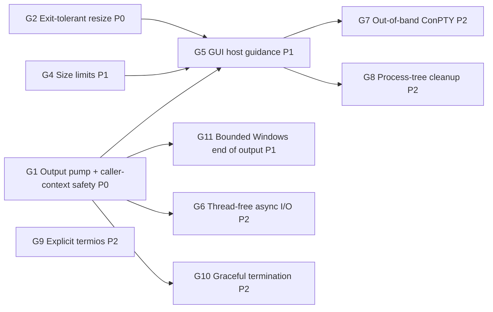

# GUI Host Readiness Plan (Desktop Terminal Embedding)

Goal: make MiniPty a dependable PTY backend for a terminal control embedded in a desktop GUI application. WinUI is the first target. WPF, WinForms, and Avalonia hosts share the same constraints. The terminal must not freeze the UI, must not starve the thread pool as tabs are added, and must not throw on ordinary GUI lifecycle events. VT fidelity must also be good enough for a terminal emulator.

**Status:** G2 implemented (2026-10-15). G1 design agreed; delivery steps 1 (caller-context test harness), 2 (exit watcher, exit task, EOF staging timer), 3 (output pump and consumer views), 4 (input path), and 4b (Windows non-blocking input, F11) are done. F12 is tracked as G11. The other items are proposed.

## Background

An embedder who was building a WinUI terminal control could not integrate MiniPty. The investigation reproduced the failure modes listed below.

All measurements were taken on Windows 11 build 26200 with 32 logical CPUs, the in-box ConPTY, and a Release build. Two terms are used throughout:

- **UI thread**: a single-threaded `SynchronizationContext` message loop that stands in for a `DispatcherQueue`.
- **Frozen**: a callback posted to that context did not run within the timeout (1.5–3 s).

## Findings

| ID | Scenario | Observed |
|---|---|---|
| F1 | `await foreach (var chunk in session.ReadOutputAsync())` started on the UI thread | No chunk is ever delivered and the UI is frozen (deadlock) |
| F2 | `await session.Output.ReadAsync(buffer)` loop on the UI thread | Startup output (204 B) arrives, then the UI is frozen while the shell is idle |
| F3 | Output pumped on the thread pool, `await session.WaitForExitAsync()` on the UI thread | UI frozen until the shell exits |
| F4 | `await session.CompleteAsync()` on the UI thread for a ~3 s command | UI frozen until the child exits |
| F5 | `PtyTerminal.Start` from the UI thread (its pump uses `Task.Run`) | UI stays responsive; first output after 39 ms |
| F6 | `PtyTerminal.Resize` after the child exited (a size change before tab teardown) | Throws `InvalidOperationException`: "Cannot resize after the pseudo-console has been closed." |
| F7 | `Resize(new PtySize(600, 200))` | Silently clamped to 512×200, so the frontend grid and the PTY disagree |
| F8 | N idle `PtyTerminal` instances, then a burst of 64 × 20 ms `Task.Run` items | N=0: 60 ms, N=4: 91 ms, N=8: 121 ms, **N=16: 1996 ms**. Minimum worker threads is 32, and 16 sessions × 2 parked threads = 32 |
| F9 | A 304 KB paste through `WriteInputAsync` (bytes and string overloads) from the UI thread, with output undrained and the child idle | UI stays responsive because ConPTY buffers the input. This holds only while ConPTY can still write its own output (see F11) |
| F10 | VT sequences written by a child through the in-box ConPTY | See the table below |
| F11 | `WriteInputAsync` while the child keeps writing output and nobody reads it (the ring, then the output pipe, are full) | ConPTY stops reading input after about 4 KiB. Writes of 1 and 4 KiB completed in 1 ms; 16 and 64 KiB blocked the caller for more than 5 s and completed 27–87 ms after output reading resumed; 2 MiB blocked for more than 15 s. With the same undrained output but an idle child, 225 KB took 311 ms. When the output loop runs on the writing thread, as with `await foreach` on a UI thread, this is a deadlock |
| F12 | Sessions started while the host runs `Process.Start` with redirected stdio on other threads (48 at a time, each child alive about 1 s or about 3 s) | End of output waits for the unrelated children. Time to the end of `ReadOutputAsync` for `cmd /c echo hi`: p50 139 ms alone, 1052 ms with 1 s children, 3061 ms with 3 s children (27/30 and 30/30 sessions over 600 ms). Making MiniPty's own pipe handles non-inheritable changed nothing (1083 / 3069 ms). `ClosePseudoConsole` returned within 2 ms in every run |

VT sequences written by the child through the in-box ConPTY (F10):

| Forwarded to the terminal side | Not forwarded verbatim |
|---|---|
| OSC 0 title, OSC 8 hyperlink (re-encoded with `id=`), OSC 52 clipboard, OSC 133 shell integration, OSC 9;4 progress | OSC 11 color query |
| DEC modes 1049 (alternate screen), 2004 (bracketed paste), 2026 (synchronized output) | DECRQSS, XTGETTCAP |
| `CSI > 1 u` keyboard-protocol push, truecolor SGR, underline-style SGR `4:3` | Kitty graphics APC, Sixel DCS |
| | Mouse tracking 1000/1003/1006, DECCKM. These are consumed by conhost itself |

Some forwarded sequences also arrived **earlier than the text the child wrote before them**. conhost re-renders the screen and flushes these sequences on its own schedule, so a mark such as OSC 133 can end up before the prompt text it belongs to.

## Root Causes

1. **`await Task.Yield()` is used as a "move to background" primitive.** When a `SynchronizationContext` is current, `Task.Yield` posts to it, so the continuation runs on the UI thread. That continuation does blocking work: transport reads, `Monitor.Wait` handoff waits, or exit polling. The call sites are [PtySession.cs:407](../../../src/MiniPty/PtySession.cs), `:413`, `:637`, and `:740`; [PtyStreams.cs:97](../../../src/MiniPty/Internal/PtyStreams.cs) and `:373`; and [UnixPtyBackend.cs:317](../../../src/MiniPty/Internal/UnixPtyBackend.cs). This causes F1–F4.
2. **Async APIs contain synchronous blocking fast paths.**
   - After the first call, `Output.ReadAsync` reads synchronously on the caller's thread ([PtyStreams.cs:80](../../../src/MiniPty/Internal/PtyStreams.cs), `:356`).
   - On both backends, `WaitForExitAsync` is a synchronous polling loop that returns an already-completed task ([WindowsPtyBackend.cs:413](../../../src/MiniPty/Internal/WindowsPtyBackend.cs)). This causes F2–F4.
3. **Every live session parks two thread-pool workers for its whole lifetime.**
   - The first is the strict-handoff producer, which blocks in the transport read and in `Monitor.Wait`.
   - The second is the exit observer: `WaitForSingleObject` with a 100 ms timeout on Windows, and 10 ms `waitpid` polling on Unix.
   - Each concurrent `WaitForExitAsync` parks one more worker.
   - The minimum pool size equals the processor count, so a few tabs on a laptop exhaust it. Every unrelated continuation in the host then waits for thread injection. This causes F8.
4. **`Resize` treats "transport closed after child exit" as a caller error** ([WindowsPtyBackend.cs:326](../../../src/MiniPty/Internal/WindowsPtyBackend.cs), [UnixPtyBackend.cs:201](../../../src/MiniPty/Internal/UnixPtyBackend.cs)). GUI size events arrive asynchronously with respect to child exit, so a terminal cannot avoid this race. This causes F6.
5. **The 512-cell clamp is below the platform limits** ([PtyStartInfo.cs:66](../../../src/MiniPty/PtyStartInfo.cs), [WindowsPtyBackend.cs:329](../../../src/MiniPty/Internal/WindowsPtyBackend.cs), [UnixPtyBackend.cs:204](../../../src/MiniPty/Internal/UnixPtyBackend.cs)). ConPTY takes a signed 16-bit `COORD`, and Unix `winsize` is unsigned 16-bit. This causes F7.
6. **The in-box ConPTY is the only Windows backend.** Its VT behavior is whatever conhost the user's Windows build ships, and it renders child output instead of relaying it. This causes F10.
7. **Windows input writes are synchronous, and ConPTY stops reading input while its own output is blocked.** Once the ring is full, the pump stops reading. conhost then blocks on the output pipe and stops draining the input pipe, which holds about 4 KiB, so a synchronous `WriteFile` blocks its caller until somebody reads output. This causes F11.
8. **End of output on Windows waits for the output pipe to break, and an unrelated process can hold it open.** A process the host spawns with handle inheritance while a pseudoconsole is being created (`Process.Start` always inherits) keeps a write handle to that session's output pipe. MiniPty's own handles are ruled out (F12), which points at handles that the in-box `CreatePseudoConsole` makes inheritable while it starts its host process. Closing the pseudoconsole then ends output only when that process exits. This causes F12.

Causes 1–3 share one structure:

- **Three independent transport read paths:** the `ReadOutputAsync` producer, raw `Output` stream reads, and the one-shot pumps of `CompleteAsync` and Capture.
- **Two polling drain paths:** the output buffer's exit observer and `PtyOutputDrain`.
- **A shared assumption:** each path blocks on whatever thread it was handed, and that thread is selected by `Task.Yield`.
- **EOF staging rides on the exit-polling loops** (`PromoteEofIfPending`, `SendEotIfPending`), so `SendEof` only makes progress while somebody is waiting for exit.

## Priority Legend

| Priority | Meaning |
|---|---|
| **P0** | Blocks GUI embedding, or crashes or freezes a correctly written host |
| **P1** | Required for a multi-tab terminal application of production quality |
| **P2** | Scale, fidelity, or robustness improvements; implement after P0/P1 or when a concrete embedder asks |

## Gap Inventory

| ID | Priority | Gap | Resolution |
|---|---|---|---|
| G1 | **P0** | Async APIs block or deadlock when awaited on a UI `SynchronizationContext` (F1–F4, F11) | [Session-owned output pump and caller-context-safe API](#g1-caller-context-safety-p0). This also delivers G3 and non-blocking input |
| G2 | **P0** | `Resize` after child exit throws (F6) | [Exit-tolerant resize](#g2-exit-tolerant-resize-p0) |
| G3 | **P1** | Idle sessions park thread-pool workers (F8) | [Merged into G1](#g3-thread-pool-independence-merged-into-g1) |
| G4 | **P1** | Terminal size clamped to 512 (F7) | [Platform size limits](#g4-platform-size-limits-p1) |
| G5 | **P1** | No guidance for GUI hosts; README patterns are unsafe on a UI thread | [GUI host guidance](#g5-gui-host-guidance-p1) |
| G6 | **P2** | After G1, each session still holds one dedicated reader thread, and a pending read cannot be canceled at the OS level | [Thread-free async I/O](#g6-thread-free-async-io-p2) |
| G7 | **P2** | Windows is limited to the in-box ConPTY (F10); `PtyTerminal.Clear()` is a no-op | [Opt-in out-of-band ConPTY](#g7-opt-in-out-of-band-conpty-p2) |
| G8 | **P2** | No process-tree cleanup on Windows | [Opt-in job object](#g8-opt-in-process-tree-cleanup-p2) |
| G9 | **P2** | Unix termios relies on kernel defaults; `IUTF8` is missing | [Explicit termios](#g9-explicit-unix-termios-p2) |
| G11 | **P1** | On Windows, end of output can wait for an unrelated process the host spawned (F12) | [Bounded end of output after close](#g11-bounded-end-of-output-on-windows-p1) |
| G10 | **P2** | Unix `Dispose` kills with `SIGKILL` immediately | [Graceful Unix termination](#g10-graceful-unix-termination-on-dispose-p2) |

---

## G1: Caller-context safety (P0)

### Why P0

GUI frameworks run user code on a thread that owns a `SynchronizationContext`. The natural first integration attempt is to call `ReadOutputAsync`, `Output.ReadAsync`, `WaitForExitAsync`, or `CompleteAsync` from a page or control event handler. Today that freezes or deadlocks the application (F1–F4).

The existing tests run without a `SynchronizationContext`, where `Task.Yield` happens to resume on the thread pool, so none of them can observe the problem.

### Scope

G1 covers three things that come from the same structure (see Root Causes):

- caller-context safety (F1–F4);
- thread-pool independence (G3, F8);
- non-blocking input writes.

Fixing only the `Task.Yield` sites would remove the freezes, but it would keep a thread-pool hop per read, keep pool starvation, and keep the duplicated read and drain paths. G2 is independent and small, and may ship in the same phase.

### Contract

- **No blocking on the caller:** no public async API performs a blocking OS wait or blocking transport I/O on the calling thread or on the caller's captured context.
- **No library code on the caller's context:** library code never runs on the caller's `SynchronizationContext`.
- **Standard await semantics for the caller's own continuations:** they resume on the captured context unless `ConfigureAwait(false)` is used.
- **Synchronous members keep their contract:** members that block by contract (`Stream.Read`, `Stream.Write`) still block.

### Architecture decisions

1. **Output pump, one per session, started by `Pty.Start`.**
   - The pump is the only code that reads the transport.
   - It reads into a bounded ring of fixed-size slots taken from the shared array pool. Each transport read fills one slot, and data that is immediately available may be appended to the same slot.
   - Read-completion timestamps travel with each read to one-shot sinks (step 3). Ring slots do not store one: only Capture needs it, and Capture receives every read directly on the reader thread.
   - When every slot is full, the pump stops reading, and backpressure flows through the OS pipe to the child as it does today.
   - **Phase 1 driver:** a dedicated background thread per reading session, never a thread-pool worker. Step 3 takes it from a process-wide pool of reader threads that park and serve later sessions, because a thread per spawn allocated about 4.9 KB once pooled buffers were returned on it.
     - Windows uses synchronous `ReadFile`. Shutdown relies on closing the pseudoconsole's write side, which makes the read return.
     - Unix waits on the master and a wake descriptor together before each read. On Linux, closing an fd does not interrupt a `read` blocked on it in another thread (see close(2)), so the wake descriptor is the reliable way to stop the reader. Step 3 keeps the master in blocking mode instead of the planned non-blocking mode, because input writes share the descriptor and step 4 owns the input path.
   - **Phase 2 driver:** G6 replaces the thread with thread-free async I/O. The public API does not change.
2. **Exit watcher.**
   - Windows uses process-wide watcher threads, each waiting on up to 63 duplicated process handles with `WaitForMultipleObjects`. A runtime registered wait was the original plan; step 2 replaced it because it allocates about 270 bytes per session.
   - Unix uses one process-wide watcher thread: pidfd on Linux 5.3+, `kqueue` `EVFILT_PROC` on macOS and FreeBSD, and consolidated `waitpid` polling on the same thread where neither is available.
   - The watcher is the only code that reaps children.
   - Exit is recorded once per session. Public waits get a `Task<PtyExitStatus>` created on first use, whose continuations run asynchronously; library-internal waits use an allocation-free waiter slot; the session's output drain is notified through an allocation-free listener.
3. **Timers instead of wait loops.**
   - EOF staging (Windows Ctrl+Z / CR and deferred input-pipe close, Unix EOT deferral) runs on one lazily created timer per session (step 2).
   - Post-exit quiet drain runs on one process-wide timer that ticks only while some session is between exit and end of output (step 3). ConPTY does not report EOF until the pseudoconsole is closed, and on Linux a grandchild can keep the slave open (macOS revokes the tty when the session leader exits). A shared timer replaced the planned per-session one because the drain needs no per-session state beyond what the pump already holds.
   - The existing heuristic values do not change: 100 ms quiet, `OutputDrainGrace`, and the deferral counts. Only the mechanism that drives them changes.
   - EOF staging no longer depends on somebody awaiting exit.
4. **Single consumer.**
   - `ReadOutputAsync`, the `Output` stream, `CompleteAsync`, `PtyCapture.RunAsync`, and `PtyTerminal` are all consumers of the pump. `ReadOutputAsync` and `Output` drain the ring on their own thread; `CompleteAsync` and Capture attach a sink that the pump writes into on the reader thread (step 3), so a one-shot run needs no consumer thread and cannot fill the ring while it waits for exit.
   - The existing one-active-consumer rule stays.
   - Removed:
     - the direct transport read paths;
     - the polling drain helpers;
     - the exit-observer loop inside the output buffer;
     - the raw-read gating;
     - the macOS-only pump scheduling.
5. **Input.**
   - A write completes synchronously when the transport accepts the bytes.
   - When the write would block, for example when a Unix tty input queue is full because the child is not reading, the remainder goes to a background writer that preserves order. Step 4 makes the session's reader thread that writer: it already waits on the master, so it adds write readiness to the same wait while input is queued. No thread or pool worker is added, and `Dispose` fails queued writes on its own thread. A queued write completes when written, which gives the caller backpressure and errors.
   - On Windows, ConPTY accepts input promptly while it can write its output (F9), but stops reading input while its output is blocked (F11). Step 4 kept writes synchronous because the anonymous input pipe cannot be waited on. Step 4b makes MiniPty's end of the input pipe overlapped: a write still completes synchronously when the pipe takes the bytes, and otherwise the rest is written in order by I/O completions, with no thread waiting. ConPTY's end of the pipe stays synchronous, and the output side is unchanged until G6.

### Public API decisions

| Member | Decision | Why |
|---|---|---|
| `ReadOutputAsync` | Shape unchanged. Completes synchronously when a chunk is ready, and resumes on the caller's context only when it has to wait. Chunk memory stays valid until the next `MoveNextAsync`. The enumerator is reused per session | Zero allocation per `MoveNextAsync`. The simplest GUI pattern, `await foreach` on the UI thread, also becomes the fastest: chunks are processed in place on the UI thread with no copy and no marshaling |
| `Output` (Stream) | Kept as a view over the pump, with one copy into the caller's buffer. `ReadAsync` never blocks; `Read` blocks, per the Stream contract | Interop: `CopyToAsync`, readers, adapters |
| `WaitForExitAsync` | **Breaking:** returns `Task<PtyExitStatus>`; `WaitForExitStatusAsync` is removed. Returns the cached exit task when the token cannot be canceled | One exit API, and zero allocation for the common call |
| `HasExited` / `ExitCode` / `ExitStatus` | Read the watcher's cached state, with no OS call | No reaping race, and polling from UI code is cheap |
| `WriteInputAsync` / `Input` | Non-blocking fast path with an ordered background slow path. `Input.WriteAsync` goes through the same path | Today `Input.WriteAsync` falls through to the base `Stream` implementation and allocates a pool task per call. Input writes can block the caller: on Unix when the tty input queue is full, on Windows while ConPTY's output is blocked (F11) |
| `CompleteAsync` | Shape unchanged; implemented as a pump consumer plus the exit task | Never blocks the caller |
| `Dispose` | **Behavior change:** does not block. It kills the child, signals the pump to stop, and returns; pooled slots go back to the pool when the pump stops, so chunk memory is invalid after `Dispose`. `DisposeAsync` awaits pump shutdown and is the deterministic option. Disposing before exit still faults pending `WaitForExitAsync` calls with `ObjectDisposedException` | Closing a tab must not freeze the UI |
| `PtyOutputChunk` | Unchanged. Read timestamps stay internal, for Capture | Avoids growing the public surface |

### Specification changes implied

- **Managed buffering bound:** from "one in-flight chunk" to "slot count × slot size", in [core_session.md](../specs/core_session.md) (`ReadOutputAsync`) and [terminal.md](../specs/terminal.md) (`Pause`). Done in step 3.
- **Output is read from spawn:** output is read into the bounded ring before any consumer attaches. Early output is never stranded, and a child no longer stalls on its first writes while nobody is reading. Done in step 3.
- **Exit API merged:** as described in the table above. Step 5.
- **Dispose versus DisposeAsync:** the new semantics above. Done in step 3.
- **Capture timestamps:** they become pump read-completion times, which are closer to the transport than consumer receipt times. Done in step 3.
- **Exit waits no longer close the transport** (step 3): the post-exit drain closes it for every consumer after output has gone quiet, in [lifecycle.md](../specs/lifecycle.md).

### Rejected alternatives

| Alternative | Why rejected |
|---|---|
| Replace `Task.Yield` with a context-ignoring thread-pool switch only | Smallest diff and fixes F1–F4, but every `Output.ReadAsync` still hops to the pool and allocates, pool starvation (F8) remains, and three read paths plus two drain paths remain. Acceptable only as a stopgap |
| Expose `System.IO.Pipelines` `PipeReader` as the output API | Ships with the shared framework, so it adds no dependency, and it batches naturally. But `ReadOnlySequence` and `AdvanceTo(consumed, examined)` are easy to misuse and contradict the "immediately intuitive API" principle. Awaiting `FlushAsync` from a dedicated reader thread also allocates. A fixed-slot ring is simpler internally |
| Make `PtyTerminal` (push) the recommended GUI pattern | Handlers run off the UI thread, so each chunk needs either a copy or a completion handshake with the UI before the handler returns |
| Start Windows on overlapped I/O immediately | Zero-allocation, cancelable reads are available, but this would rebuild the ConPTY coalescing behavior (`PIPE_NOWAIT`, micro-window) at the same time as the API restructuring. Deferred to G6 so each change can be measured separately. Step 4b makes only the input pipe overlapped (F11); input has no coalescing to rebuild |
| Windows input: non-blocking (`PIPE_NOWAIT`) writes with a retry | Nothing signals when ConPTY reads input again, so the retry would poll |
| Windows input: a writer thread | A thread per session costs what the pump avoids, and a shared writer is stalled by any one session whose ConPTY stopped reading |
| Start the pump lazily on the first consumer (current behavior) | Leaves a window where early output stalls the child and fast children race the reader's start, which is the reason for today's macOS-only scheduling. The cost of eager start, one thread plus pooled slots for sessions that are never read, is acceptable |

### Delivery steps

Run the narrowest relevant tests after each step, so a hang can be attributed to that step.

1. **Test harness first:** add a single-threaded `SynchronizationContext` helper. Write tests for F1–F4, `Output.ReadAsync`, `WriteInputAsync` against a full Unix input queue, and `Dispose` on the UI thread, and confirm they fail before any implementation changes.
2. **Exit watcher, exit task, and session timer:** move EOF staging off the wait loops.
3. **Output pump and consumer views:** migrate `ReadOutputAsync`, `Output`, `CompleteAsync`, Capture, and `PtyTerminal`, then delete the old paths. Remove the `Skip` from `ReadOutputAsyncOnUiThreadDeliversOutputWithoutBlockingIt`, `OutputReadAsyncOnUiThreadDoesNotBlockItWhileIdle`, and `IdleSessionsDoNotOccupyThreadPoolWorkers`.
4. **Input path.** Remove the `Skip` from `WriteInputAsyncTextOnUiThreadDoesNotBlockItWhenTheChildIsNotReading`.
   - **4b. Windows input path (F11).** Add tests that fail first: a write on the UI thread while the child floods output that nobody reads, and queued Windows input delivered with EOF after it. Then make the input pipe overlapped.
5. **Public API break:** `WaitForExitAsync` returns `PtyExitStatus`. Update samples, specifications, the README, and benchmarks.

Tests that a later step fixes stay in the suite but are skipped until that step, so every pull request merges with a passing CI. Each skip reason names the step that removes it.

### Step 1 result: caller-context tests

`SingleThreadSynchronizationContext` (test helper) stands in for a GUI dispatcher. `PtyCallerContextTests` drives the API from it.

| Test | Finding | Previous code |
|---|---|---|
| `ReadOutputAsyncOnUiThreadDeliversOutputWithoutBlockingIt` | F1 | Fails on Windows and Linux: no chunk arrives |
| `OutputReadAsyncOnUiThreadDoesNotBlockItWhileIdle` | F2 | Fails: the UI thread is busy for the whole window |
| `WaitForExitAsyncOnUiThreadDoesNotBlockIt` | F3 | Fails |
| `CompleteAsyncOnUiThreadDoesNotBlockIt` | F4 | Fails |
| `PtyCaptureRunAsyncOnUiThreadDoesNotBlockIt` | F4 via Capture | Fails |
| `WriteInputAsyncTextOnUiThreadDoesNotBlockItWhenTheChildIsNotReading` | Non-blocking input | Fails on Linux; returns early on Windows (F9) |
| `WriteInputAsyncBytesOnUiThreadDoesNotBlockItWhenTheChildIsNotReading` | Guard | Passes, because the base `Stream.WriteAsync` offloads the write today |
| `DisposeOnUiThreadReturnsPromptly`, `DisposeAsyncOnUiThreadDoesNotBlockIt` | Guards | Pass |
| `PtyTerminalOnUiThreadDeliversOutputWithoutBlockingIt` | Guard (F5) | Passes |
| `IdleSessionsDoNotOccupyThreadPoolWorkers` | F8 | Fails: 4 idle sessions occupy exactly 8 workers on both platforms |

Lessons from building the harness:

- **A single probe is not enough.** The previous Unix exit wait blocks for 100 ms and then calls `Task.Yield`, which lets a probe slip through between slices, so the UI thread looks responsive while it is blocked about 100% of the time. The harness therefore also measures the time the UI thread spends inside callbacks during a 500 ms idle window. A free thread is busy for well under 1 ms; a blocked one is busy for the whole window.
- **Measure pool occupancy directly.** Occupied workers, computed as `GetMaxThreads` minus `GetAvailableThreads`, give a deterministic F8 signal (2 per session), where burst latency does not. The test runs `[NotInParallel]`.
- **Until G1 fixes F8, run the guards on their own.** The failing tests occupy pool workers in the test process itself. On an 8-core Linux machine (minimum 8 workers), that starves the timing-sensitive guards in a full parallel run, and they time out. Run `PtyCallerContextTests` by itself to check the guards until the occupancy is gone. On the 32-core Windows machine the full run shows only the expected failures.
- **A blocked Unix input write can outlive cleanup.** A write blocked on a full tty input queue stays blocked through cleanup when the pool is starved. The background writer in step 4 must be stoppable by `Dispose` without depending on pool threads (resolved in step 4: the reader thread writes, and `Dispose` fails queued writes itself).

### Step 2 result: exit watcher, exit task, EOF staging timer

What changed:

- **Exit observation:** process-wide watchers replace every exit poll loop (see [Child exit observation](../references/pty_crossplatform.md#child-exit-observation)).
- **Waits:** `WaitForExitAsync`, `WaitForExitStatusAsync`, and `CompleteAsync` await the recorded exit and never poll or block.
- **EOF staging:** a per-session 100 ms timer advances it, with the same tick counts as before. `SendEof` no longer depends on somebody awaiting exit.
- **Unix `Dispose`:** kills without the caller-thread reap wait, and the watcher always reaps.
- **Output drain:** `ReadOutputAsync`'s post-exit drain is queued by the exit listener instead of a polling task.

Results:

| Test | Windows | Linux |
|---|---|---|
| F3 `WaitForExitAsync`, F4 `CompleteAsync`, F4 Capture | Pass | Pass |
| F8 occupied workers | 8 → 4 (producers only; step 3) | 8 → 4 |
| F1, F2, Unix text input | Still fail (steps 3–4) | Still fail |
| Existing suite | All pass, 3 runs | All pass, 3 runs |

On Linux, exit is reported 2 ms after it happens through pidfd. The previous polling took 10–100 ms. A process with three sessions has one watcher thread and no zombies after `Dispose`. NativeAOT publish and run were verified on Windows and on Linux (project reference, shared native library).

Allocation (Windows, KB per operation, in the repository checkout; HEAD maximum of four runs against this step's three runs):

| Benchmark | HEAD | Step 2 |
|---|---|---|
| `Session_Exit0_Bytes` | 3.75 | 2.68 |
| `Session_32KiB_Bytes` | 41.97 | 39.25–39.58 |
| `Session_32KiB_StreamBytes` | 6.50 | 4.19–4.30 |
| `Session_32KiB_OutputStreamBytes` | 4.13 | 2.00 |
| `Capture_32KiB_Text` | 126.87 | 124.14–124.48 |

About 1.1 KB of each improvement comes from the Windows command-line builder: it now measures and writes one exact-size buffer instead of building a string, a NUL-terminated copy, and a char array. The exit work alone saved about 170 B on the one-shot paths, but added about 85 B to `OutputStreamBytes`, because the exit state lives in every backend object. The command-line change more than offsets that, and `WindowsCommandLineTests` checks it against the previous quoting with 2000 random inputs.

Lessons:

- **Kill-on-cancellation cannot ride on a token registration next to `WaitAsync(token)`.** Callbacks run in reverse registration order, so the waiter resumed and unregistered the kill before it ran (`PtyCancellationKill` caught it).
- **A latent deadlock in the output buffer surfaced once exit timing changed.** Completing the consumer's wait under the buffer lock deadlocked against a concurrent cancellation callback (see [core_session.md](../specs/core_session.md) lessons). It hung two stdio bridge tests deterministically on Linux.
- **Stale epoll registrations from forked children closed live descriptors** and hung the Linux suite until registrations became one-shot and explicitly removed.
- **Allocation-neutral exit observation needs care at every layer:**
  - Create the task lazily.
  - Give internal waits a slot, not a task.
  - Avoid async state machines where only one await happens.
  - Never construct an exception that is not thrown (`Dispose` built an `ObjectDisposedException` on every call).
  - Pooled `ValueTask` builders did not help: boxes returned on another thread were often not reused.
- **The caller-context probe must not depend on the thread pool.** Its latency is now timestamped on the UI thread. Tests whose operation spawns a child on the UI thread start measuring after the spawn, which is inherent and can exceed 100 ms under load.

### Step 3 result: output pump and consumer views

What changed:

- **Reader:** each session's output is read from spawn by one pump on a dedicated reader thread, into a ring of 4 × 4 KiB slots. Reader threads come from a process-wide pool: a thread parks when its session's output ends and serves the next session (see [Output pump](../references/pty_crossplatform.md#output-pump)).
- **Ring consumers:** `ReadOutputAsync` uses one enumerator per session that hands out slots in place and allocates nothing per `MoveNextAsync`. `Output` is a stream view whose `ReadAsync` never blocks.
- **Sink consumers:** `CompleteAsync` and Capture attach a sink that the pump writes into on the reader thread. Capture chunk times are read-completion times.
- **Post-exit drain:** one process-wide timer closes the transport after 100 ms of quiet. Exit waits no longer close it.
- **Disposal:** `Dispose` does not block. `DisposeAsync` completes when the reader has stopped.
- **Unix master:** reference-counted, with each reader stopped through its own wake descriptor (`eventfd` on Linux, a pipe elsewhere, `select` on macOS).
- **Removed:**
  - the transport read streams and raw-read gating;
  - the output buffer and its drain work item;
  - the transport pump tasks, including the macOS scheduling;
  - the polling drain helpers;
  - the `FIONREAD` and `minipty_try_read` natives;
  - `CloseTransportAfterExit`;
  - `PtyTransportPumpBenchmarks`.

Results:

| Test | Windows | Linux |
|---|---|---|
| F1 `ReadOutputAsync` on the UI thread | Pass | Pass |
| F2 `Output.ReadAsync` on the UI thread | Pass | Pass |
| F8 occupied workers, 4 idle sessions | Pass (≤ 2; was 4 after step 2) | Pass |
| Full suite (3 new tests: output kept for a late reader, `CompleteAsync` after output ended, blocking `Output.Read`) | 197 pass, 1 skipped (step 4), 3 runs | 197 pass, 1 skipped, 3 runs |

NativeAOT publish and run were verified on Windows and Linux with the `Session` and `Interactive` samples, with no trim or AOT warnings. On Linux the static archive under the ignored `runtimes/` folder must be rebuilt with `scripts/build-native.sh` first; the stale local copy lacked the new natives.

Allocation (Windows, KB per operation, in the repository checkout; HEAD minimum against this step's final three runs, which had no outliers):

| Benchmark | HEAD | Step 3 |
|---|---|---|
| `Session_Exit0_Bytes` | 2.68 | 1.98 |
| `Session_Echo_Bytes` | 2.72 | 2.03–2.04 |
| `Capture_Echo_Bytes` | 3.89 | 3.21–3.22 |
| `Session_32KiB_Bytes` | 39.25 | 38.51 |
| `Capture_32KiB_Bytes` | 45.29 | 39.92–39.93 |
| `Session_32KiB_StreamBytes` | 4.24 | 1.70 |
| `Session_32KiB_OutputStreamBytes` | 2.00 | 1.80 |
| `Session_Echo_Text` | 3.04 | 2.35–2.36 |
| `Capture_Echo_Text` | 5.36 | 4.68 |
| `Capture_32KiB_Text` | 124.14 | 114.10–114.12 |
| `Capture_32KiB_DisplayPlain` | 189.67 | 179.64 |

Notes on the numbers:

- `Session_32KiB_OutputStreamBytes` now only reads `Output` to the end. Before, it had to wait for exit and run the drain helper itself, because ConPTY output never ended on its own.
- Its time rose from 94 ms to about 185–245 ms. Exit no longer closes the pseudo-console, so output ends after the 100 ms quiet period, as `ReadOutputAsync` always did (`Session_32KiB_StreamBytes`, about 188–223 ms). The one-shot benchmarks got slightly faster (for example `Capture_32KiB_Bytes` 202 → 187 ms).
- Capture allocates about 5–10 KB less because coalescing now applies to it, which gives fewer chunks and less chunk metadata.

Lessons:

- **Reuse reader threads.** A bare thread start allocates 137 B. One pooled-array return on a fresh thread raises that to about 4.9 KB, because the array pool allocates a per-thread cache and strands the returned array in it when the thread exits.
- **Keep each pooled buffer's rent and return on one thread.** An array returned on another thread stays in that thread's pool cache, and the next rent elsewhere allocates. Two places did this. Signaling end of output before dropping the pump's ring reference intermittently left the final ring release to the reader thread (the streaming benchmark averaged 7.2 KB instead of 1.7 KB in one run). Detaching a one-shot result on the thread that resumed the caller stranded grown buffers in a worker's cache (intermittent 7 KB and 119 KB averages on the one-shot benchmarks; HEAD showed the same kind of spike). The pump now releases the ring and parks its thread before completion is visible, and a sink finishes its result on the reader thread.
- **Stamp quiet detection per read, not per slot.** Stamping the last read after the coalescing micro-window let its empty tail postpone the post-exit close by up to a clock tick. Capture runs were about 10 ms slower until the stamp moved to each read that returned bytes.
- **One-shot consumers belong on the reader thread.** A bounded ring drained by a consumer that only starts after exit would block a bulk-output child before it can exit. Writing into a sink on the reader thread also removed the pump task, the drain polling, and the timeout tasks.
- **A one-time timeout needs a re-check after arming.** Review found that the drain close timeout, which fires once, could land between the sink's state check and its arming the wait, leaving no wait to signal and the scheduler done with the pump: `CompleteAsync` would have hung instead of throwing. The sink now re-checks after arming, with full fences on both sides. Review also found a full ring spinning against a closed Unix master; that state now ends output. Neither had a failing test.
- **macOS was not run locally.** The macOS-only native paths (the `select` wait and the pipe wake descriptor) were neither compiled nor exercised here; FreeBSD shares the pipe path. CI on macOS is the first real check.

### Step 4 result: input path

What changed:

- **Unix:** the master is non-blocking. A write takes what the tty input queue accepts on the calling thread, and the rest is queued in issue order. The session's reader thread writes the queue: while input is queued it waits for the master to be writable along with readable, including while parked on a full ring. A queued write completes when written. `Dispose` fails queued writes with `ObjectDisposedException` on the disposing thread, end of output fails them with `IOException`, and cancellation discards the bytes not yet written. Staged EOT waits until nothing is queued.
- **Windows:** writes stay synchronous; ConPTY takes input promptly (F9), and the anonymous pipe cannot be waited on. F11 later showed that this holds only while ConPTY's output is drained; step 4b revisits it.
- **Both:** `WriteInputAsync` (both overloads), `Input.WriteAsync`, and the APM pair go through the backend directly; Stream's async-over-sync default is gone. One `PtyInputStream` replaces the per-platform write-stream wrappers.

Results:

| Test | Windows | Linux |
|---|---|---|
| `WriteInputAsyncTextOnUiThreadDoesNotBlockItWhenTheChildIsNotReading` | Pass (returns early, F9) | Pass; the skip is removed |
| New `PtyInputTests`: synchronous small writes; 140 KB queued while the child sleeps, delivered in order with EOF after it (and a blocking `Input.Write` waiting its turn); canceling and disposing a queued write | Pass (Unix cases return early) | Pass |
| Full suite | 216 pass, no skips, 3 runs | 216 pass, no skips, 3 runs |

Allocation and time (Windows, new `PtyInputBenchmarks`: one 64-byte line into a live session whose child reads and discards it):

| Benchmark | Before | After |
|---|---|---|
| `WriteInputBytes` | 111.6 µs, 248 B | 89.9 µs, 0 B |
| `WriteInputText` | 105.1 µs, 0 B | 88.8 µs, 0 B |
| `InputStreamWriteAsync` | 107.6 µs, 112 B | 90.9 µs, 0 B |

Every `PtyIntegrationBenchmarks` scenario allocates about 0.1 KB less, because one input stream object replaced two; times did not change. NativeAOT publish and run were verified on Windows and Linux (`Session` and `Interactive` samples).

Lessons:

- **The reader thread is the natural input writer on Unix.** It already waits on the master, so write readiness joins the same wait. A separate writer would cost a thread per session or a pool worker, and step 1 showed that a pool worker blocked on a full tty can outlive cleanup.
- **EOF is ordered input too.** Staged EOT must not overtake input still queued for a child that is not reading. The ordering test writes 20,000 numbered lines plus EOF at once and checks that the child saw every line.
- **macOS was not run locally.** Its write wait uses the `select` write set, which only macOS compiles; CI on macOS is the first real check.

### Step 4b result: Windows input path

Why: F11. A Windows write blocks its caller while ConPTY's output is blocked, so a GUI host that pastes while output is flowing and reads output on the same thread deadlocks. G1's contract forbids blocking transport I/O on the caller.

Decision:

- **Transport:** MiniPty's end of the input pipe is the server end of a named pipe, opened overlapped. Anonymous pipes cannot be opened overlapped.
  - ConPTY's end is opened synchronously by name right after creation and is handed to `CreatePseudoConsole` as before.
  - The pipe has a random name, allows one instance, must be the first instance of that name, and rejects remote clients. If anything else connects first, the spawn fails instead of sharing the pipe.
  - The buffer stays 4 KiB, as the anonymous pipe's default was. With a zero buffer every write would wait for ConPTY to read.
- **Writes:** a write completes synchronously when the pipe takes the bytes, which is the usual case and allocates nothing. Otherwise the rest is queued in issue order, and each I/O completion writes the next part, so no thread waits. The queue keeps step 4's semantics:
  - cancellation discards bytes not yet written;
  - `Dispose` fails queued writes with `ObjectDisposedException` on the disposing thread;
  - end of output fails them with `IOException`;
  - staged EOF (Ctrl+Z / CR) waits until nothing is queued.
- **Both pipes are created non-inheritable.** Nothing needs them inheritable, and F12 showed that MiniPty's own handles are not the leak.
- **No cost for sessions that never write.** The queue, the completion-port binding, the reusable overlapped structure, and a 4 KiB native staging buffer are created on the first write. Every write is issued from the staging buffer, because an overlapped write needs its bytes until it completes, which can be after the caller's span is gone.
- **Queued-write entries are reused** on both platforms, through one process-wide spare. An entry returns there only after both the completer and the waiter are done with it.

Results:

| Test | Windows | Linux |
|---|---|---|
| New `WriteInputAsync{Text,Bytes}OnUiThreadDoesNotBlockItWhileOutputIsBackedUp` | Fail before (UI thread busy for the whole 500 ms window); pass | Pass before and after |
| `PtyInputTests`: delivery with EOF after it while output is backed up (new, both platforms); cancel and dispose of a queued write (now both platforms) | Fail before (the write call itself did not return within 5 s); pass | Pass |
| Full suite | 219 pass, 3 runs | 219 pass, 3 runs |

Allocation and time (Windows, against HEAD):

| Benchmark | HEAD | Step 4b |
|---|---|---|
| `WriteInputBytes` | 85.1 µs, 0 B | 86.5 µs, 0 B |
| `WriteInputText` | 85.6 µs, 0 B | 86.0 µs, 0 B |
| `InputStreamWriteAsync` | 87.2 µs, 0 B | 86.7 µs, 0 B |
| `PtyIntegrationBenchmarks`, every scenario | for example `Session_Exit0_Bytes` 1.88–1.89 KB | 0.03–0.04 KB less (1.84–1.85 KB); times unchanged |

The integration benchmarks allocate less because the old pipe setup boxed a security-attributes structure to marshal it. NativeAOT publish and run were verified on Windows and Linux (`Session` and `Interactive` samples), and a NativeAOT probe on Windows completed 312 pending writes in 20,000 through the completion port.

Lessons:

- **The input benchmark saturates the pipe.** It writes faster than ConPTY reads, so exactly one write in 64 (64 × 64 B = the 4 KiB buffer) waits. Before this step, that write blocked the benchmark thread. With the queue, it first allocated an entry (2 B per write on average) until entries were reused. Read a benchmark's per-operation average with its saturation in mind.
- **Every new field on the backend object is paid by every session.** The first version kept the queue and the overlapped state as backend fields, and every integration scenario allocated about 20–30 B more, although none of them writes input. One lazily created object fixed it.
- **A reused `IValueTaskSource` needs both parties to let go.** Resetting an entry as soon as its waiter has read the result races the completer, which may still be signaling that waiter. The entry is recycled only after `Complete` has returned and the waiter has read the result.
- **Pin system tools by full path in tests.** A bare `find` resolved to a Unix `find` earlier on `PATH` and walked the file system instead of counting lines.

### Acceptance

- **Caller context:** F1–F4 tests are green on Windows and Unix. A probe posted to the single-threaded context runs within a short bound while the child is idle, and output and exit are still observed.
- **Thread pool (F8):** with 16 idle sessions, a burst of short pool work completes within 2× of the zero-session baseline, and the pool thread count does not depend on the number of sessions.
- **Exit latency:** exit-to-completion latency is no worse than today's 100 ms / 10 ms polling.
- **Allocation:**
  - No benchmark in [baselines/integration.json](../../../BenchmarkDotNet.Artifacts/baselines/integration.json) exceeds its baseline.
  - Steady state allocates nothing per chunk and nothing per wait.
- **Behavior preserved:** the existing lifecycle behavior holds, covering drain-then-exit, EOF staging, kill-then-drain, and one active consumer.

### Estimate

Large. This restructures both backends and every output consumer.

---

## G2: Exit-tolerant resize (P0)

### Why P0

A terminal resizes on every layout change, and child exit is asynchronous to layout. A shell that exits while its tab is still visible makes the next size change throw (F6). In WinUI an unhandled exception from a size handler terminates the application.

### Decision (implemented)

- **Child exit never makes `Resize` fail.**
  - While the transport is open, the size is applied, even if the child has already exited.
  - Once the transport has been closed after exit, `Resize` is a no-op and `Size` keeps its last applied value.
  - If the OS rejects the call and the child has exited in the meantime, that is also a no-op.
- **What still throws:** `ObjectDisposedException` after `Dispose`, `ArgumentOutOfRangeException` for negative pixel dimensions (validated before the exit state is considered), and OS failures while the child is running.
- **Windows race guard:** a reference on the pseudo-console handle is held for the duration of `ResizePseudoConsole`. A drain close on another thread therefore defers `ClosePseudoConsole` until the call returns, instead of invalidating the handle mid-call.
- **Documentation:** `PtySession.Resize`, `PtyTerminal.Resize`, [core_session.md](../specs/core_session.md), and [terminal.md](../specs/terminal.md) describe the behavior.

### Tests

| Test | State it covers |
|---|---|
| `PtyResizeUpdatesSize`, `PtyResizeAcceptsPixelDimensions` (existing) | Child running |
| `PtyResizeAfterExitWithOpenTransportDoesNotThrow` | Child exited, transport open |
| `PtyResizeAfterTransportClosedIsNoOp` | Child exited, transport closed (F6) |
| `PtyResizeAfterDisposeThrowsObjectDisposed` | Disposed |
| `PtyTerminalResizeAfterCompletionIsNoOp` | Size change after `Completion` (F6) |

The two F6 tests fail on the previous code with `InvalidOperationException`.

### Lessons Learned

- **Define the no-op by transport state, not by `HasExited`.** The planned rule, a no-op as soon as the child had exited, would have broken existing resize tests that use fast-exiting children (`PtyResizeUpdatesSize`, `PtyWindowsSpawnAllowsImmediateResize`). Their resize would race the exit and silently stop applying. Applying the size while the transport is open is harmless on both platforms, and it keeps `Size` deterministic until drain closes the transport.
- **The Unix master fd can still be closed and reused by a concurrent drain during the ioctl.** This race predates this change and is resolved by G1's fd-lifetime design (see G10).

### Estimate

Small.

---

## G3: Thread-pool independence (merged into G1)

Each idle session parks two thread-pool workers. With 16 idle sessions on a 32-thread minimum pool, an unrelated burst of short work took 1996 ms instead of 60 ms (F8). On an 8-core laptop the threshold is four tabs.

The fix uses the same components as G1: the session-owned output pump on a dedicated thread, the exit watcher with no per-session thread, and the session timer in place of polling loops. G3 is therefore delivered by G1, and its acceptance criteria (pool burst latency, and pool thread count independent of session count) are part of G1's acceptance.

---

## G4: Platform size limits (P1)

### Why P1

High-resolution displays with small fonts exceed 512 columns. A silent clamp makes the frontend grid and the PTY disagree, which corrupts line wrapping (F7).

### Decision

- Clamp to the platform limits instead: Windows 1–32767 (signed 16-bit `COORD`), Unix 1–65535 (`winsize`).
- `Size` reports the value actually applied.
- Update the `PtyStartInfo.Size` documentation.

### Acceptance

A test resizes to 600×200 and confirms that both `Size` and the child-visible size report it.

### Estimate

Small.

---

## G5: GUI host guidance (P1)

### Why P1

The README's primary pattern, `ReadOutputAsync` followed by `WaitForExitAsync`, is exactly F1 and F3 when it is placed in an event handler. After G1 the pattern is safe, and on a UI thread it becomes the recommended one. Hosts still need the threading model spelled out.

### Decision

- Add a "GUI hosts" section to the core session specification and a short README note. It covers:
  - the pull pattern on the UI thread (`await foreach` over `ReadOutputAsync`, no copy, no marshaling) as the primary recommendation;
  - `PtyTerminal` for push-style transports, where handlers run on background threads and must marshal to the UI and copy any retained bytes;
  - resize from size-change events, which is safe after G2;
  - exit through `WaitForExitAsync` or `Completion`;
  - `DisposeAsync` on tab close, with `Dispose` as the non-blocking alternative.
- Until G1 ships, the README explicitly warns against awaiting session APIs on a UI thread.

### Acceptance

- Specification and README updated.
- A runnable sample demonstrates the threading model. Its form is an open question (see below).

### Estimate

Small.

---

## G6: Thread-free async I/O (P2)

### Why P2

After G1, an idle session holds one dedicated reader thread, and a pending read is stopped only by closing or waking the transport. A host that keeps dozens of background tabs, or that hands sessions between owners, benefits from reads that hold no thread and can be canceled at the OS level. G1 already fixes every observed failure, so this item is about scale.

### Decision

G6 replaces G1's phase 1 pump driver without changing the public API.

- **Windows:** create MiniPty's own pipe ends overlapped; the ConPTY ends stay synchronous. Complete reads through the I/O completion port and cancel them with `CancelIoEx`. The input end is already overlapped by G1 step 4b, so G6 covers the output end.
- **Unix:** drive every session's non-blocking master from one shared readiness loop (`epoll` / `kqueue`). This is the same loop that G1's exit watcher already runs.
- **Coalescing:** redesign the ConPTY coalescing (`PIPE_NOWAIT`, micro-window) and the Unix continuation reads around completion and readiness notifications.

### Acceptance

- Thread count stays constant with 64 idle sessions.
- No throughput or allocation regression in the benchmarks.

### Estimate

Large.

---

## G7: Opt-in out-of-band ConPTY (P2)

### Why P2

The in-box ConPTY's VT behavior depends on the user's Windows build. On the measured build it withholds query responses (OSC 11, DECRQSS, XTGETTCAP) and graphics protocols from the terminal side. It also reorders forwarded sequences relative to text (F10). It exposes no buffer clear, which is why `PtyTerminal.Clear()` is a no-op ([plan_terminal_parity.md](plan_terminal_parity.md) T7).

A terminal emulator that wants consistent behavior across Windows builds needs Microsoft's out-of-band ConPTY redistributable: `conpty.dll` plus `OpenConsole.exe`.

### Decision

- **Bring your own binaries:** MiniPty ships no binary and takes no dependency, consistent with AGENTS.md and T7. The host application supplies `conpty.dll` and `OpenConsole.exe` and opts in explicitly. The API shape is an open question.
- **Load by absolute path:** never load `conpty.dll` by bare name. A bare-name load can bind an OS copy where one exists, which may be conhost-backed and so defeats the purpose.
- **Detect the missing host:** `conpty.dll` without `OpenConsole.exe` in its per-architecture subdirectory is reported to fall back to conhost silently. MiniPty detects this case and reports it.
- **Diagnostics:** expose which implementation is active, for logging.
- **Startup handshake (to verify during implementation):** the out-of-band host opens with a Primary Device Attributes (DA1) query and waits up to 3 s for a reply.
  - A terminal emulator answers DA1 itself, so MiniPty does nothing by default.
  - An option lets read-only hosts have MiniPty answer.
  - Whoever answers must also hide that first query from the frontend. Otherwise a second answer reaches the child as keyboard input.
- **Clear:** when the out-of-band implementation is active, `PtyTerminal.Clear()` maps to its clear operation. This revisits T7's no-op resolution, and remains compatible with it because nothing is shipped.

### Acceptance

- Rerunning the F10 probe set with the out-of-band implementation shows which sequences are forwarded, recorded in the cross-platform reference.
- A process census shows `OpenConsole.exe` hosting the session.
- The missing-host fallback is reported.
- `Clear()` is effective when the out-of-band implementation is active.

### Estimate

Large, mostly packaging and verification.

---

## G8: Opt-in process-tree cleanup (P2)

### Why P2

When a host crashes or is killed, descendants that detached from the console, or that ignore console close, can outlive the terminal. A Windows job object with kill-on-close removes the whole tree.

### Decision

- **Opt-in, off by default.** A job also terminates GUI applications the user launched from the terminal, which hosts usually do not want.
- **Spawn order:** spawn suspended, assign to the job, then resume. Assigning after the child is already running loses a race against fast-exiting children under load, and then the spawn fails.

### Acceptance

- Enabled: a grandchild is terminated on dispose and on host process exit.
- Disabled: behavior is unchanged.

### Estimate

Small–medium.

---

## G9: Explicit Unix termios (P2)

### Why P2

Linux spawns with the kernel default termios, which lacks `IUTF8`. In canonical mode, erasing a multibyte character such as Japanese input then removes only one byte and leaves invalid UTF-8 in the line.

### Decision

- Set termios explicitly at spawn. This includes `IUTF8`, and pins the output and input flags that are currently implied by kernel defaults (`ONLCR`, `ICRNL`, and so on).
- Apply this consistently to the Linux, macOS, and FreeBSD spawn paths.

### Acceptance

A canonical-mode read of multibyte input followed by an erase yields valid UTF-8.

### Estimate

Small.

---

## G10: Graceful Unix termination on dispose (P2)

### Why P2

Unix `Dispose` used to have several teardown hazards. Most of them are removed by G1:

| Original hazard | Removed by G1 because |
|---|---|
| `Dispose` sleep-polls up to 1 s on the caller's thread to reap ([UnixPtyBackend.cs:339](../../../src/MiniPty/Internal/UnixPtyBackend.cs)) | `Dispose` no longer blocks |
| A child is left as a zombie when that 1 s deadline passes | The exit watcher always reaps |
| A transport close races a `read` blocked in another thread, and EBADF reported as EOF ([PtyStreams.cs:399](../../../src/MiniPty/Internal/PtyStreams.cs)) masks it | The pump stops through its wake descriptor and closes the master only after leaving the read |
| macOS toggles `O_NONBLOCK` on the shared master description ([minipty_unix.c:731](../../../src/MiniPty/Native/minipty_unix.c)), so a concurrent write can fail with `EAGAIN` | The master is permanently non-blocking, and writes handle `EAGAIN` through the slow path |

What remains is the termination policy itself. `Dispose` sends `SIGKILL` immediately, so shells cannot save history or clean up.

### Decision

On `Dispose`, hang up first and escalate to kill after a bounded grace period. Both steps run off the caller's thread.

### Acceptance

- An interactive shell observes the hangup and can exit cleanly.
- A child that ignores hangup is still killed within the bound.
- `Dispose` returns promptly.

### Estimate

Small, after G1.

---

## G11: Bounded end of output on Windows (P1)

### Why P1

Hosts such as IDEs start other processes, for example `git` or language servers, while terminals open. F12 shows two effects:

- `ReadOutputAsync` and `Output` do not end until the unrelated process exits, which for a long-lived language server is never.
- `CompleteAsync` throws `TimeoutException` after `OutputReaderCloseTimeout`, although all output was read.

Nothing freezes, so this is P1 rather than P0.

### Decision (proposed)

- **Do not rely only on the output pipe breaking.** After the pseudoconsole is closed, end output once the pipe has delivered nothing for a quiet interval, and release the reader from its blocking read with `CancelSynchronousIo`. A normal session still ends when the pipe breaks; only a pipe held open waits for the interval.
- **Cancel only this session's read.** Reader threads serve several sessions over their lifetime, so the cancel must target only a read issued for this session.
- **Not fixable at the source.** Making MiniPty's own handles non-inheritable does not help (F12). A library cannot serialize the host's process creation against `CreatePseudoConsole`.

### Open

Whether `ClosePseudoConsole` can return before the host process has written its final frame. That decides how long the quiet interval must be. On build 26200 it returned within 2 ms in every F12 run. See also the `ClosePseudoConsole` open question.

### Acceptance

- With concurrent `Process.Start` children that live several seconds, `ReadOutputAsync` ends within the quiet interval plus a margin after exit, and `CompleteAsync` does not time out.
- No output is lost in the existing drain and capture tests.

### Estimate

Small–medium.

---

## Suggested Implementation Order

| Phase | Items | Outcome |
|---|---|---|
| **Phase A** | G1 (including G3), G2 | A WinUI host can use any MiniPty API from its UI thread without freezes or resize crashes, and idle tabs do not starve the thread pool |
| **Phase B** | G4, G5, G11 | Wide windows work, the threading model is documented with the pull pattern as the GUI recommendation, and Windows output ends even while the host spawns other processes |
| **Phase C** | G6, G9, G10 | Reads hold no thread, and Unix input and teardown are correct |
| **Phase D** | G7, G8 | Optional Windows VT fidelity and process-tree cleanup for hosts that opt in |

## Lessons Learned

- **`Task.Yield` is not a thread-pool switch.** It posts to the current `SynchronizationContext` when one exists. Any library code that yields and then blocks is a UI deadlock waiting for a GUI host.
- **Tests without a `SynchronizationContext` cannot detect caller-context blocking.** The console and test runners resume continuations on the pool. Context-sensitive behavior needs an explicit single-threaded context in tests.
- **`PtyTerminal` avoided F1–F4 only incidentally.** Its pump starts with `Task.Run`, which detaches from the caller's context. The core APIs offered no such protection.
- **The pool starvation threshold is the minimum worker thread count** (the processor count). It is not a large number of sessions, so the problem appears with only a few tabs.
- **Large pastes through `WriteInputAsync` did not block the UI thread on Windows while the child was idle**, even with output undrained (F9). That is not a property of ConPTY: with a child that keeps writing output nobody reads, ConPTY stops reading input after about 4 KiB (F11). Measure input with output both idle and flowing. Unix tty input queues are small and can block a writer.
- **On Windows, a closed pseudoconsole does not guarantee end of output.** An unrelated process the host spawned at the wrong moment can hold the output pipe open (F12).
- **Bound every background load in a measurement.** A first F12 probe started processes in an unbounded loop and accumulated about 16,000 console processes within minutes, because each console child also starts a console host and process creation slows as they pile up. The probe that produced F12 caps concurrency and waits for each child.
- **The in-box ConPTY reorders forwarded sequences relative to text** and consumes several query and graphics sequences. Its behavior must be treated as Windows-build-dependent, and must not be assumed to be a transparent relay.
- **Measure allocation baselines in the same checkout path as the change.** Spawn allocations grow with the length of the executable and working-directory paths. A baseline measured in a worktree under a long temp path came out about 1.5 KB higher and looked like a stale baseline, but it was not one. Async paths also jitter by roughly 50–400 B between runs, and single runs occasionally double, so compare several runs before attributing a delta.

## Open Questions

- **Slot sizing:** the pump's slot count and size. Step 3 ships 4 × 4 KiB: a 32 KiB Windows child arrives in 12–13 chunks and every allocation benchmark improved. Throughput tuning is still open.
- ~~**Coalescing micro-window:** whether the ConPTY 1 ms coalescing micro-window is still needed once reads are pipelined into multiple slots.~~ Resolved: still needed. Without it, 32 KiB from ConPTY arrives in about 124 chunks of at most 1755 B instead of 13 full 4 KiB ones.
- ~~**Windows coalescing budget:** whether ConPTY's unbounded coalescing chain, whose window lasted until the next clock tick, must be bounded like Unix's 2 ms.~~ Resolved: yes. The window is now 500 µs measured with `Stopwatch`, and a slot stops appending 2 ms after its first read, as on Unix. Measured on Windows 11 with 20-byte writes and `ReadOutputAsync`:

  | Interval | Latency p50 / p99 / max, before | After | Parent process CPU (mostly the reader), before → after |
  |---|---|---|---|
  | 1 ms | 8.0 / 17.1 / 31.3 ms | 0.55 / 4.7–5.6 / 8.7–12.7 ms | 78% → 41–44% of a core |
  | 5 ms | 8.2 / 18.8 / 22.7 ms | 0.55 / 7.5–7.7 / 8.5–8.8 ms | 83% → 10–13% |
  | 10 ms | 8.1 / 18.7 / 22.1 ms | 0.57 / 7.4–7.5 / 8.0 ms | 85% → 8–9% |

  Bulk output keeps its chunking: 13 chunks of up to 4096 B for 32 KiB (12–13 before), with ConPTY slices measured 20–45 µs apart at the median and 90th percentile. With coalescing disabled, ConPTY alone still delivers some writes up to about 15 ms late, so the remaining tail is ConPTY's rendering, not the reader.
- ~~**Unix fallback interval:** the `waitpid` polling interval for the fallback exit watcher on kernels without pidfd.~~ Resolved in step 2: 10 ms, on the single watcher thread, for unregistrable children only.
- **`ClosePseudoConsole` blocking:** whether `ClosePseudoConsole` can block on older Windows builds when output is not being drained. G1 makes `Dispose` non-blocking, so if it can block, the call must run off the caller's thread. Step 3 still closes on the caller's thread but switches the reader to discarding output first, so the final frame always has a reader. Verify on Windows 10 and Windows 11 builds before 24H2. PR review flagged the same risk for `Dispose` and `DisposeAsync`: if the close can wait, move it off the calling thread and include it in the `DisposeAsync` wait. On build 26200 the close returned within 2 ms, even while an unrelated process held the output pipe open (F12). It is still unverified whether, on builds where the close waits for the host process, such a process keeps the host alive and so makes the close wait for it as well.
- **G7 API shape:** a `PtyStartInfo` property, a process-wide setting, or a separate start method.
- **G5 sample form:** a WinUI sample needs the Windows App SDK, which is a third-party dependency in a sample and cannot run in CI. The alternative is a framework-neutral console sample with a single-threaded context.

## Documentation Touchpoints (after each phase)

- [specs/core_session.md](../specs/core_session.md): caller-context contract, consumer model, managed buffering bound, merged exit API, `Dispose` versus `DisposeAsync`, `Resize` after exit, size limits, GUI host section.
- [specs/lifecycle.md](../specs/lifecycle.md): output pump started at spawn, exit watcher, timer-driven EOF staging and post-exit drain.
- [specs/terminal.md](../specs/terminal.md): `Pause` buffering bound, handler threading, `Clear()` with out-of-band ConPTY.
- [specs/capture.md](../specs/capture.md): timestamps taken at pump read completion.
- [specs/platform_support.md](../specs/platform_support.md): Windows ConPTY implementation choice, kernel requirements for pidfd.
- [references/pty_crossplatform.md](../references/pty_crossplatform.md): ConPTY VT forwarding measurements, reader shutdown via wake descriptor, termios settings.
- [README.md](../../../README.md): GUI host note, recommended pull pattern, `WaitForExitAsync` signature.

## Related Documents

- [plan_terminal_parity.md](plan_terminal_parity.md): T7 (ConPTY clear), revisited by G7.
- [specs/core_session.md](../specs/core_session.md): `ReadOutputAsync` bounded buffering and coalescing (the step 3 pump, which G6 later re-drives).
- [specs/terminal.md](../specs/terminal.md): `PtyTerminal` contract.
- [references/pty_crossplatform.md](../references/pty_crossplatform.md): ConPTY and Unix spawn details.
