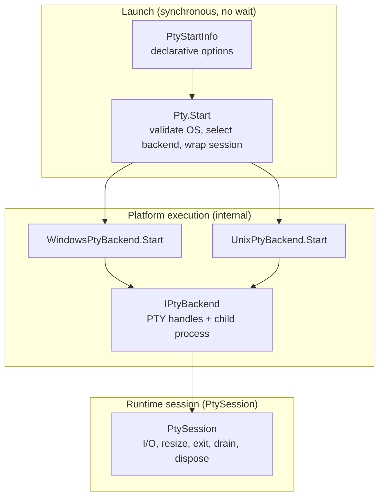
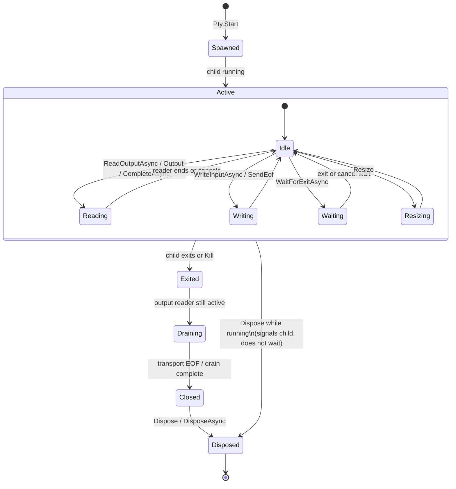

# Lifecycle Specification

Implemented lifecycle, cancellation, EOF, drain, and failure behavior for MiniPty.

## Mental Model

MiniPty splits **what to start**, **how to start it on this OS**, and **how to manage the live session**. Public callers interact with the first and third layers only.

| Layer | Type | Responsibility |
|---|---|---|
| `PtyStartInfo` | Public data | Executable, arguments, cwd, size, environment overlay, Unix `TERM` name. No orchestration logic. |
| `Pty.Start` | Public entry | Null and OS support checks; Windows vs Unix backend selection; returns `PtySession`. Does not wait for exit. |
| `WindowsPtyBackend` / `UnixPtyBackend` | Internal | ConPTY or Unix PTY spawn, handle ownership, platform EOF and resize. |
| `IPtyBackend` | Internal contract | Thin runtime boundary: input stream, the start of the session's output driver, process id, exit notification (task, internal waiter, listener), kill, transport close. Not a launch or plugin abstraction. |
| `IPtyOutputDriver` | Internal contract | How reads are waited for: it hands what it reads to the session's output pump, which decides everything about the ring, its consumers, and end of output. `WindowsOutputDriver` (I/O completions) on Windows; on Unix the backend itself, served by the exit watcher's loop. |
| `PtySession` | Public session | Live PTY lifecycle only: output consumers, stdin writes, `SendEof`, resize, `WaitForExitAsync`, `CompleteAsync`, kill, dispose. Does not decide how the child was spawned. |

Normalization stays localized: `PtyStartInfo.ClampedSize` for dimensions, `PtyEnvironment` for child environment materialization, backends for platform launch preparation.

## Session Flow

A typical session moves from spawn through active I/O to teardown. Exact EOF, drain, and cancellation details are platform- and API-specific (tables below).

Persistent embedders usually keep **one** output consumer active for the whole `Active` phase (`ReadOutputAsync` or raw `Output`). One-shot callers use `CompleteAsync` or `PtyCapture.RunAsync` instead. See [Output consumer exclusivity](#output-consumer-exclusivity).

`Dispose` / `DisposeAsync` may run from any state. If the child is still running, disposal signals it and releases handles without waiting for it to exit: on Unix a hang-up (`SIGHUP`) followed by a kill after a one-second grace period, or at normal host process exit if that comes first; on Windows termination. On Unix the terminal's master is released once the child is reaped or killed, so the hang-up is the only one the child gets while it runs. See [Disposal](../references/pty_crossplatform.md#disposal).

## Cancellation

| API | On cancellation |
|---|---|
| `WaitForExitAsync` | Waiting stops with `OperationCanceledException`; the child continues running. |
| `ReadOutputAsync` | Output enumeration stops with `OperationCanceledException`; the child continues running. |
| `WriteInputAsync` | A write still waiting for the terminal to take it stops with `OperationCanceledException`. Bytes already handed to the terminal still reach the child, and the rest is discarded. On Windows the bytes handed over include a pending part of up to 4 KiB that ConPTY has not read yet. The child continues running. |
| `CompleteAsync` | When `KillOnCancellation` is true, the child is killed and `OperationCanceledException` is thrown. |
| `PtyCapture.RunAsync` | Same as `CompleteAsync`; it uses completion options. |

This split lets embedders observe cancellation without tearing down long-running children, while one-shot capture runs default to killing on cancellation so hung children do not leak.

### Concurrent cancellation

When `ReadOutputAsync` and `WaitForExitAsync` run concurrently, cancellation is **scoped to the operation whose token was canceled**. Canceling one does not cancel the other and does not kill the child.

After `ReadOutputAsync` is canceled, the same session may start a new `ReadOutputAsync` enumeration. After `WaitForExitAsync` is canceled, the same session may call `WaitForExitAsync` again.

## Timeouts

| API / option | Timeout behavior |
|---|---|
| `CompleteAsync` / `PtyCapture.RunAsync` | `ExitTimeout`, `OutputDrainGrace`, and `OutputReaderCloseTimeout` from `PtyCompleteOptions` apply. |
| `ReadOutputAsync` | No implicit drain or read timeout. Use `CancellationToken` only. |
| `PtySession.WaitForExitAsync` | No implicit exit timeout. Use `CancellationToken` only. |

One-shot completion may bound waits to avoid hung children in fire-and-forget scenarios. Persistent streaming expects the embedder to supply cancellation.

## Output consumer exclusivity

Exactly **one** active output consumer is allowed per session. The first started consumer holds exclusivity until that read path ends (enumeration completed, canceled, or faulted).

| Active consumer | Forbidden (throws `InvalidOperationException`) | Allowed concurrently |
|---|---|---|
| `ReadOutputAsync` | Second `ReadOutputAsync`; raw `Output` read; `CompleteAsync` | `WriteInputAsync`, `SendEof`, `WaitForExitAsync`, `Resize`, `Kill`, `Dispose` |
| Raw `Output` read | `ReadOutputAsync`; `CompleteAsync` | `WriteInputAsync`, `SendEof`, `WaitForExitAsync`, `Resize`, `Kill`, `Dispose` |

`CompleteAsync` is not queued or blocked behind an active output consumer. Callers must finish or cancel the active read before starting one-shot completion.

`ReadOutputAsync` and `WaitForExitAsync` **may run concurrently** without deadlock, data loss, or premature transport close. Duplicate `WaitForExitAsync` calls are allowed.

### Host input adapters

Packages such as **MiniPty.Console** ([Console](console.md)) forward host keyboard bytes to `WriteInputAsync`. They **must not** start a second PTY output consumer.

Interactive hosts (use case 3) keep a single embedder-owned `ReadOutputAsync` reader for recording and host display while Console handles host terminal modes and stdin forwarding.

## EOF

`SendEof()` is platform-specific:

| Platform | Behavior |
|---|---|
| Windows | Writes Ctrl+Z + CR (`0x1A`, `0x0D`) to the ConPTY input stream after every input byte written before it: while earlier input is still queued because ConPTY stopped reading input, the chord waits for later staging ticks. With no bytes written, the chord goes on the first tick. Keeps the input pipe open until the child exits. Pipe close is never used — the console host observes it as `STATUS_CONTROL_C_EXIT` for its clients, not as EOF, and a child about to exit on its own loses that race under load. |
| Unix | Writes EOT (`0x04`, Ctrl-D) to the PTY master after every input byte written before it: while earlier input is still queued for a child that is not reading, EOT waits for later staging ticks. It does not close the master fd. |

Unix EOT is a terminal convention, not kernel EOF. It is reliable for canonical-mode shell-wrapped one-shot commands, but not for raw-mode TUI programs. Windows stream EOF uses the legacy console Ctrl+Z + CR convention; when input lacks a trailing line terminator, an extra CR is written first to submit the pending line. Raw/TUI programs are not guaranteed.

If the slave side is already closed when staged EOT runs, the master write may fail with `EIO` or `EPIPE`; MiniPty treats that as harmless and does not throw.

### ConPTY spawn readiness

EOF staging advances on a per-session 100 ms timer, so it gives the child time to attach and progresses whether or not anyone awaits exit. The console host queues the Ctrl+Z + CR chord for the child whether or not the child has attached yet, so the first tick is enough. Tests check that immediate post-`Pty.Start` `WriteInputAsync`, `Resize`, and empty-stdin `SendEof` do not cause spurious child failure (for example `STATUS_CONTROL_C_EXIT`). This remains an internal transport concern; there is no public ready-state API.

## Drain, kill, and disposal

| Behavior | Contract |
|---|---|
| `ReadOutputAsync` / `Output` after child exit | Drains remaining output and then completes normally. Where the transport stays open after exit (the in-box ConPTY before Windows 11 24H2; a released console host, out-of-band or in-box from 24H2, breaks the pipe when it exits with the child, so output ends at once there unless a grandchild keeps the host alive; Linux when a grandchild holds the slave; macOS revokes the tty when the child exits, so output a grandchild writes afterwards is lost), the post-exit drain closes it once output has been quiet for 100 ms. Output the child left in the terminal when it exited is never lost to a consumer that has stopped reading: on macOS, where the terminal would discard it 0.6 s after an exit that closed its last descriptor, the session holds a descriptor of its own, and the child's exit waits until that output is read ([Post-exit drain](../references/pty_crossplatform.md#post-exit-drain)). Where even the close does not end it (Windows, when another process holds ConPTY's output pipe open), output ends once reads have been quiet for another 100 ms after the close; end of output never waits for an unrelated process. |
| `WaitForExitAsync` | Observes exit only. It does not close the transport, so a concurrent reader keeps receiving output until end of output. On macOS a child that exits while its last output is still in the terminal, because the output buffer is full, finishes exiting only once a consumer reads, as a child that writes more than the buffer holds already does. |
| Output ends before exit | Linux, when the child closes the terminal and keeps running: output ends, the child is not hung up, and its own exit status is reported when it exits. macOS does not end output first, because the child's session keeps the terminal open as its controlling terminal until the child exits. ConPTY cannot end output first, because it ends output only when the pseudo-console closes, which MiniPty does after exit. |
| `ReadOutputAsync` after `Kill()` | Same as exit: drain remaining output, then complete normally (EOF). |
| `CompleteAsync` after child exit | Drains output; the transport closes once output has been quiet, and at `OutputDrainGrace` after exit at the latest. |
| Output reader close (one-shot) | Waits up to `OutputReaderCloseTimeout`. |
| `Dispose` / `DisposeAsync` while child running | Ends the child (Unix: `SIGHUP`, then `SIGKILL` after a one-second grace period or at normal host process exit, whichever comes first; Windows: `TerminateProcess`) and releases handles without blocking; neither waits for the child to exit. On Unix the master stays open until the child is reaped or killed, and the exit watcher discards the child's output meanwhile. On Unix a host ended within the grace by a crash or by a signal it does not cancel sends no `SIGKILL`, so a child that ignores `SIGHUP` keeps running ([session contract](core_session.md#session-contract)). The background output reader discards remaining output and stops on its own; `DisposeAsync` completes once it has stopped. |
| `Dispose` while operations are in flight | All in-flight `ReadOutputAsync`, `WaitForExitAsync`, and `WriteInputAsync` operations fail immediately with `ObjectDisposedException`. |
| Repeated or concurrent `Dispose` / `DisposeAsync` | Safe from any number of threads. The first call tears the session down; a later or concurrent `Dispose` returns at once, and every `DisposeAsync` completes once the output reader has stopped. Handles and the output buffer are released exactly once. |
| `Kill()` racing `Dispose` | Ends the child, throws `ObjectDisposedException`, or returns without signaling because disposal has begun. In the last two cases disposal ends the child as the `Dispose` row above describes. `HasExited`, `ExitCode`, and `ExitStatus` never fail during or after disposal; on Windows a child disposed while running never reports its exit. |
| `Kill()` | Terminates the child but does not release handles. Call `Dispose` afterward. |
| `Kill(PtySignal)` | Unix: delivers the mapped native signal to the child, through its pidfd on Linux when the kernel provides one, and otherwise with `kill(2)` once a check shows the pid is still an unreaped child. Catchable signals may be handled or ignored, so exit is not guaranteed. Windows: validates the enum, then terminates unconditionally (node-pty parity). Drain-after-kill behavior is unchanged. |

## Failure Behavior

| Condition | Behavior |
|---|---|
| Unsupported OS | `PlatformNotSupportedException` from `Pty.Start`. |
| Program not found, or working directory missing | Windows: `Win32Exception` from `Pty.Start` (`ERROR_FILE_NOT_FOUND` 2, `ERROR_DIRECTORY` 267), because `CreateProcess` fails. A batch file that is not found, or that cannot be opened, fails the same way from MiniPty's lookup, which follows `CreateProcess` ([Batch files](core_session.md#batch-files-windows)). Unix: `Win32Exception` from `Pty.Start` with the `errno` (`ENOENT` 2 for a missing program, directory, or interpreter; `EACCES` 13 for a file that may not be executed). The `chdir` and the exec run in the child after the fork, so the child reports the `errno` on a close-on-exec pipe before it exits, and the start reaps it ([Start failure report](../references/pty_crossplatform.md#start-failure-report)). A child that exits 127 or 126 by itself has started. |
| Spawn, ConPTY, `openpty`, or `forkpty` failure | OS exception with error code; run aborts. What the start had created is released, and a child it had already started is killed (and reaped on Unix). |
| Child non-zero exit | Returned as `ExitCode`; MiniPty does not throw for non-zero child exits. |
| Second output consumer | `InvalidOperationException`. |
| Session disposed while output streaming | `ObjectDisposedException`. |
| `ExitTimeout` exceeded (`CompleteAsync` / capture) | `TimeoutException`. |
| Output drain or reader close timeout (one-shot) | `TimeoutException`. |

MiniPty does not fall back to pipe redirect when PTY creation fails.

## Descendants

By default MiniPty ends only the child. What disposal, or the child's own exit, does to the processes the child started follows from the terminal:

| Platform | Descendant ends | Descendant keeps running |
|---|---|---|
| Unix | One in the terminal's foreground process group: when the child (the session leader) exits, the system hangs that group up. That includes a command that a shell without job control, such as `sh -c`, runs with `&`. A background job of a shell with job control, such as an interactive one, ends too when the shell resends the hang-up to its jobs before it exits. | One that ignores `SIGHUP` (`nohup`), was disowned, or started its own session. A running background job of a shell with job control that exits without resending the hang-up, such as one ended by `Kill()`, by the grace kill before it has done so, or an interactive bash that exits on its own, unless it is a login shell with `huponexit` set. |
| Windows | One attached to the pseudo-console: closing it, at disposal or by the post-exit drain, ends every attached process. | One in a console of its own, or a GUI process. Also one still starting when the pseudo-console closes: a process attaches during its own startup, after `CreateProcess` has returned, and one that finds the pseudo-console closed never attaches. |
| Windows, `KillProcessTree` | Every one, whatever its console: at `Dispose`, at `Kill`, and when the host process ends in any way, including a crash ([Process tree](core_session.md#process-tree)). | None, except while the session lives: the child's own exit leaves the tree running until disposal. |

A surviving descendant belongs to the host from then on. It never holds end of output: output ends shortly after the child exits even while a descendant keeps the terminal open (see [Drain, kill, and disposal](#drain-kill-and-disposal)).

## Baseline guarantees

Every session, on every platform, guarantees:

1. A start that fails leaks no handle or descriptor.
2. A child that exits by itself is reported, and disposing the session then releases every handle and descriptor (and on Unix, the child has been reaped).
3. Teardown can be repeated, in any order and from several threads.
4. Output ending before exit, or exit before output is read, breaks neither.
5. Output nobody reads blocks the child instead of growing a buffer (one-shot results excepted).
6. A resize reaches the running child as a notification.
7. What teardown does to descendants is fixed per platform ([Descendants](#descendants)).
8. Start failure, exit, and cancellation behave as documented above on Windows and Unix alike.
9. Handles do not leak across the session: the child inherits none of the host's handles or descriptors, and the host's other children inherit none of the session's. Two instants are outside this: ConPTY's own inside `CreatePseudoConsole`, and on Linux the one inside and right after `forkpty`. glibc opens the master and the slave without close-on-exec, closes the parent's copy of the slave only after forking, and MiniPty marks the master once `forkpty` returns. Every other descriptor MiniPty keeps is opened close-on-exec or is a kqueue, which a fork child never inherits.

`PtyBaselineTests` checks each of them with real children through the public API only. A start that fails with its child already running is reached only by injecting the failure, which `PtyStartFaultTests` does, and the instant before a descriptor is marked only by recreating it, which `PtyMacDescriptorTests` does. Other test classes go deeper into each area.

## Lessons Learned

- **ConPTY pipes are transport, not the terminal.** `HPCON` is the pseudo-console; mishandling pipe ends after `CreatePseudoConsole` causes missing output, hangs, or leaks to the parent console.
- **Child stdin must not be closed on Windows, not even when nothing was written.** A ConPTY input pipe close yields `STATUS_CONTROL_C_EXIT` (0xC000013A). Empty-stdin EOF first waited for the child to attach and then closed the pipe, and a fast child still lost that race on a loaded hosted runner (`PtyEmptyInputSignalsEof` on windows-2025). It now writes Ctrl+Z + CR on the first staging tick like any other EOF, and the pipe stays open until the child exits.
- **ConPTY input pipe close after a write is not clean EOF.** For one-shot stdin with bytes, MiniPty writes Ctrl+Z + CR and waits for natural exit; pipe close is deferred to transport cleanup after exit.
- **A byte value cannot mark that no input was written.** Windows kept the last byte staged, with 0xFF meaning none. Input ending in 0xFF therefore counted as empty, so `SendEof` closed the pipe instead of writing Ctrl+Z + CR, and the child exited with `STATUS_CONTROL_C_EXIT`. The last byte is now a wider value kept in the input state that the first write creates, so a session that never writes pays nothing for it.
- **Unix PTY master fds cannot be half-closed.** Closing the master ends both read and write, so `SendEof()` writes EOT instead.
- **Canonical EOT is not kernel EOF on Unix.** One EOT on a non-empty line buffer delivers buffered bytes but does not end input; a submitted line or a second EOT may be needed.
- **Output drain after child exit needs bounded waits on one-shot paths.** `OutputDrainGrace` and `OutputReaderCloseTimeout` prevent hung readers without dropping ordinary slow flushes. Persistent `ReadOutputAsync` and `Output` do not use those timeouts.
- **Kill/drain tests need an observed-output synchronization point and a child that cannot time out naturally.** Fixed delays can expire before a loaded CI worker schedules the reader or completes `fork`/`exec`; conversely, a time-limited child can exit before a starved reader resumes, so the test never reaches `Kill()`. Have the child emit readiness and then block on stdin, observe readiness from the active output enumeration, then kill and continue that same enumeration to EOF.
- **Cancel semantics differ by use case.** Waiting cancellation does not kill; one-shot completion defaults to killing when canceled.
- **Do not queue `CompleteAsync` behind active output reads.** Fail fast with `InvalidOperationException` so read, wait, and completion cannot deadlock inside hidden session queues.
- **Never close ConPTY at exit; close it after output has gone quiet.** Closing on exit truncated bulk stdout, so one-shot paths already deferred it, but the public exit wait still closed the transport and could cut a concurrent reader short. Exit waits now never close it: one post-exit drain, shared by every consumer, closes the transport once the reader has seen 100 ms of silence while not parked on a full buffer. A reader therefore sees end of output about 100 ms after the last output rather than at exit.
- **Post-exit drain uses quiet heuristics, not completion truth.** Closing the ConPTY or Unix PTY master after quiet unblocks end of output when nothing else would end it; it does not detect shell command completion. One-shot completion bounds it by `OutputDrainGrace` and never quiet-closes before the first read, because ConPTY can emit its first frame after a fast child has already exited.
- **Read output on a thread the library owns, from spawn.** A caller-side wait for a pump to start starved the thread pool under parallel CI and could throw cancellation before `KillOnCancellation` ran, and a pump queued to the thread pool could start too late for fast children (the macOS-only scheduling workaround). The output reader now starts at spawn on a dedicated thread on every platform; see [pty_crossplatform.md](../references/pty_crossplatform.md) → Output pump.
- **Disposal must be admitted once, and a handle must outlive every concurrent user.** Hosts race disposal on purpose (an exit handler disposing while the main thread does), and library threads race it on their own (exit watcher, EOF timer). A check-then-set guard let two disposals both tear down: the session dropped its reference to the output buffer twice, returning it to the shared pool while the reader could still write into it, and the backends closed handles and freed native memory twice. Separately, the Windows process handle was a raw value that exit queries, kills, the watcher, and the timer kept using after disposal closed it. Windows hands a released handle's value to the next object the process opens, so a disposed session reported another child's exit code (reproduced by duplicating a handle right after disposal). Disposal is now admitted with an atomic exchange, and the process handle is a `SafeHandle` pinned for each native call.
- **A descendant must finish setting up before the test ends its parent.** A Unix child that ran `nohup` and exited at once sometimes exited before `nohup` had ignored `SIGHUP`, so the hang-up of the foreground group killed the descendant, and the test reported a policy change that was only a race. Descendants now record their own pid once they are set up, and the child exits only when the test tells it to. Windows has the same race in attaching: a descendant whose `CreateProcess` had returned but which had not yet attached to the pseudo-console when disposal closed it kept running under CPU load (2 of 6 runs with 48 busy processes), so the Windows child reports a descendant only once `GetConsoleProcessList` lists it.
- **ConPTY drains slowly under CPU contention, whatever the line shape.** With 48 busy processes on Windows 11 build 26200, 256 KiB took 20–60 s to drain in 512, 128, or 32 lines, and a test that paused and resumed 256 KiB timed out at 30 s on both hosted Windows runners, while 16 KiB unread already kept the child blocked. A test that drains through ConPTY within a timeout writes only what its check needs; the pause test writes 64 KiB on Windows. Tests that spin threads to race run alone, so they do not take cores from ConPTY-bound tests beside them. Their spin yields its time slice: a busy spin on a two-core runner kept the threads it waited for off the cores, and one such test took minutes.
- **A full output buffer holds back end of output for a session nobody reads.** When the buffer held four reads of any size, under CPU contention ConPTY's frames for a single `echo` arrived as separate small reads, three of them before the post-exit close; the frame ConPTY flushed after the close took the fourth slot, and the reader parked with output still in the pipe. End of output then waits for a consumer, by design, since ending it would drop that frame, and a consumer that starts later gets everything. A test that reads only after exit therefore waits for exit and the close, not for end of output, which it saw in only 7 of 10 full-suite runs pinned to two cores. The buffer now holds 16 KiB of bytes rather than four reads, so such small frames no longer fill it, but output larger than the buffer still parks the reader the same way.
- **A start that fails after the child exists leaves a child no watcher knows.** The session registers its child with the exit watcher last, so a failure before that point left a running child and, on Unix, a zombie. The failed start now kills it, and reaps it on Unix. The steps there fail only on resource exhaustion, so tests inject the failure through an internal hook at two stages: before the backend owns the child, and before the session does.
- **glibc's `forkpty` master is inherited by every later child of the host.** MiniPty's own children close it, but a child started with `Process.Start` kept it, measured on Linux, and with it the terminal, which then does not hang up until that child exits. The parent now marks the master close-on-exec right after `forkpty`; only a fork on another thread in that instant can still inherit it. The slave has a shorter window of its own: glibc's `openpty` opens it without close-on-exec too, and `forkpty` closes the parent's copy right after forking. A process forked on another thread in between keeps the slave, and with it the terminal, open after the child exits, so on Linux output then ends through the post-exit drain rather than when the child exits. Closing either window would take opening both ends with `O_CLOEXEC`, which `forkpty` does not offer; the macOS path does so.
- **On macOS a descriptor marked close-on-exec after it opens can still leak.** macOS has no `pipe2`, so the wake pipes of the former output reader threads and of the exit watcher were marked with `fcntl` after `pipe`, and .NET's `Process.Start` on another thread in that instant passes on every descriptor not yet marked (measured: a child started that way kept both ends of an unmarked pipe). macOS then woke both with an `EVFILT_USER` event on a kqueue, which a fork child never inherits whatever its flags, and the exit watcher still does. Linux and FreeBSD open the watcher's wake pipe with `pipe2(O_CLOEXEC | O_NONBLOCK)` (glibc declares it only with `_GNU_SOURCE`). The instant cannot be hit on purpose, so the test of the readers' wake descriptors opened one directly and duplicated it, since `dup` leaves the copy unmarked, and checked that a child started next found none; it went with those descriptors. A first version counted the descriptors new sessions added instead and flaked: a session opened one only when no parked reader thread was left, and earlier tests had parked more than it started.
- **A signal by pid number can reach another process.** The exit watcher is the only reaper of a session's child that MiniPty has, but a host process can have others: code that reaps every child, or a `SIGCHLD` disposition of `SIG_IGN`, under which the kernel reaps them. They free a child's pid before the watcher notices, and a later process can get it. A `Kill` or a disposal would then signal that process, and when it is another child of the host, the watcher's reap would take its exit. On Linux the child's signals and its reap now go through its pidfd (the reap needs Linux 5.4). The pidfd was first opened by pid when the session was built, after the child could already have exited, so it could name the process that got the pid. Forcing the reuse in a user and pid namespace showed it: `Kill` and `Dispose` killed that process. The spawn now opens the pidfd right after the fork and, on Linux 5.4 and later, refuses one that names no child of the host. A child that waited on a pipe until the parent had opened the child's pidfd narrowed the instant that remains, but was dropped. On a host started with its standard descriptors closed, the pipe landed on descriptors 0-2, which `forkpty` replaces with the terminal, so the child waited on the terminal and the first spawn hung (measured with a NativeAOT host, 5 of 5). With a `forkpty` that waits for end of file on a pipe of its own, as musl's does, concurrent spawns deadlocked. Without a pidfd, a signal is sent only while `waitid` with `WNOWAIT` reports the pid as a child of the host, and the watcher reaps by pid. That check cannot tell the session's child from another child of the host that got the pid: forced the same way, a session killed a child it never started, and in some runs reported that child's exit status as its own. The native calls are tested with stand-ins for a reused pid: a live process that is not the child, with signal 0, a child reaped elsewhere, and a zombie that must stay waitable. The session's reap and the timing of its pidfd are tested with a forced reuse in a user and pid namespace, where one can be created. Its signals are not: with a pidfd the watcher usually reports the exit before `Pty.Start` returns, after which the session sends none, and a forced reuse cannot hold the watcher off there.
- **ConPTY can drop a process's output when another process on the same console writes at the same moment.** A child that wrote `ready` while a descendant attached to the same pseudo-console (`ping`) printed its first lines lost `ready` in 0.5–5 % of runs, depending on load, although the child exited normally after writing it. A byte-for-byte copy of everything MiniPty read from the output pipe matched what it delivered, and `ready` was not in it, so ConPTY never emitted it; the frames ConPTY did emit moved the cursor past the row `ready` was written to. With no second writer it never happened in hundreds of runs, and tearing down other sessions concurrently did not make it more frequent. Tests that look for text therefore keep one writer per console; this is ConPTY's behavior, not output MiniPty loses.
- **A handle count right after a burst of starts overstates it on Windows.** After 40 starts that failed at once, a few milliseconds each, the count was about 50 higher, and back to its earlier value a second later; most likely the pseudo-consoles finishing their close. The first starts in a process also add a few dozen handles that stay. Leak checks therefore warm up until the count holds still and read it once it has settled, before and after; a leak never settles.
- **A settled count can still grow once from something else in the process.** The start-fault leak check failed in 2 to 4 of 10 local Windows runs with 28 to 49 more handles. A census by object type showed what they were: certificate store keys (`SystemCertificates\ROOT`, `CA`, `AuthRoot`), a native thread pool (a worker factory, an I/O completion port, wait packets, timers), and ETW registrations. The test platform's telemetry upload had made an HTTPS connection in the middle of the measured runs, and with telemetry turned off the check passed 15 runs out of 15. A step like that happens once and grows one batch of runs, while a leak grows every batch, so a leak check now runs a second batch when the first grew and fails only when both did. A deliberate leak of one handle per start still fails it ("40, then 36").
- **A non-blocking `Dispose` still lets ConPTY finish closing.** Closing a pseudo-console can wait until its final frame fits in the output pipe, so disposal switches the reader to discarding output before it closes the transport, and the reader keeps draining until the pipe ends.
- **The exec payload need not outlive the spawn; the exit-127 flakes had another cause.**
  - **What was believed.** The parent held `file`, `argv`, `envp`, and `cwd` until disposal, because freeing them right after `forkpty` returned was believed to race the child and cause exit-127 flakes under parallel CI.
  - **Why that cannot be.** A forked child reads its own copy-on-write image of the parent, taken at the fork. The hold also did not stop the flake: the commit that added it put `[Retry(3)]` on `PtyUnixPathLookupTreatsEmptyPathEntriesAsCurrentDirectory`, which still failed.
  - **Measured on WSL (2026-10-27).**
    - The parent overwrote every payload string with garbage right after the fork, before the child exec'd. 6,000 concurrent starts (64 and 128 at a time), each checking its working directory, environment, argument, and `PATH` lookup, all matched. The full suite passed with that overwrite in every start.
    - The same overwrite before the fork failed all 200 starts, so it did reach what the child reads.
  - **The payload is now freed when the spawn returns.** Since the start failure report, the spawn also returns only once the child has exec'd or failed.
  - **The likely cause of the flakes is `ETXTBSY`, on Linux.** Those tests write a script and exec it at once. A child forked on another thread during the write inherits the script's write descriptor and holds it until its own exec, and on Linux exec of a file open for writing fails with `ETXTBSY`. The shim then ended every exec failure with 127. On Linux a start that executes a file open for writing now fails with `Win32Exception` 26, measured. macOS has no such check: a script and a compiled binary that another process held open for writing both started, measured, so a concurrent fork does not fail the start there. The race is in the tests' fixtures, not in MiniPty, so their retries stay.
- **A library-wide signal handler costs more than the gap it closes.** A host ended by a `SIGTERM`, `SIGINT`, `SIGHUP`, or `SIGQUIT` that it does not cancel raises no `ProcessExit`, so a child it disposed within the grace and that ignores `SIGHUP` keeps running. Non-canceling `PosixSignalRegistration` handlers for the four signals sent the pending kills for a host with no handlers of its own (tested for `SIGTERM` and `SIGHUP`). They were reverted for the risks they put on every host. These were measured on Linux with .NET 10. With the thread pool capped and every worker blocked, a host was still running 15 seconds after `SIGHUP`. With the default pool and a backlog of queued work, it took 3 to 35 seconds. Without the registration, it ended within milliseconds. A host out of threads aborted with 134 on `SIGTERM`, `SIGINT`, and `SIGHUP` instead of ending with 143, 130, and 129. `SIGQUIT` was not measured. A disposal in a handler the host registered before the first `Pty.Start` was not covered. The rest follows from the runtime source and the reverted code. The runtime runs `SIGHUP` handlers on the thread pool and gives `SIGTERM`, `SIGINT`, and `SIGQUIT` a new thread each. Signal handlers run in reverse order of registration, so a handler the host registered first runs after the library's. The library's handler did not treat the signal as an exit, because a later handler might cancel it. For the same reason, it would kill children in their grace even when a later handler cancels the signal and the host goes on running. A failed `PosixSignalRegistration` type initializer stays failed for the process. So when the library is the first to set up the runtime's signal handling while descriptors or threads are exhausted, the host's own handlers, `Console.CancelKeyPress` included, stop working. The gap therefore stays documented. A host that must not leave such a child cancels the signal, shuts down as the app-exit pattern in [GUI hosts](core_session.md#gui-hosts) does, and then exits normally, which sends the remaining kills. That fails when the host is out of threads, because handling the signal needs one. Calling `Kill()` before `Dispose` works even then, but skips the hang-up. An interactive shell killed this way cannot resend the hang-up to its jobs, so a running background job keeps running.
- **Closing the master during a hang-up cuts a shell's hang-up short.** bash saves its history before it resends the hang-up to its jobs. Disposal closed the master right after its `SIGHUP`, and the close hangs the tty up and signals the child again. A second `SIGHUP` during the save ended bash before it reached its jobs, so a running background job kept running. A pty harness that sent `SIGHUP` to an interactive bash 5.2 and closed the master after a delay (Linux 6.6, WSL Ubuntu 24.04) left the job running only when the close landed inside a window that grew with the history: under 1 ms at 2,000 lines, 0.5 to 1 ms at 20,000, and up to about 10 ms at 200,000. A close at the same instant (20,000 lines) or after the window left none. With 20,000 lines the regression test passed in the test host, so it keeps 200,000 lines, and before the change it failed 5 of 5 runs. Disposal now leaves the master open until the watcher reaps the child or sends the kill. The reader still stops at disposal, so `DisposeAsync` does not wait for the child. Without a reader, a hang-up trap that wrote 1 MB blocked on the full terminal and was killed at the deadline, where it had finished in about 100 ms before, so the watcher discards the child's output. Discarding on the watcher's 10 ms polling interval was enough on Linux, where a master buffers about 64 KiB, but a macOS master buffers 1 KiB, so the same trap could write only about 100 KiB/s there and was still killed at the deadline. The master's output now wakes the watcher, and a drain woken that way read the same 1 MB on macOS in about 0.16 s. A child that ignores the hang-up and reads its terminal used to exit when the close failed the read, in about 10 ms, and now waits until the kill.
