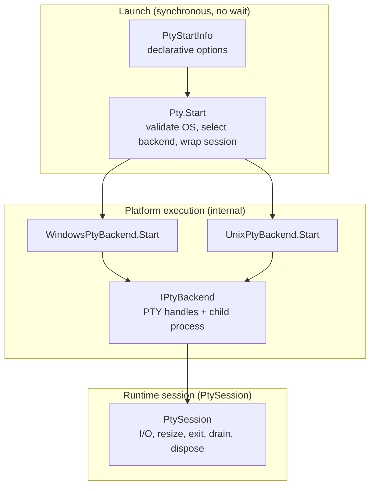
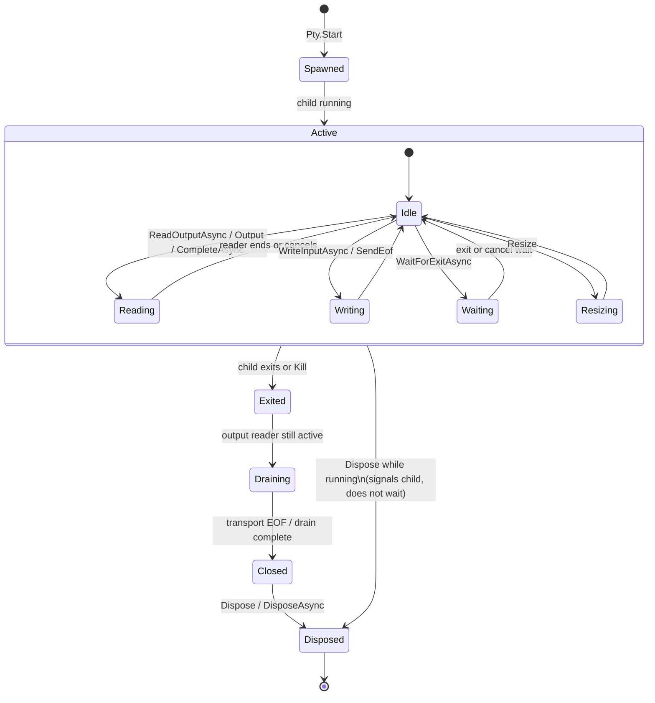

# Lifecycle Specification

Implemented lifecycle, cancellation, EOF, drain, and failure behavior for MiniPty.

## Mental Model

MiniPty splits **what to start**, **how to start it on this OS**, and **how to manage the live session**. Public callers interact with the first and third layers only.

| Layer | Type | Responsibility |
|---|---|---|
| `PtyStartInfo` | Public data | Executable, arguments, cwd, size, environment overlay, Unix `TERM` name. No orchestration logic. |
| `Pty.Start` | Public entry | Null and OS support checks; Windows vs Unix backend selection; returns `PtySession`. Does not wait for exit. |
| `WindowsPtyBackend` / `UnixPtyBackend` | Internal | ConPTY or Unix PTY spawn, handle ownership, platform EOF and resize. |
| `IPtyBackend` | Internal contract | Thin runtime boundary: input stream, output read primitives for the session's output pump, process id, exit notification (task, internal waiter, listener), kill, transport close. Not a launch or plugin abstraction. |
| `PtySession` | Public session | Live PTY lifecycle only: output consumers, stdin writes, `SendEof`, resize, `WaitForExitAsync`, `CompleteAsync`, kill, dispose. Does not decide how the child was spawned. |

Normalization stays localized: `PtyStartInfo.ClampedSize` for dimensions, `PtyEnvironment` for child environment materialization, backends for platform launch preparation.

## Session Flow

A typical session moves from spawn through active I/O to teardown. Exact EOF, drain, and cancellation details are platform- and API-specific (tables below).

Persistent embedders usually keep **one** output consumer active for the whole `Active` phase (`ReadOutputAsync` or raw `Output`). One-shot callers use `CompleteAsync` or `PtyCapture.RunAsync` instead. See [Output consumer exclusivity](#output-consumer-exclusivity).

`Dispose` / `DisposeAsync` may run from any state. If the child is still running, disposal signals it and releases handles without waiting for it to exit: on Unix a hang-up (`SIGHUP`) followed by a kill after a one-second grace period, or at normal host process exit if that comes first; on Windows termination. See [Disposal](../references/pty_crossplatform.md#disposal).

## Cancellation

| API | On cancellation |
|---|---|
| `WaitForExitAsync` | Waiting stops with `OperationCanceledException`; the child continues running. |
| `ReadOutputAsync` | Output enumeration stops with `OperationCanceledException`; the child continues running. |
| `WriteInputAsync` | A write still waiting for the terminal to take it stops with `OperationCanceledException`. Bytes already handed to the terminal still reach the child, and the rest is discarded. On Windows the bytes handed over include a pending part of up to 4 KiB that ConPTY has not read yet. The child continues running. |
| `CompleteAsync` | When `KillOnCancellation` is true, the child is killed and `OperationCanceledException` is thrown. |
| `PtyCapture.RunAsync` | Same as `CompleteAsync`; it uses completion options. |

This split lets embedders observe cancellation without tearing down long-running children, while one-shot capture runs default to killing on cancellation so hung children do not leak.

### Concurrent cancellation

When `ReadOutputAsync` and `WaitForExitAsync` run concurrently, cancellation is **scoped to the operation whose token was canceled**. Canceling one does not cancel the other and does not kill the child.

After `ReadOutputAsync` is canceled, the same session may start a new `ReadOutputAsync` enumeration. After `WaitForExitAsync` is canceled, the same session may call `WaitForExitAsync` again.

## Timeouts

| API / option | Timeout behavior |
|---|---|
| `CompleteAsync` / `PtyCapture.RunAsync` | `ExitTimeout`, `OutputDrainGrace`, and `OutputReaderCloseTimeout` from `PtyCompleteOptions` apply. |
| `ReadOutputAsync` | No implicit drain or read timeout. Use `CancellationToken` only. |
| `PtySession.WaitForExitAsync` | No implicit exit timeout. Use `CancellationToken` only. |

One-shot completion may bound waits to avoid hung children in fire-and-forget scenarios. Persistent streaming expects the embedder to supply cancellation.

## Output consumer exclusivity

Exactly **one** active output consumer is allowed per session. The first started consumer holds exclusivity until that read path ends (enumeration completed, canceled, or faulted).

| Active consumer | Forbidden (throws `InvalidOperationException`) | Allowed concurrently |
|---|---|---|
| `ReadOutputAsync` | Second `ReadOutputAsync`; raw `Output` read; `CompleteAsync` | `WriteInputAsync`, `SendEof`, `WaitForExitAsync`, `Resize`, `Kill`, `Dispose` |
| Raw `Output` read | `ReadOutputAsync`; `CompleteAsync` | `WriteInputAsync`, `SendEof`, `WaitForExitAsync`, `Resize`, `Kill`, `Dispose` |

`CompleteAsync` is not queued or blocked behind an active output consumer. Callers must finish or cancel the active read before starting one-shot completion.

`ReadOutputAsync` and `WaitForExitAsync` **may run concurrently** without deadlock, data loss, or premature transport close. Duplicate `WaitForExitAsync` calls are allowed.

### Host input adapters

Packages such as **MiniPty.Console** ([Console](console.md)) forward host keyboard bytes to `WriteInputAsync`. They **must not** start a second PTY output consumer.

Interactive hosts (use case 3) keep a single embedder-owned `ReadOutputAsync` reader for recording and host display while Console handles host terminal modes and stdin forwarding.

## EOF

`SendEof()` is platform-specific:

| Platform | Behavior |
|---|---|
| Windows (bytes written) | Writes Ctrl+Z + CR (`0x1A`, `0x0D`) to the ConPTY input stream after every input byte written before it: while earlier input is still queued because ConPTY stopped reading input, the chord waits for later staging ticks. Keeps the input pipe open until the child exits. Pipe close is not used for this case — it is observed as `STATUS_CONTROL_C_EXIT`, not EOF. |
| Windows (no bytes) | Closes the ConPTY input pipe after staging (attach deferral). A write during that wait switches EOF to Ctrl+Z + CR, as when bytes were written. |
| Unix | Writes EOT (`0x04`, Ctrl-D) to the PTY master after every input byte written before it: while earlier input is still queued for a child that is not reading, EOT waits for later staging ticks. It does not close the master fd. |

Unix EOT is a terminal convention, not kernel EOF. It is reliable for canonical-mode shell-wrapped one-shot commands, but not for raw-mode TUI programs. Windows stream EOF uses the legacy console Ctrl+Z + CR convention; when input lacks a trailing line terminator, an extra CR is written first to submit the pending line. Raw/TUI programs are not guaranteed.

If the slave side is already closed when staged EOT runs, the master write may fail with `EIO` or `EPIPE`; MiniPty treats that as harmless and does not throw.

### ConPTY spawn readiness

EOF staging advances on a per-session 100 ms timer, so it gives the child time to attach and progresses whether or not anyone awaits exit. Milestone 3 validates that immediate post-`Pty.Start` `WriteInputAsync`, `Resize`, and empty-stdin `SendEof` do not cause spurious child failure (for example `STATUS_CONTROL_C_EXIT`). This remains an internal transport concern; there is no public ready-state API.

## Drain, kill, and disposal

| Behavior | Contract |
|---|---|
| `ReadOutputAsync` / `Output` after child exit | Drains remaining output and then completes normally. Where the transport stays open after exit (ConPTY always, Linux when a grandchild holds the slave; macOS revokes the tty when the child exits, so output a grandchild writes afterwards is lost), the post-exit drain closes it once output has been quiet for 100 ms. Where even the close does not end it (Windows, when another process holds ConPTY's output pipe open), output ends once reads have been quiet for another 100 ms after the close; end of output never waits for an unrelated process. |
| `WaitForExitAsync` | Observes exit only. It does not close the transport, so a concurrent reader keeps receiving output until end of output. |
| Output ends before exit | Unix, when the child closes the terminal and keeps running: output ends, the child is not hung up, and its own exit status is reported when it exits. ConPTY cannot end output first, because it ends output only when the pseudo-console closes, which MiniPty does after exit. |
| `ReadOutputAsync` after `Kill()` | Same as exit: drain remaining output, then complete normally (EOF). |
| `CompleteAsync` after child exit | Drains output; the transport closes once output has been quiet, and at `OutputDrainGrace` after exit at the latest. |
| Output reader close (one-shot) | Waits up to `OutputReaderCloseTimeout`. |
| `Dispose` / `DisposeAsync` while child running | Ends the child (Unix: `SIGHUP`, then `SIGKILL` after a one-second grace period or at normal host process exit, whichever comes first; Windows: `TerminateProcess`) and releases handles without blocking; neither waits for the child to exit. The background output reader discards remaining output and stops on its own; `DisposeAsync` completes once it has stopped. |
| `Dispose` while operations are in flight | All in-flight `ReadOutputAsync`, `WaitForExitAsync`, and `WriteInputAsync` operations fail immediately with `ObjectDisposedException`. |
| Repeated or concurrent `Dispose` / `DisposeAsync` | Safe from any number of threads. The first call tears the session down; a later or concurrent `Dispose` returns at once, and every `DisposeAsync` completes once the output reader has stopped. Handles and the output buffer are released exactly once. |
| `Kill()` racing `Dispose` | Either ends the child or throws `ObjectDisposedException`; disposal ends the child either way. `HasExited`, `ExitCode`, and `ExitStatus` never fail during or after disposal; on Windows a child disposed while running never reports its exit. |
| `Kill()` | Terminates the child but does not release handles. Call `Dispose` afterward. |
| `Kill(PtySignal)` | Unix: delivers the mapped native signal via `kill(2)`; catchable signals may be handled or ignored, so exit is not guaranteed. Windows: validates the enum, then terminates unconditionally (node-pty parity). Drain-after-kill behavior is unchanged. |

## Failure Behavior

| Condition | Behavior |
|---|---|
| Unsupported OS | `PlatformNotSupportedException` from `Pty.Start`. |
| Program not found, or working directory missing | Windows: `Win32Exception` from `Pty.Start` (`ERROR_FILE_NOT_FOUND` 2, `ERROR_DIRECTORY` 267), because `CreateProcess` fails. Unix: `Pty.Start` succeeds, because the fork has already happened when `exec` or `chdir` fails in the child; the child exits with 127 or 126, the shell convention. |
| Spawn, ConPTY, `openpty`, or `forkpty` failure | OS exception with error code; run aborts. What the start had created is released, and a child it had already started is killed (and reaped on Unix). |
| Child non-zero exit | Returned as `ExitCode`; MiniPty does not throw for non-zero child exits. |
| Second output consumer | `InvalidOperationException`. |
| Session disposed while output streaming | `ObjectDisposedException`. |
| `ExitTimeout` exceeded (`CompleteAsync` / capture) | `TimeoutException`. |
| Output drain or reader close timeout (one-shot) | `TimeoutException`. |

MiniPty does not fall back to pipe redirect when PTY creation fails.

## Descendants

By default MiniPty ends only the child. What disposal, or the child's own exit, does to the processes the child started follows from the terminal:

| Platform | Descendant ends | Descendant keeps running |
|---|---|---|
| Unix | One in the terminal's foreground process group: when the child (the session leader) exits, the system hangs that group up. An interactive shell also hangs up its jobs. | One that ignores `SIGHUP` (`nohup`), was disowned, or started its own session. |
| Windows | One attached to the pseudo-console: closing it, at disposal or by the post-exit drain, ends every attached process. | One in a console of its own, or a GUI process. Also one still starting when the pseudo-console closes: a process attaches during its own startup, after `CreateProcess` has returned, and one that finds the pseudo-console closed never attaches. |
| Windows, `KillProcessTree` | Every one, whatever its console: at `Dispose`, at `Kill`, and when the host process ends in any way, including a crash ([Process tree](core_session.md#process-tree)). | None, except while the session lives: the child's own exit leaves the tree running until disposal. |

A surviving descendant belongs to the host from then on. It never holds end of output: output ends shortly after the child exits even while a descendant keeps the terminal open (see [Drain, kill, and disposal](#drain-kill-and-disposal)).

## Baseline guarantees

Every session, on every platform, guarantees:

1. A start that fails leaks no handle or descriptor.
2. A child that exits by itself is reported, and disposing the session then releases every handle and descriptor (and on Unix, the child has been reaped).
3. Teardown can be repeated, in any order and from several threads.
4. Output ending before exit, or exit before output is read, breaks neither.
5. Output nobody reads blocks the child instead of growing a buffer (one-shot results excepted).
6. A resize reaches the running child as a notification.
7. What teardown does to descendants is fixed per platform ([Descendants](#descendants)).
8. Start failure, exit, and cancellation behave as documented above on Windows and Unix alike.
9. Handles do not leak across the session: the child inherits none of the host's handles or descriptors, and the host's other children inherit none of the session's. Two instants are outside this: ConPTY's own inside `CreatePseudoConsole`, and on Linux the one inside and right after `forkpty`. glibc opens the master and the slave without close-on-exec, closes the parent's copy of the slave only after forking, and MiniPty marks the master once `forkpty` returns. Every other descriptor MiniPty keeps is opened close-on-exec or is a kqueue, which a fork child never inherits.

`PtyBaselineTests` checks each of them with real children through the public API only. A start that fails with its child already running is reached only by injecting the failure, which `PtyStartFaultTests` does, and the instant before a descriptor is marked only by recreating it, which `PtyMacDescriptorTests` does. Other test classes go deeper into each area.

## Lessons Learned

- **ConPTY pipes are transport, not the terminal.** `HPCON` is the pseudo-console; mishandling pipe ends after `CreatePseudoConsole` causes missing output, hangs, or leaks to the parent console.
- **Child stdin must not be closed before launch completes on Windows.** Early ConPTY input pipe close yields `STATUS_CONTROL_C_EXIT` (0xC000013A). Empty-stdin EOF is staged to the staging timer or transport close.
- **ConPTY input pipe close after a write is not clean EOF.** For one-shot stdin with bytes, MiniPty writes Ctrl+Z + CR and waits for natural exit; pipe close is deferred to transport cleanup after exit.
- **A byte value cannot mark that no input was written.** Windows kept the last byte staged, with 0xFF meaning none. Input ending in 0xFF therefore counted as empty, so `SendEof` closed the pipe instead of writing Ctrl+Z + CR, and the child exited with `STATUS_CONTROL_C_EXIT`. The last byte is now a wider value kept in the input state that the first write creates, so a session that never writes pays nothing for it.
- **Unix PTY master fds cannot be half-closed.** Closing the master ends both read and write, so `SendEof()` writes EOT instead.
- **Canonical EOT is not kernel EOF on Unix.** One EOT on a non-empty line buffer delivers buffered bytes but does not end input; a submitted line or a second EOT may be needed.
- **Output drain after child exit needs bounded waits on one-shot paths.** `OutputDrainGrace` and `OutputReaderCloseTimeout` prevent hung readers without dropping ordinary slow flushes. Persistent `ReadOutputAsync` and `Output` do not use those timeouts.
- **Kill/drain tests need an observed-output synchronization point and a child that cannot time out naturally.** Fixed delays can expire before a loaded CI worker schedules the reader or completes `fork`/`exec`; conversely, a time-limited child can exit before a starved reader resumes, so the test never reaches `Kill()`. Have the child emit readiness and then block on stdin, observe readiness from the active output enumeration, then kill and continue that same enumeration to EOF.
- **Cancel semantics differ by use case.** Waiting cancellation does not kill; one-shot completion defaults to killing when canceled.
- **Do not queue `CompleteAsync` behind active output reads.** Fail fast with `InvalidOperationException` so read, wait, and completion cannot deadlock inside hidden session queues.
- **Never close ConPTY at exit; close it after output has gone quiet.** Closing on exit truncated bulk stdout, so one-shot paths already deferred it, but the public exit wait still closed the transport and could cut a concurrent reader short. Exit waits now never close it: one post-exit drain, shared by every consumer, closes the transport once the reader has seen 100 ms of silence while not parked on a full buffer. A reader therefore sees end of output about 100 ms after the last output rather than at exit.
- **Post-exit drain uses quiet heuristics, not completion truth.** Closing the ConPTY or Unix PTY master after quiet unblocks end of output when nothing else would end it; it does not detect shell command completion. One-shot completion bounds it by `OutputDrainGrace` and never quiet-closes before the first read, because ConPTY can emit its first frame after a fast child has already exited.
- **Read output on a thread the library owns, from spawn.** A caller-side wait for a pump to start starved the thread pool under parallel CI and could throw cancellation before `KillOnCancellation` ran, and a pump queued to the thread pool could start too late for fast children (the macOS-only scheduling workaround). The output reader now starts at spawn on a dedicated thread on every platform; see [pty_crossplatform.md](../references/pty_crossplatform.md) → Output pump.
- **Disposal must be admitted once, and a handle must outlive every concurrent user.** Hosts race disposal on purpose (an exit handler disposing while the main thread does), and library threads race it on their own (exit watcher, EOF timer). A check-then-set guard let two disposals both tear down: the session dropped its reference to the output buffer twice, returning it to the shared pool while the reader could still write into it, and the backends closed handles and freed native memory twice. Separately, the Windows process handle was a raw value that exit queries, kills, the watcher, and the timer kept using after disposal closed it. Windows hands a released handle's value to the next object the process opens, so a disposed session reported another child's exit code (reproduced by duplicating a handle right after disposal). Disposal is now admitted with an atomic exchange, and the process handle is a `SafeHandle` pinned for each native call.
- **A descendant must finish setting up before the test ends its parent.** A Unix child that ran `nohup` and exited at once sometimes exited before `nohup` had ignored `SIGHUP`, so the hang-up of the foreground group killed the descendant, and the test reported a policy change that was only a race. Descendants now record their own pid once they are set up, and the child exits only when the test tells it to. Windows has the same race in attaching: a descendant whose `CreateProcess` had returned but which had not yet attached to the pseudo-console when disposal closed it kept running under CPU load (2 of 6 runs with 48 busy processes), so the Windows child reports a descendant only once `GetConsoleProcessList` lists it.
- **ConPTY drains slowly under CPU contention, whatever the line shape.** With 48 busy processes on Windows 11 build 26200, 256 KiB took 20–60 s to drain in 512, 128, or 32 lines, and a test that paused and resumed 256 KiB timed out at 30 s on both hosted Windows runners, while 16 KiB unread already kept the child blocked. A test that drains through ConPTY within a timeout writes only what its check needs; the pause test writes 64 KiB on Windows. Tests that spin threads to race run alone, so they do not take cores from ConPTY-bound tests beside them. Their spin yields its time slice: a busy spin on a two-core runner kept the threads it waited for off the cores, and one such test took minutes.
- **The output buffer holds four reads, so a session nobody reads may not reach end of output.** Under CPU contention ConPTY's frames for a single `echo` arrived as separate small reads, three of them before the post-exit close; the frame ConPTY flushed after the close took the fourth slot, and the reader parked with output still in the pipe. End of output then waits for a consumer, by design, since ending it would drop that frame, and a consumer that starts later gets everything. A test that reads only after exit therefore waits for exit and the close, not for end of output, which it saw in only 7 of 10 full-suite runs pinned to two cores.
- **A start that fails after the child exists leaves a child no watcher knows.** The session registers its child with the exit watcher last, so a failure before that point left a running child and, on Unix, a zombie. The failed start now kills it, and reaps it on Unix. The steps there fail only on resource exhaustion, so tests inject the failure through an internal hook at two stages: before the backend owns the child, and before the session does.
- **glibc's `forkpty` master is inherited by every later child of the host.** MiniPty's own children close it, but a child started with `Process.Start` kept it, measured on Linux, and with it the terminal, which then does not hang up until that child exits. The parent now marks the master close-on-exec right after `forkpty`; only a fork on another thread in that instant can still inherit it. The slave has a shorter window of its own: glibc's `openpty` opens it without close-on-exec too, and `forkpty` closes the parent's copy right after forking. A process forked on another thread in between keeps the slave, and with it the terminal, open after the child exits, so on Linux output then ends through the post-exit drain rather than when the child exits. Closing either window would take opening both ends with `O_CLOEXEC`, which `forkpty` does not offer; the macOS path does so.
- **On macOS a descriptor marked close-on-exec after it opens can still leak.** macOS has no `pipe2`, so the wake pipes of the output readers and the exit watcher were marked with `fcntl` after `pipe`, and .NET's `Process.Start` on another thread in that instant passes on every descriptor not yet marked (measured: a child started that way kept both ends of an unmarked pipe). macOS now wakes both with an `EVFILT_USER` event on a kqueue, which a fork child never inherits whatever its flags. Linux and FreeBSD open their wake pipes with `pipe2(O_CLOEXEC | O_NONBLOCK)` (glibc declares it only with `_GNU_SOURCE`). The instant cannot be hit on purpose, so the test opens a reader's wake descriptor directly and duplicates it, since `dup` leaves the copy unmarked, and checks that a child started next finds none. A first version counted the descriptors new sessions added instead and flaked: a session opens one only when no parked reader thread is left, and earlier tests had parked more than it started.
- **ConPTY can drop a process's output when another process on the same console writes at the same moment.** A child that wrote `ready` while a descendant attached to the same pseudo-console (`ping`) printed its first lines lost `ready` in 0.5–5 % of runs, depending on load, although the child exited normally after writing it. A byte-for-byte copy of everything MiniPty read from the output pipe matched what it delivered, and `ready` was not in it, so ConPTY never emitted it; the frames ConPTY did emit moved the cursor past the row `ready` was written to. With no second writer it never happened in hundreds of runs, and tearing down other sessions concurrently did not make it more frequent. Tests that look for text therefore keep one writer per console; this is ConPTY's behavior, not output MiniPty loses.
- **A handle count right after a burst of starts overstates it on Windows.** After 40 starts that failed at once, a few milliseconds each, the count was about 50 higher, and back to its earlier value a second later; most likely the pseudo-consoles finishing their close. The first starts in a process also add a few dozen handles that stay. Leak checks therefore warm up until the count holds still and read it once it has settled, before and after; a leak never settles.
- **A non-blocking `Dispose` still lets ConPTY finish closing.** Closing a pseudo-console can wait until its final frame fits in the output pipe, so disposal switches the reader to discarding output before it closes the transport, and the reader keeps draining until the pipe ends.
- **Linux `forkpty` exec payloads must outlive the pre-exec child.** The parent must keep `file`, `argv`, `envp`, and `cwd` pointers valid until the child has `chdir`/`execve` or exited. Freeing managed UTF-8 allocations immediately after `forkpty` returns races the child and flakes as exit **127** or wrong working-directory lookup under parallel CI load. Hold the payload until session/backend disposal; the fork child uses its copy-on-write mapping for `chdir` (no child-side copy when the parent holds — see [pty_crossplatform.md](../references/pty_crossplatform.md) → `forkpty()` safety). `posix_spawn` paths copy env/cwd in the kernel before returning.
