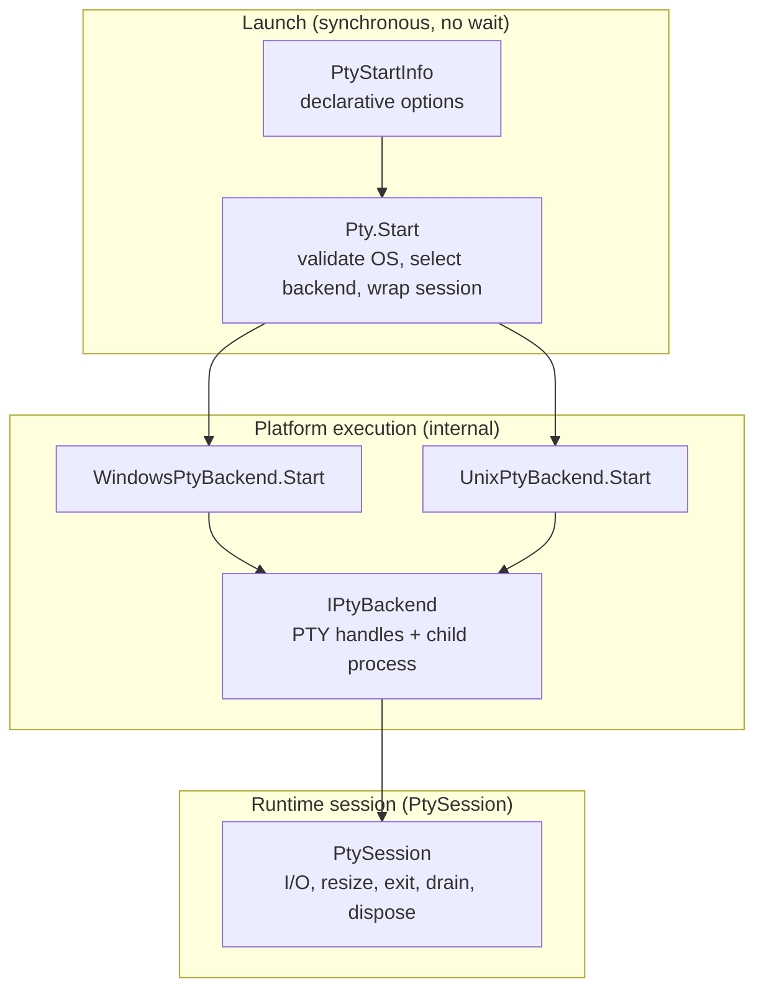
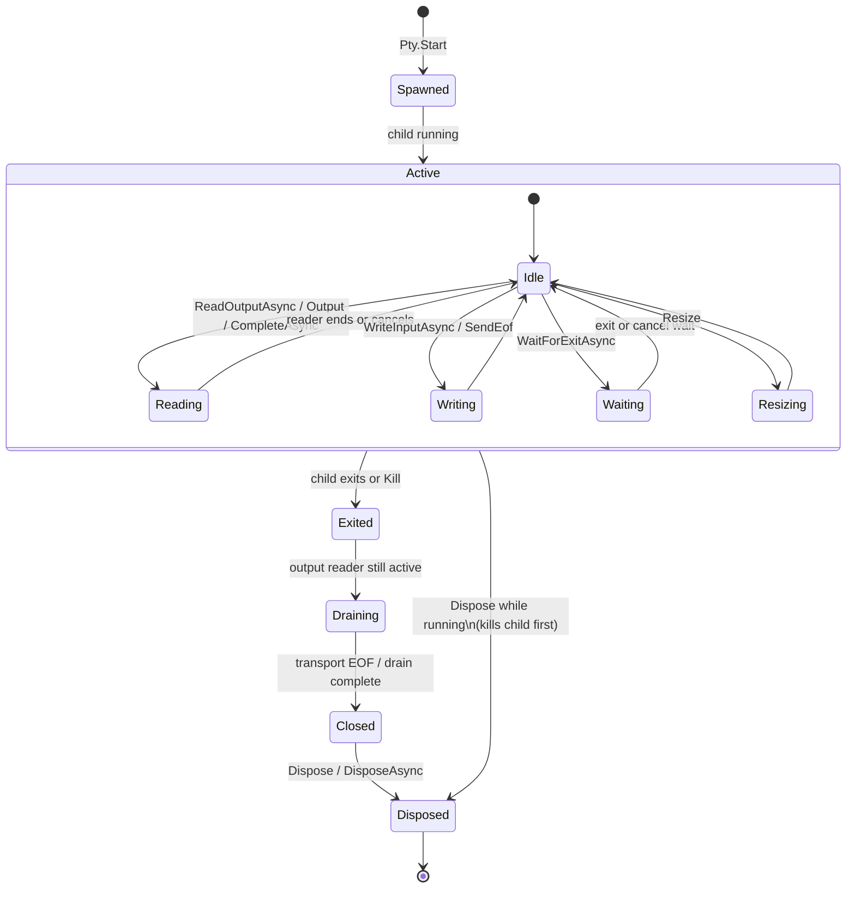

# Lifecycle Specification

Implemented lifecycle, cancellation, EOF, drain, and failure behavior for MiniPty.

## Mental Model

MiniPty splits **what to start**, **how to start it on this OS**, and **how to manage the live session**. Public callers interact with the first and third layers only.

| Layer | Type | Responsibility |
|---|---|---|
| `PtyStartInfo` | Public data | Executable, arguments, cwd, size, environment overlay, Unix `TERM` name. No orchestration logic. |
| `Pty.Start` | Public entry | Null and OS support checks; Windows vs Unix backend selection; returns `PtySession`. Does not wait for exit. |
| `WindowsPtyBackend` / `UnixPtyBackend` | Internal | ConPTY or Unix PTY spawn, handle ownership, platform EOF and resize. |
| `IPtyBackend` | Internal contract | Thin runtime boundary: input stream, output read primitives for the session's output pump, process id, exit notification (task, internal waiter, listener), kill, transport close. Not a launch or plugin abstraction. |
| `PtySession` | Public session | Live PTY lifecycle only: output consumers, stdin writes, `SendEof`, resize, `WaitForExitAsync`, `CompleteAsync`, kill, dispose. Does not decide how the child was spawned. |

Normalization stays localized: `PtyStartInfo.ClampedSize` for dimensions, `PtyEnvironment` for child environment materialization, backends for platform launch preparation.

## Session Flow

A typical session moves from spawn through active I/O to teardown. Exact EOF, drain, and cancellation details are platform- and API-specific (tables below).

Persistent embedders usually keep **one** output consumer active for the whole `Active` phase (`ReadOutputAsync` or raw `Output`). One-shot callers use `CompleteAsync` or `PtyCapture.RunAsync` instead. See [Output consumer exclusivity](#output-consumer-exclusivity).

`Dispose` / `DisposeAsync` may run from any state. If the child is still running, disposal kills it before releasing handles.

## Cancellation

| API | On cancellation |
|---|---|
| `WaitForExitAsync` | Waiting stops with `OperationCanceledException`; the child continues running. |
| `WaitForExitStatusAsync` | Same as `WaitForExitAsync`; the child continues running. |
| `ReadOutputAsync` | Output enumeration stops with `OperationCanceledException`; the child continues running. |
| `WriteInputAsync` | A write still waiting for the terminal to take it stops with `OperationCanceledException`. Bytes already written stay written; the rest is discarded. The child continues running. |
| `CompleteAsync` | When `KillOnCancellation` is true, the child is killed and `OperationCanceledException` is thrown. |
| `PtyCapture.RunAsync` | Same as `CompleteAsync`; it uses completion options. |

This split lets embedders observe cancellation without tearing down long-running children, while one-shot capture runs default to killing on cancellation so hung children do not leak.

### Concurrent cancellation

When `ReadOutputAsync` and `WaitForExitAsync` run concurrently, cancellation is **scoped to the operation whose token was canceled**. Canceling one does not cancel the other and does not kill the child.

After `ReadOutputAsync` is canceled, the same session may start a new `ReadOutputAsync` enumeration. After `WaitForExitAsync` is canceled, the same session may call `WaitForExitAsync` again.

## Timeouts

| API / option | Timeout behavior |
|---|---|
| `CompleteAsync` / `PtyCapture.RunAsync` | `ExitTimeout`, `OutputDrainGrace`, and `OutputReaderCloseTimeout` from `PtyCompleteOptions` apply. |
| `ReadOutputAsync` | No implicit drain or read timeout. Use `CancellationToken` only. |
| `PtySession.WaitForExitAsync` | No implicit exit timeout. Use `CancellationToken` only. |

One-shot completion may bound waits to avoid hung children in fire-and-forget scenarios. Persistent streaming expects the embedder to supply cancellation.

## Output consumer exclusivity

Exactly **one** active output consumer is allowed per session. The first started consumer holds exclusivity until that read path ends (enumeration completed, canceled, or faulted).

| Active consumer | Forbidden (throws `InvalidOperationException`) | Allowed concurrently |
|---|---|---|
| `ReadOutputAsync` | Second `ReadOutputAsync`; raw `Output` read; `CompleteAsync` | `WriteInputAsync`, `SendEof`, `WaitForExitAsync`, `Resize`, `Kill`, `Dispose` |
| Raw `Output` read | `ReadOutputAsync`; `CompleteAsync` | `WriteInputAsync`, `SendEof`, `WaitForExitAsync`, `Resize`, `Kill`, `Dispose` |

`CompleteAsync` is not queued or blocked behind an active output consumer. Callers must finish or cancel the active read before starting one-shot completion.

`ReadOutputAsync` and `WaitForExitAsync` **may run concurrently** without deadlock, data loss, or premature transport close. Duplicate `WaitForExitAsync` calls are allowed.

### Host input adapters

Packages such as **MiniPty.Console** ([Console](console.md)) forward host keyboard bytes to `WriteInputAsync`. They **must not** start a second PTY output consumer.

Interactive hosts (use case 3) keep a single embedder-owned `ReadOutputAsync` reader for recording and host display while Console handles host terminal modes and stdin forwarding.

## EOF

`SendEof()` is platform-specific:

| Platform | Behavior |
|---|---|
| Windows (bytes written) | Writes Ctrl+Z + CR (`0x1A`, `0x0D`) to the ConPTY input stream after every input byte written before it: while earlier input is still queued because ConPTY stopped reading input, the chord waits for later staging ticks. Keeps the input pipe open until the child exits. Pipe close is not used for this case — it is observed as `STATUS_CONTROL_C_EXIT`, not EOF. |
| Windows (no bytes) | Closes the ConPTY input pipe after staging (attach deferral). |
| Unix | Writes EOT (`0x04`, Ctrl-D) to the PTY master after every input byte written before it: while earlier input is still queued for a child that is not reading, EOT waits for later staging ticks. It does not close the master fd. |

Unix EOT is a terminal convention, not kernel EOF. It is reliable for canonical-mode shell-wrapped one-shot commands, but not for raw-mode TUI programs. Windows stream EOF uses the legacy console Ctrl+Z + CR convention; when input lacks a trailing line terminator, an extra CR is written first to submit the pending line. Raw/TUI programs are not guaranteed.

If the slave side is already closed when staged EOT runs, the master write may fail with `EIO` or `EPIPE`; MiniPty treats that as harmless and does not throw.

### ConPTY spawn readiness

EOF staging advances on a per-session 100 ms timer, so it gives the child time to attach and progresses whether or not anyone awaits exit. Milestone 3 validates that immediate post-`Pty.Start` `WriteInputAsync`, `Resize`, and empty-stdin `SendEof` do not cause spurious child failure (for example `STATUS_CONTROL_C_EXIT`). This remains an internal transport concern; there is no public ready-state API.

## Drain, kill, and disposal

| Behavior | Contract |
|---|---|
| `ReadOutputAsync` / `Output` after child exit | Drains remaining output and then completes normally. Where the transport stays open after exit (ConPTY always, Linux when a grandchild holds the slave; macOS revokes the tty when the child exits, so output a grandchild writes afterwards is lost), the post-exit drain closes it once output has been quiet for 100 ms. |
| `WaitForExitAsync` | Observes exit only. It does not close the transport, so a concurrent reader keeps receiving output until end of output. |
| `ReadOutputAsync` after `Kill()` | Same as exit: drain remaining output, then complete normally (EOF). |
| `CompleteAsync` after child exit | Drains output; the transport closes once output has been quiet, and at `OutputDrainGrace` after exit at the latest. |
| Output reader close (one-shot) | Waits up to `OutputReaderCloseTimeout`. |
| `Dispose` / `DisposeAsync` while child running | Kills the child and releases handles without blocking. The background output reader discards remaining output and stops on its own; `DisposeAsync` completes once it has stopped. |
| `Dispose` while operations are in flight | All in-flight `ReadOutputAsync`, `WaitForExitAsync`, and `WriteInputAsync` operations fail immediately with `ObjectDisposedException`. |
| `Kill()` | Terminates the child but does not release handles. Call `Dispose` afterward. |
| `Kill(PtySignal)` | Unix: delivers the mapped native signal via `kill(2)`; catchable signals may be handled or ignored, so exit is not guaranteed. Windows: validates the enum, then terminates unconditionally (node-pty parity). Drain-after-kill behavior is unchanged. |

## Failure Behavior

| Condition | Behavior |
|---|---|
| Unsupported OS | `PlatformNotSupportedException` from `Pty.Start`. |
| Spawn, ConPTY, `openpty`, or `forkpty` failure | OS exception with error code; run aborts. |
| Child non-zero exit | Returned as `ExitCode`; MiniPty does not throw for non-zero child exits. |
| Second output consumer | `InvalidOperationException`. |
| Session disposed while output streaming | `ObjectDisposedException`. |
| `ExitTimeout` exceeded (`CompleteAsync` / capture) | `TimeoutException`. |
| Output drain or reader close timeout (one-shot) | `TimeoutException`. |

MiniPty does not fall back to pipe redirect when PTY creation fails.

## Lessons Learned

- **ConPTY pipes are transport, not the terminal.** `HPCON` is the pseudo-console; mishandling pipe ends after `CreatePseudoConsole` causes missing output, hangs, or leaks to the parent console.
- **Child stdin must not be closed before launch completes on Windows.** Early ConPTY input pipe close yields `STATUS_CONTROL_C_EXIT` (0xC000013A). Empty-stdin EOF is staged to the staging timer or transport close.
- **ConPTY input pipe close after a write is not clean EOF.** For one-shot stdin with bytes, MiniPty writes Ctrl+Z + CR and waits for natural exit; pipe close is deferred to transport cleanup after exit.
- **Unix PTY master fds cannot be half-closed.** Closing the master ends both read and write, so `SendEof()` writes EOT instead.
- **Canonical EOT is not kernel EOF on Unix.** One EOT on a non-empty line buffer delivers buffered bytes but does not end input; a submitted line or a second EOT may be needed.
- **Output drain after child exit needs bounded waits on one-shot paths.** `OutputDrainGrace` and `OutputReaderCloseTimeout` prevent hung readers without dropping ordinary slow flushes. Persistent `ReadOutputAsync` and `Output` do not use those timeouts.
- **Kill/drain tests need an observed-output synchronization point and a child that cannot time out naturally.** Fixed delays can expire before a loaded CI worker schedules the reader or completes `fork`/`exec`; conversely, a time-limited child can exit before a starved reader resumes, so the test never reaches `Kill()`. Have the child emit readiness and then block on stdin, observe readiness from the active output enumeration, then kill and continue that same enumeration to EOF.
- **Cancel semantics differ by use case.** Waiting cancellation does not kill; one-shot completion defaults to killing when canceled.
- **Do not queue `CompleteAsync` behind active output reads.** Fail fast with `InvalidOperationException` so read, wait, and completion cannot deadlock inside hidden session queues.
- **Never close ConPTY at exit; close it after output has gone quiet.** Closing on exit truncated bulk stdout, so one-shot paths already deferred it, but the public exit wait still closed the transport and could cut a concurrent reader short. Exit waits now never close it: one post-exit drain, shared by every consumer, closes the transport once the reader has seen 100 ms of silence while not parked on a full buffer. A reader therefore sees end of output about 100 ms after the last output rather than at exit.
- **Post-exit drain uses quiet heuristics, not completion truth.** Closing the ConPTY or Unix PTY master after quiet unblocks end of output when nothing else would end it; it does not detect shell command completion. One-shot completion bounds it by `OutputDrainGrace` and never quiet-closes before the first read, because ConPTY can emit its first frame after a fast child has already exited.
- **Read output on a thread the library owns, from spawn.** A caller-side wait for a pump to start starved the thread pool under parallel CI and could throw cancellation before `KillOnCancellation` ran, and a pump queued to the thread pool could start too late for fast children (the macOS-only scheduling workaround). The output reader now starts at spawn on a dedicated thread on every platform; see [pty_crossplatform.md](../references/pty_crossplatform.md) → Output pump.
- **A non-blocking `Dispose` still lets ConPTY finish closing.** Closing a pseudo-console can wait until its final frame fits in the output pipe, so disposal switches the reader to discarding output before it closes the transport, and the reader keeps draining until the pipe ends.
- **Linux `forkpty` exec payloads must outlive the pre-exec child.** The parent must keep `file`, `argv`, `envp`, and `cwd` pointers valid until the child has `chdir`/`execve` or exited. Freeing managed UTF-8 allocations immediately after `forkpty` returns races the child and flakes as exit **127** or wrong working-directory lookup under parallel CI load. Hold the payload until session/backend disposal; the fork child uses its copy-on-write mapping for `chdir` (no child-side copy when the parent holds — see [pty_crossplatform.md](../references/pty_crossplatform.md) → `forkpty()` safety). `posix_spawn` paths copy env/cwd in the kernel before returning.
